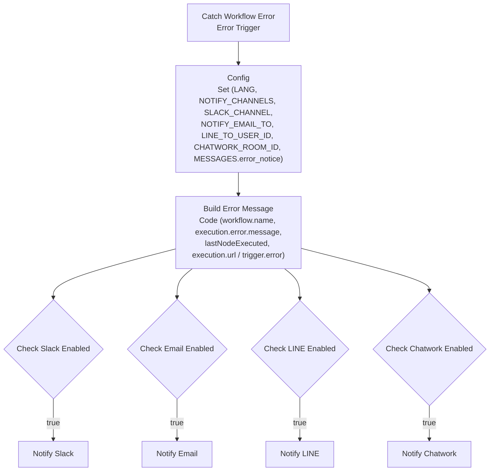

# テンプレ01 入金消込 — DESIGN.md

| 項目 | 値 |
|---|---|
| ワークフロー名 | `[Odaji] 01 Bank Deposit Reconciliation v1.0.0` |
| 同梱 | `workflow.json`（本体）、`error-handler.json`（Error Workflow） |
| 文書の版 | P1 設計版（2026-09-23、P1 レビュー反映済み）。P2 の実装・P3 のテストで実測値を追記する |
| 仕様の出典 | `CLAUDE.md` §1（絶対ルール）、§4（共通設計規約）、§5（共有 Google Sheets スキーマ）、「テンプレ01：入金消込」 |
| ノード資料 | n8n 公式ドキュメント（2026-09-23 取得、`ASSUMPTIONS.md` の一覧）。**ノードのパラメータ名・`typeVersion` は P2 で n8n-mcp の `get_node` で確認してから書く** |

この文書は「何を・なぜ・どう作るか」を固定するためのもの。ここに無い判断は末尾の「仕様判断 / Decisions」に追記し、`ASSUMPTIONS.md` へ転記する。英語の要約は末尾「EN summary」。

---

## 1. 目的・スコープ

**目的**：銀行 CSV・入金通知メールに含まれる入金を、Google Sheets の `invoices` と自動で突き合わせ、「誰から・どの請求の入金か」を判定する。確認が必要な分だけを通知で人に渡す。

**買い手**：請求書払い（銀行振込）のフリーランス・小規模 EC・BtoB 小規模事業者。月に数十〜数百件の入金を通帳と請求一覧で目視突合している人。

**スコープに含む**
- 入力：監視フォルダに置かれた銀行 CSV（Shift_JIS 既定、UTF-8 BOM 可。復号は Code ノード、§3.8）、Gmail の入金通知メール（正規表現設定式）、毎日の再突合。3 系統は Config `TRIGGERS_ENABLED` で ON／OFF
- 突合：完全一致／金額のみ／手数料差引／合算（2〜3件）／一部入金／曖昧／未消込の判定（仕様の規則 1〜5）
- 出力：`invoices` の更新、`transactions` への追記、Slack／Email／LINE／Chatwork への通知（設定分のみ）
- 冪等：`txn_id` を台帳で先に照合し、既存なら skip。同一 CSV を2回投入してもシートに差分を作らない
- Error Workflow の同梱

**スコープに含まない**
- 特定銀行との互換の保証（fixture は架空の2形式。自行に合わせて `CSV_MAPPING`・`MAIL_PARSERS` を調整する前提）
- 元画像・PDF 通帳の OCR、外貨、消費税判定、会計ソフト連携（02）、督促（03）
- 「曖昧」「未消込」の自動確定。人が候補から選ぶ（シートを直接編集）
- コミュニティノード、`Read/Write Files from Disk`（n8n Cloud 非対応のため使わない）、`Extract From File`（Shift_JIS を選べないため使わない。`ASSUMPTIONS.md` A6）

---

## 2. ノード構成図

### 2.1 本体ワークフロー（Mermaid）

```mermaid
flowchart TD
  subgraph IN["入力 / Input  —  Sticky: 青 blue"]
    T1["Watch Drive Folder<br/>Google Drive Trigger<br/>(fileCreated in DRIVE_FOLDER_ID, polling)"]
    T2["Watch Gmail Inbox<br/>Gmail Trigger<br/>(polling, Search = GMAIL_QUERY, Simplify OFF)"]
    T3["Run Daily Rematch<br/>Schedule Trigger<br/>(daily, RUN_AT)"]
  end

  CFG["Config<br/>Set (JSON output, include all input fields)<br/>+ SOURCE = $prevNode.name"]
  T1 --> CFG
  T2 --> CFG
  T3 --> CFG

  subgraph DEC1["振り分け / Routing  —  黄 yellow"]
    SW1{"Route by Source<br/>Switch: SOURCE = トリガー名 AND TRIGGERS_ENABLED.&lt;key&gt; = true"}
    SKIP0["Skip Disabled Trigger<br/>NoOp（Fallback Output: Extra Output）"]
  end
  CFG --> SW1
  SW1 -- "fallback: OFF のトリガー / 未知の SOURCE" --> SKIP0

  subgraph DRV["CSV 取込 / CSV intake  —  青 blue"]
    CHK{"Check File Is CSV<br/>IF (name ends with .csv OR mimeType text/csv)"}
    SKIP1["Skip Non-CSV File<br/>NoOp"]
    DL["Download File<br/>Google Drive: file download<br/>(binary 'data', Sheets→CSV conversion)"]
    P1["Parse Bank CSV<br/>Code (run once for all items)<br/>binary → TextDecoder('shift_jis') → 行 → pre-txn"]
  end
  SW1 -- "drive" --> CHK
  CHK -- "false" --> SKIP1
  CHK -- "true" --> DL
  DL --> P1

  subgraph GM["メール取込 / Mail intake  —  青 blue"]
    P2["Parse Mail<br/>Code (run once for all items, MAIL_PARSERS)"]
  end
  SW1 -- "gmail" --> P2

  COL["Collect Transactions<br/>Code → 1 item { txns[], warnings[], source }"]
  P1 --> COL
  P2 --> COL
  SW1 -- "schedule (no new txns)" --> COL

  subgraph RD["台帳読込 / Ledger read  —  青 blue"]
    RI["Read Invoices<br/>Google Sheets: Get Row(s)<br/>Execute Once + Always Output Data"]
    RT["Read Transactions<br/>Google Sheets: Get Row(s)<br/>Execute Once + Always Output Data"]
  end
  COL --> RI --> RT

  subgraph MT["突合 / Matching  —  黄 yellow"]
    NP["Normalize Payer<br/>Code (run once for all items)<br/>payer_name_norm / memo_norm / txn_id を付与<br/>→ 1 item { txns, invoices(_names 付き), existing }"]
    MI["Match Invoices<br/>Code (run once for all items)<br/>$input.first().json = Normalize Payer の出力, $('Config').first()"]
    SW2{"Route Match Results<br/>Switch on _kind"}
  end
  RT --> NP --> MI --> SW2

  subgraph OUT["出力 / Output  —  緑 green"]
    UI["Update Invoices<br/>Google Sheets: Append or Update<br/>match on invoice_id, Cell Format: Let n8n format"]
    UT["Upsert Transactions<br/>Google Sheets: Append or Update<br/>match on txn_id, Cell Format: Let n8n format"]
    BN["Build Notification<br/>Code (MESSAGES[LANG].recon_summary)"]
    IF1{"Check Slack Enabled<br/>IF NOTIFY_CHANNELS contains 'slack'"}
    IF2{"Check Email Enabled<br/>IF … contains 'email'"}
    IF3{"Check LINE Enabled<br/>IF … contains 'line'"}
    IF4{"Check Chatwork Enabled<br/>IF … contains 'chatwork'"}
    NS["Notify Slack<br/>Slack: message send (Block Kit)<br/>On Error: Continue (using error output)"]
    NE["Notify Email<br/>Gmail: message send<br/>On Error: Continue (using error output)"]
    NL["Notify LINE<br/>HTTP Request POST push<br/>Header Auth credential<br/>On Error: Continue (using error output)"]
    NC["Notify Chatwork<br/>HTTP Request POST rooms/{id}/messages<br/>Header Auth credential<br/>On Error: Continue (using error output)"]
    MRG["Merge Notification Results<br/>Merge: Append, Number of Inputs = 8"]
    CHKN["Check Notification Results<br/>Code: 全チャネル失敗のときだけ throw → Error Workflow"]
  end
  SW2 -- "0: invoice_update" --> UI
  SW2 -- "1: txn_row" --> UT
  SW2 -- "2: summary" --> BN
  BN --> IF1 -- "true" --> NS
  BN --> IF2 -- "true" --> NE
  BN --> IF3 -- "true" --> NL
  BN --> IF4 -- "true" --> NC
  NS -- "success / error" --> MRG
  NE -- "success / error" --> MRG
  NL -- "success / error" --> MRG
  NC -- "success / error" --> MRG
  MRG --> CHKN

  subgraph WARN["注意 / Caution  —  赤 red（Sticky のみ）"]
    N1["Sticky: payer_name_alias を埋めないと自動消込率が落ちる<br/>Sticky: Config 以外にトリガー3ノードにも設定値がある<br/>Sticky: TRIGGERS_ENABLED=false でもトリガーのポーリングは続く<br/>Sticky: 曖昧・未消込は自動確定しない"]
  end
```



実行順の前提：ワークフロー Settings は `executionOrder = v1`（分岐を順番に実行）。`Route Match Results` の出力は 0→1→2 の順に配線し、**シート書込み（0, 1）が通知（2）より先に実行される**ことを P3 の実行ログで確認する。`Merge Notification Results` は各 Notify ノードの成功出力（main[0]）と error 出力（main[1]）の計 8 本を受ける。IF で止まったチャネルの入力にはデータが来ないが、`executionOrder = v1` では他に実行するノードが無くなった時点で届いている入力だけで Merge が実行される（**P2 で実測**、§8.3）。

### 2.2 Error Workflow（`error-handler.json`）



- 本体ワークフローの Settings → **Error workflow** にこのワークフローを指定する（SETUP に手順）。
- Error Workflow は本体の `Config` を参照できないため、通知に必要なキーだけを持つ自前の `Config` を置く（同じ値を2か所に書く。SETUP で明記）。
- Error Workflow 自身の Error workflow 設定は空にする（無限ループ防止）。Error Workflow 内の Notify ノードは On Error = Stop のまま（ここで失敗しても次の受け皿は無い）。
- Error Trigger は手動実行では発火しない（公式ドキュメント）。P3 では本体を「有効化して自動実行」させ、`Read Invoices` の Sheet ID を壊す等で意図的に失敗させて確認する。
- **Error Workflow 自身も有効化（Publish）されていなければ呼び出されない**（n8n 2.40.5 実測、P3 g3 所見 1、`ASSUMPTIONS.md` A35）。`workflow-execution.service.js` の `loadErrorWorkflowData` は published data が無いと `Calling Error Workflow for "…". Workflow "…" is not active and cannot be executed` をログに出して `null` を返す。公式ドキュメント（Error Trigger）は「公開不要」と読めるが、実測では必要。SETUP §4 に「Credential を選んでから Error Handler を Publish」を書く。
- **有効化（Publish）時に n8n は接続済みの有効ノード全部の Credential を検証する**（`Cannot publish workflow: … Missing required credential: slackApi / gmailOAuth2`。無効化（disabled）したノードだけが検証対象外。A36）。買い手が使わないチャネルの `Notify …` ノードは、本体・Error Workflow の両方で無効化（右クリック → Deactivate）するか Credential を割り当てる。出荷時は 4 ノードとも有効のまま（D34：有効化時に大声で失敗させる）。

### 2.3 ノード一覧（型 ID・役割・主要設定）

`typeVersion` は **P2 で n8n-mcp（`get_node`）により確認**してから `workflow.json` に書く。パラメータ名（`operation` 等の内部名）も同様。下表の「主要設定」は公式ドキュメントの UI 名で書いている。

| # | ノード名 | type | 役割 | 主要設定（UI 名） | Sticky |
|---|---|---|---|---|---|
| 1 | Watch Drive Folder | `n8n-nodes-base.googleDriveTrigger` | 監視フォルダに CSV が置かれたら起動 | Trigger on: changes involving a specific folder（`DRIVE_FOLDER_ID` の実値を**このノードに**入れる）、Watch for: file created、Poll Times: every minute（既定でよい） | 青 |
| 2 | Watch Gmail Inbox | `n8n-nodes-base.gmailTrigger` | 入金通知メールで起動 | Poll: every X minutes（5）、Simplify: OFF（本文 `text`/`html` が必要）、Filters → Search: `GMAIL_QUERY` の実値（既定 `subject:(入金 OR Deposit) newer_than:1d`）、Read Status: unread and read、Max Emails per Poll: 10 | 青 |
| 3 | Run Daily Rematch | `n8n-nodes-base.scheduleTrigger` | 毎日 `RUN_AT` に未消込を再突合 | Trigger Interval: Days、Days Between: 1、Trigger at Hour/Minute: 09:00（Config `RUN_AT` と一致させる） | 青 |
| 4 | Config | `n8n-nodes-base.set` | 全調整値。§4 の表 | Mode: JSON Output、Include in Output: All Input Fields（トリガーの `id` 等を後段へ通す）、JSON に `"SOURCE": "{{ $prevNode.name }}"` | 黄 |
| 5 | Route by Source | `n8n-nodes-base.switch` | トリガー別に分岐。`TRIGGERS_ENABLED` が false の系統は落とす | Mode: Rules。各ルールは 2 条件の AND：`{{ $json.SOURCE }}` string equals `Watch Drive Folder` **AND** `{{ $json.TRIGGERS_ENABLED.drive }}` boolean is true → output `drive`；同様に `Watch Gmail Inbox` + `TRIGGERS_ENABLED.gmail` → `gmail`、`Run Daily Rematch` + `TRIGGERS_ENABLED.schedule` → `schedule`。Options → Fallback Output: **Extra Output**（→ 6） | 黄 |
| 6 | Skip Disabled Trigger | `n8n-nodes-base.noOp` | OFF のトリガー・未知の `SOURCE` を正常終了させる（実行ログに残す） | — | 黄 |
| 7 | Check File Is CSV | `n8n-nodes-base.if` | CSV 以外のファイルを弾く | `{{ $json.name }}` ends with `.csv`（Ignore Case）OR `{{ $json.mimeType }}` equals `text/csv` OR equals `application/vnd.google-apps.spreadsheet`（Drive が変換した場合） | 黄 |
| 8 | Skip Non-CSV File | `n8n-nodes-base.noOp` | 何もしない（実行ログに残すため） | — | 青 |
| 9 | Download File | `n8n-nodes-base.googleDrive` | CSV をバイナリで取得 | Resource: File、Operation: Download、File ID: `{{ $json.id }}`、Options → Google File Conversion: Google Sheets → CSV、Binary property: `data` | 青 |
| 10 | Parse Bank CSV | `n8n-nodes-base.code` | 復号（`TextDecoder`）・BOM 除去・`skip_rows`・列対応・出金除外・pre-txn 生成 | Mode: Run Once for All Items、JavaScript（§6.2） | 青 |
| 11 | Parse Mail | `n8n-nodes-base.code` | `MAIL_PARSERS` で本文から金額・名義・日付を抽出 | Run Once for All Items（§6.3） | 青 |
| 12 | Collect Transactions | `n8n-nodes-base.code` | 3経路の合流点。常に1アイテム `{ txns, warnings, source }` を返す | Run Once for All Items（§6.4） | 青 |
| 13 | Read Invoices | `n8n-nodes-base.googleSheets` | `invoices` 全行 | Resource: Sheet Within Document、Operation: Get Row(s)、Document: By ID `{{ $('Config').first().json.SHEET_ID }}`、Sheet: By Name `{{ …SHEET_INVOICES }}`、Options → Output Formatting: Values (unformatted)、Settings: **Execute Once ON、Always Output Data ON** | 青 |
| 14 | Read Transactions | `n8n-nodes-base.googleSheets` | `transactions` 全行（冪等キーと再突合対象） | 同上、Sheet: `SHEET_TRANSACTIONS` | 青 |
| 15 | Normalize Payer | `n8n-nodes-base.code` | 名義正規化の唯一の置き場所（仕様「名義正規化」）。新規 txn に `payer_name_norm` / `txn_id` を付与し、請求に `_names`、既存行に `payer_name_norm` の補完を付けて 1 アイテム `{ txns, invoices, existing, … }` にまとめる | Run Once for All Items（§6.6）。`$input.all()` = Read Transactions、`$('Read Invoices').all()`、`$('Collect Transactions').first()` | 黄 |
| 16 | Match Invoices | `n8n-nodes-base.code` | 突合の本体（§6.7） | Run Once for All Items。`$input.first().json` = Normalize Payer の出力 | 黄 |
| 17 | Route Match Results | `n8n-nodes-base.switch` | `_kind` で3出力 | Rules: `{{ $json._kind }}` equals `invoice_update` / `txn_row` / `summary`（この順で出力 0/1/2）、Fallback: none | 黄 |
| 18 | Update Invoices | `n8n-nodes-base.googleSheets` | 請求の状態更新 | Operation: Append or Update Row、Column to Match On: `invoice_id`、Mapping: Map Automatically、Options → Cell Format: **Let n8n format**（`shared/sheets-schema.md` の規定。既定の Let Google Sheets format では `2026-09-01` 等が日付型に変換される）、Handling extra fields: Ignore Them（`_kind` を落とす） | 緑 |
| 19 | Upsert Transactions | `n8n-nodes-base.googleSheets` | 取引の追記・更新 | 同上、Column to Match On: `txn_id`、Cell Format: Let n8n format | 緑 |
| 20 | Build Notification | `n8n-nodes-base.code` | 通知文面（§6.8）。通知不要なら `[]` を返して後段を止める | Run Once for All Items | 緑 |
| 21 | Check Slack Enabled | `n8n-nodes-base.if` | チャネル判定 | Array → contains：`{{ $('Config').first().json.NOTIFY_CHANNELS }}` contains `slack` | 黄 |
| 22 | Check Email Enabled | `n8n-nodes-base.if` | 同上 `email` | | 黄 |
| 23 | Check LINE Enabled | `n8n-nodes-base.if` | 同上 `line` | | 黄 |
| 24 | Check Chatwork Enabled | `n8n-nodes-base.if` | 同上 `chatwork` | | 黄 |
| 25 | Notify Slack | `n8n-nodes-base.slack` | Block Kit で投稿 | Resource: Message、Operation: Send、Send Message To: Channel、Channel: `{{ …SLACK_CHANNEL }}`、Message Type: Blocks、Blocks: `{{ JSON.stringify($json.slack_blocks) }}`、Notification text: `{{ $json.title }}`、Options → Include Link to Workflow: **OFF**（既定 ON では買い手の n8n URL とワークフロー ID を含む section が末尾に付く。`Notify Email` の attribution OFF と揃える）、Settings: Retry On Fail 3回・待機 2000ms、On Error: Continue (using error output) | 緑 |
| 26 | Notify Email | `n8n-nodes-base.gmail` | メール通知 | Resource: Message、Operation: Send、To: `{{ …NOTIFY_EMAIL_TO }}`、Subject: `{{ $json.title }}`、Email Type: Text、Message: `{{ $json.body_text }}`、Options → Append n8n attribution: OFF、Retry 3回、On Error: Continue (using error output) | 緑 |
| 27 | Notify LINE | `n8n-nodes-base.httpRequest` | LINE Messaging API push | POST `https://api.line.me/v2/bot/message/push`、Authentication: Generic → Header Auth（Credential 名 `LINE Messaging API`）、Body: JSON `{ "to": LINE_TO_USER_ID, "messages": [{ "type": "text", "text": {{ $json.line_text }} }] }`（`line_text` は §6.8 で 4,900 文字に切った本文。`body_text` は使わない）、Retry 3回・2000ms、Timeout 10000ms、On Error: Continue (using error output) | 緑 |
| 28 | Notify Chatwork | `n8n-nodes-base.httpRequest` | Chatwork API | POST `https://api.chatwork.com/v2/rooms/{{ …CHATWORK_ROOM_ID }}/messages`、Header Auth（Credential 名 `Chatwork API`、ヘッダ名 `X-ChatWorkToken`）、Body: Form URL-encoded `body={{ $json.chatwork_text }}`、Retry 3回、On Error: Continue (using error output) | 緑 |
| 29 | Merge Notification Results | `n8n-nodes-base.merge` | 4 つの Notify の成功出力と error 出力（計 8 本）を 1 つにまとめる | Mode: Append、Number of Inputs: 8（入力 1〜4 = 25〜28 の main[0]、入力 5〜8 = 25〜28 の main[1]） | 緑 |
| 30 | Check Notification Results | `n8n-nodes-base.code` | 試行したチャネルが**全て**失敗したときだけ `throw` → Error Workflow。一部失敗は出力に残して実行は成功。**無効化された Notify ノードを素通りしたペイロード**（`json.error` 無し・チャネル応答マーカー無しで `title`/`body_text` 等を持つアイテム）も失敗チャネルに数える（D34） | Run Once for All Items（§6.10） | 緑 |
| 31〜 | Sticky Note ×8 | `n8n-nodes-base.stickyNote` | 日英併記の説明 | §2.4 | — |
| E1 | Catch Workflow Error | `n8n-nodes-base.errorTrigger` | Error Workflow の起点 | — | 青 |
| E2 | Config | `n8n-nodes-base.set` | 通知用の最小 Config | JSON Output | 黄 |
| E3 | Build Error Message | `n8n-nodes-base.code` | §6.9 | Run Once for All Items | 緑 |
| E4〜 | Check … Enabled ×4、Notify … ×4 | 上と同じ | 本体と同一設定。ただし On Error は Stop（Merge／Check は置かない）。LINE は `{{ $json.line_text }}`、Chatwork は `body={{ $json.chatwork_text }}` | | |

LINE／Chatwork のエンドポイントは仕様 §4.3 の記載。**§1-4 により P2 で公式ドキュメントを WebFetch して URL・フィールド名・文字数上限を確認し、`ASSUMPTIONS.md` に URL と確認日を記録してから実装する。**

#25〜30 の補足（P3 g3 所見 2、D34、A36）：4 つの `Notify …` ノードは Credential ブロック無しで出荷し、**4 ノードとも有効（enabled）のまま**にする。n8n 2.40.5 は Publish 時に有効な全ノードの Credential を検証するため、使わないチャネルのノードは買い手が無効化（右クリック → Deactivate）するか Credential を選ぶ必要がある（本体・Error Workflow とも）。無効化したノードは入力アイテムをそのまま main 出力に通すので、そのチャネルを `NOTIFY_CHANNELS` に残すと Build Notification のペイロードが #29 Merge に届く。#30 はこれを「送信済み」と誤認せず、`notify node disabled or not executed (payload passed through)` として失敗チャネルに数える（そのチャネルしか無ければ `throw` → Error Workflow）。

### 2.4 Sticky Note グループと色

| Sticky | 色 | 覆うノード | 内容（## JA → ## EN の順） |
|---|---|---|---|
| S1 入力 | 青 | 1〜3 | 3系統のトリガー。**トリガーの中に設定する値（フォルダ・検索式・時刻）**は Config の `DRIVE_FOLDER_ID` / `GMAIL_QUERY` / `RUN_AT` と同じ値にする理由。`TRIGGERS_ENABLED` で OFF にした系統は `Route by Source` で落ちるだけで**トリガーノード自体のポーリング（API 呼出し）は続く**。呼出しも止めたいときはそのトリガーノードを無効化（Deactivate）する。トリガー名を変えたら `Route by Source` も直す |
| S2 Config | 黄 | 4〜6 | 概要と `TRIGGERS_ENABLED` の 3 キーの説明。「買い手が触るのはここと S1 の3ノードだけ」。§4 の表は下段の黄色い付箋 2 枚「Config キー一覧（1/2）（2/2）」に分けて載せる（ノードは覆わない） |
| S3 取込 | 青 | 7〜12 | Shift_JIS の扱い（Code ノードで復号）、`CSV_MAPPING`、`MAIL_PARSERS` の調整方法（正本は `fixtures/mail_parsers.example.json`）、非 CSV は skip |
| S4 突合 | 黄 | 13〜17 | 名義正規化は `Normalize Payer` だけで行う（`txn_id` の定義箇所）。規則 1〜5 の要約と「自動確定は 1・2・3a・3b・3c のみ」。`currency` が JPY でない請求は対象外にして警告 |
| S5 出力 | 緑 | 18〜30 | シート更新の列（Cell Format: Let n8n format）、通知チャネルの ON/OFF、Credential 名、「通知は設定した全チャネルを試し、全滅したときだけ Error Workflow」 |
| S6 注意 | 赤 | （下段、ノードは覆わない） | `payer_name_alias` 必須級、同姓同名、CSV 形式の月次変化と `skip_rows`、Error Workflow の設定手順 |

n8n の Sticky Note `color` は 1〜7 の番号。**番号と色の対応（黄・青・緑・赤）は P2 で実機で確認**して `workflow.json` に反映する。

### 2.5 ノード Settings の要点

| ノード | Execute Once | Always Output Data | Retry On Fail | On Error |
|---|---|---|---|---|
| Read Invoices / Read Transactions | ON | ON（空シートでも後段を止めない） | 3回・2000ms | Stop |
| Update Invoices / Upsert Transactions | OFF（全アイテム処理） | OFF | 3回・2000ms | Stop（副作用があるので Continue にしない）。Options → **Cell Format: Let n8n format** |
| Notify Slack / Email / LINE / Chatwork | OFF | OFF | 3回・2000ms | **Continue (using error output)**。成功・失敗とも 29 Merge へ。出荷時は 4 ノードとも有効。買い手が使わないチャネルは**ノードを無効化**（disabled）して `NOTIFY_CHANNELS` からも外す（無効化ノードは入力をそのまま通す。D34） |
| Merge Notification Results | — | OFF | なし | Stop |
| Check Notification Results | — | OFF | なし | Stop（全チャネル失敗のときだけ自ら throw → Error Workflow） |
| Code ノード（上記以外） | — | OFF | なし | Stop（バグは大声で失敗させる） |
| Check File Is CSV → false | — | — | — | NoOp で正常終了 |
| Route by Source → fallback | — | — | — | NoOp（Skip Disabled Trigger）で正常終了 |

---

## 3. データフロー（ノード間のアイテム形状）

以下の JSON は設計時点の想定。**トリガーと Google ノードの実出力は P2 で1回実行して確認し、差分があればこの節を更新する。**

### 3.1 トリガー出力 → Config

Google Drive Trigger（fileCreated）の1アイテム（想定）：
```json
{ "kind": "drive#file", "id": "1AbC…", "name": "bank_A_2026-09.csv", "mimeType": "text/csv", "parents": ["<folder id>"], "createdTime": "2026-09-23T00:05:00.000Z" }
```
Gmail Trigger（Simplify OFF）の1アイテム（想定。`text`/`html` が本文）：
```json
{ "id": "18f3…", "threadId": "18f3…", "labelIds": ["INBOX"], "date": "2026-09-23T09:12:00+09:00",
  "from": { "value": [{ "address": "notice@example.jp", "name": "サンプル銀行" }], "text": "サンプル銀行 <notice@example.jp>" },
  "subject": "【入金のお知らせ】", "text": "…お振込人：ｶ)ｻﾝﾌﾟﾙｼﾖｳｼﾞ\n入金額：33,000円\n…", "html": "<p>…</p>" }
```
Schedule Trigger の1アイテム：
```json
{ "timestamp": "2026-09-24T09:00:00.000+09:00", "Readable date": "…", "Day of week": "Wednesday", … }
```
Config 通過後（トリガーの全フィールド + Config キー + `SOURCE`）：
```json
{ "id": "1AbC…", "name": "bank_A_2026-09.csv", "mimeType": "text/csv", …,
  "SOURCE": "Watch Drive Folder", "TZ": "Asia/Tokyo", "LANG": "ja", "SHEET_ID": "REPLACE_ME_SHEET_ID", … }
```

### 3.2 Drive 経路：Download File → binary → 行 → txn

Download File 出力（`json` はトリガーのファイル情報がそのまま通る（`download.operation.js` の `json: item.json`）、`binary.data` に本体）。**同じポーリングで複数ファイルが作られた場合はファイルごとに 1 アイテム**（Drive Trigger は前回ポーリング以降の全ファイルを 1 実行にまとめて出す。D31）：
```json
{ "json": { "id": "1AbC…", "name": "bank_A_2026-09.csv", "mimeType": "text/csv" },
  "binary": { "data": { "mimeType": "text/csv", "fileName": "bank_A_2026-09.csv", "fileSize": "1.2 kB", "data": "<base64 or file reference>" } } }
```
Parse Bank CSV（Code）は**入力アイテムごとに** `await this.helpers.getBinaryDataBuffer(i, 'data')` → `TextDecoder('shift_jis' | 'utf-8')`（BOM があれば UTF-8。`json.mimeType` が `application/vnd.google-apps.spreadsheet` なら Drive のエクスポートは常に UTF-8（BOM 無し）なので `CSV_MAPPING.encoding` に関わらず UTF-8、D22）→ 自前 CSV パース → 見出しキーの行オブジェクト（fixture A の例）：
```json
{ "日付": "2026/09/01", "摘要": "振込 ｶ)ｻﾝﾌﾟﾙｼﾖｳｼﾞ", "入金額": "33,000", "出金額": "", "残高": "1,233,000" }
```

Parse Bank CSV 出力（1取引1アイテムの **pre-txn**。出金行・空行は出さない。`payer_name_norm` / `txn_id` はまだ無く、`Normalize Payer` が付ける）：
```json
{ "_kind": "txn", "source": "bank_csv", "txn_date": "2026-09-01",
  "payer_name_raw": "振込 ｶ)ｻﾝﾌﾟﾙｼﾖｳｼﾞ", "amount": 33000, "memo": "",
  "_file": "bank_A_2026-09.csv", "_row": 3 }
```
`_file` / `_row` は通知・デバッグ用で、シートには書かない（`Upsert Transactions` の「extra fields: Ignore」で落ちる）。各出力アイテムの `pairedItem.item` は元ファイルのアイテム番号。`file_stats` はファイルごとに 1 件出る。

### 3.3 Gmail 経路：message → txn

Parse Mail は1メール → 0 or 1 取引。パーサに一致しない・抽出できないメールは **warning アイテム**として残す：
```json
{ "_kind": "warning", "type": "no_parser_matched", "message_id": "18f3…", "from": "notice@example.jp", "subject": "…" }
```
取引アイテムは 3.2 と同じ pre-txn の形で `_kind: "txn"`, `source: "gmail"`、`memo: "【入金のお知らせ】 (gmail:18f3…)"`、`_message_id`, `_parser` 付き。

### 3.4 Collect Transactions（合流点）

3経路のどれから来ても**必ず1アイテム**を返す：
```json
{ "source": "drive", "txns": [ { "_kind": "txn", "source": "bank_csv", "txn_date": "…", "payer_name_raw": "…", "amount": 33000, "memo": "", … } ],
  "warnings": [ { "type": "no_parser_matched", … } ], "ignored_withdraw": 4, "file_name": "bank_A_2026-09.csv" }
```
Schedule 経路では `{ "source": "schedule", "txns": [], "warnings": [] }`。Drive 経路で複数ファイルが届いたときは `file_stats` を集約し、`ignored_withdraw` は合計、`file_name` は `", "` 区切りの連結（D31）。

### 3.5 Read Invoices / Read Transactions

Google Sheets Get Row(s) は1行1アイテム（見出し行は返らない）。数値は number、空セルは `""`、日付は表示文字列（ロケール依存）で返る：
```json
{ "invoice_id": "INV-2026-001", "customer_id": "C001", "customer_name": "株式会社サンプル商事", "payer_name_alias": "カ)サンプルシヨウジ,サンプルシヨウジ",
  "customer_email": "ap@example.jp", "amount": 33000, "currency": "JPY", "issue_date": "2026-08-31", "due_date": "2026-09-30",
  "status": "unpaid", "paid_amount": "", "paid_date": "", "matched_txn_ids": "", "match_confidence": "", "fee_deducted": "",
  "remind_stage": 0, "last_reminded_at": "", "promised_date": "", "do_not_remind": "", "notes": "" }
```
`Always Output Data` が ON のため、**空シートのときは `{}` 1件**が来る。Normalize Payer は `invoice_id` / `txn_id` が空の行を読み飛ばす。

Normalize Payer 出力（常に 1 アイテム。ここで初めて `payer_name_norm` と `txn_id` が決まる）：
```json
{ "source": "drive", "file_name": "bank_A_2026-09.csv", "ignored_withdraw": 4, "warnings": [],
  "txns": [ { "txn_id": "2026-09-01|33000|サンプルシヨウジ|", "source": "bank_csv", "txn_date": "2026-09-01",
              "payer_name_raw": "振込 ｶ)ｻﾝﾌﾟﾙｼﾖｳｼﾞ", "payer_name_norm": "サンプルシヨウジ", "amount": 33000, "memo": "", "_file": "…", "_row": 3 } ],
  "invoices": [ { "invoice_id": "INV-2026-001", "customer_name": "株式会社サンプル商事", "payer_name_alias": "カ)サンプルシヨウジ,サンプルシヨウジ", "amount": 33000, "status": "unpaid", "currency": "JPY", "…": "…",
                  "_names": ["サンプル商事", "サンプルシヨウジ"] } ],
  "existing": [ { "txn_id": "2026-08-28|66000|ミホンシヨウカイ|", "payer_name_norm": "ミホンシヨウカイ", "status": "matched", "…": "…" } ] }
```

### 3.6 Match Invoices 出力（3種、`_kind` で識別）

```json
{ "_kind": "invoice_update", "invoice_id": "INV-2026-001", "status": "paid", "paid_amount": 33000, "paid_date": "2026-09-01",
  "matched_txn_ids": "2026-09-01|33000|サンプルシヨウジ|", "match_confidence": "auto", "fee_deducted": 0 }
```
```json
{ "_kind": "txn_row", "txn_id": "2026-09-01|33000|サンプルシヨウジ|", "source": "bank_csv", "txn_date": "2026-09-01",
  "payer_name_raw": "振込 ｶ)ｻﾝﾌﾟﾙｼﾖｳｼﾞ", "payer_name_norm": "サンプルシヨウジ", "amount": 33000, "memo": "",
  "matched_invoice_ids": "INV-2026-001", "status": "matched", "suggested_invoice_ids": "", "imported_at": "2026-09-23T09:05:12+09:00" }
```
```json
{ "_kind": "summary", "date": "2026-09-23", "source": "drive", "n": 11, "a": 7, "b": 2, "c": 2, "rematched": 0,
  "skipped_existing": 0, "skipped_duplicate_in_batch": 0, "ignored_withdraw": 4,
  "auto": [ { "txn_date": "2026-09-01", "payer_raw": "…", "amount": 33000, "invoice_ids": ["INV-2026-001"], "reason": "auto" } ],
  "needs_review": [ { "…": "…", "invoice_ids": ["INV-2026-004"], "reason": "fee_deducted", "fee": 220 } ],
  "ambiguous": [ { "…": "…", "reason": "same_amount_multiple", "candidates": [ { "invoice_id": "INV-2026-010", "remaining": 50000 }, { "invoice_id": "INV-2026-011", "remaining": 50000 } ] } ],
  "unmatched": [ { "…": "…", "candidates": [] } ],
  "warnings": [ { "type": "non_jpy_invoice", "invoice_id": "INV-2026-022", "currency": "USD" } ] }
```
`warnings` には Collect Transactions からの取込警告（`no_parser_matched` / `parser_no_capture` / `bad_date`）に加え、Match Invoices が対象外にした非 JPY 請求（`non_jpy_invoice`）が入る。
`invoice_update` は請求1件につき1アイテムに**集約**（同一実行で同じ請求に2回書かない）。

### 3.7 Build Notification 出力

```json
{ "title": "【入金消込 2026-09-23】処理 11件｜自動消込 7｜要確認 2｜未消込 2",
  "body_text": "【入金消込 2026-09-23】処理 11件｜…\n\n■ 要確認（…）\n・2026-09-02 ｶ)ｻﾝﾌﾟﾙ ¥32,780 → INV-2026-004（手数料 220 差引）\n…",
  "slack_blocks": [ { "type": "header", "text": { "type": "plain_text", "text": "【入金消込 2026-09-23】…" } },
                    { "type": "section", "text": { "type": "mrkdwn", "text": "■ 要確認…\n・…" } } ] }
```
通知不要（§5 D12）のときは `[]` を返し、Check … Enabled 以降は実行されない。

### 3.8 Shift_JIS の復号は Code ノード（決定済み：`ASSUMPTIONS.md` A6）

仕様（テンプレ01「入力パース」）は「`Extract from File` → 不可なら Code ノード」。n8n 2.40.5 の Extract From File（CSV）の Options → Encoding は ascii / latin1 / ucs-2 / ucs2 / utf-8 / utf16le / utf8 のみで **`shift_jis` が無い**（n8n-mcp `get_node` と `n8n-nodes-base` の実装で確認、A6）ため、Code ノード（Path B）を採用し、**`Extract From File` ノードは `workflow.json` に含めない**。比較は記録として残す：

| | Path A：組み込みノード（不採用） | Path B：Code ノード（採用） |
|---|---|---|
| 復号 | Extract From File（CSV）の Options → Encoding に `shift_jis` が無い | `new TextDecoder('shift_jis').decode(buffer)`（Code ノードで動作することは A12 で実測済み） |
| BOM | ノード任せ | 先頭 `EF BB BF` を自前で除去 |
| `skip_rows` | 該当オプションが無い（見出しが2行目以降にある CSV は Header Row ON では読めない） | Code で行を捨ててから見出しを取る |
| 引用符付き金額 `"33,000"` | ノードの CSV パーサ | 自前パーサ（§6.2） |

**P2 で再確認するのは 2 点だけ**：(1) タスクランナー上の Code ノードで `TextDecoder('shift_jis')` と `this.helpers.getBinaryDataBuffer` が使えること（A12 の再現）。(2) `bank_A_sjis.csv` の名義が文字化けせず、`bank_B_utf8bom.csv` の 1 列目見出しに BOM が残らないこと（R08）。結果は `tests/RESULTS.md` に記録する。

---

## 4. Config キー一覧

Set ノード `Config` の JSON。**買い手は `REPLACE_ME_` を置き換える。** 型は JSON の型。「意味」は Sticky S2 にも要約して載せる。

| キー | 型 | 既定値 | 意味（JA） | Meaning (EN) |
|---|---|---|---|---|
| `TZ` | string | `"Asia/Tokyo"` | 日付判定と `imported_at` のタイムゾーン。ワークフロー Settings の Timezone とも一致させる | Time zone for date handling; keep equal to the workflow's Timezone setting |
| `LANG` | string | `"ja"` | 通知文面の言語 `ja` / `en` | Notification language |
| `SHEET_ID` | string | `"REPLACE_ME_SHEET_ID"` | スプレッドシートの ID（URL の `/d/<ID>/`） | Spreadsheet ID from the URL |
| `SHEET_INVOICES` | string | `"invoices"` | 請求一覧のシート名 | Sheet name for invoices |
| `SHEET_TRANSACTIONS` | string | `"transactions"` | 取引台帳のシート名 | Sheet name for transactions |
| `DRIVE_FOLDER_ID` | string | `"REPLACE_ME_DRIVE_FOLDER_ID"` | 監視フォルダ ID。**参照用。実値は `Watch Drive Folder` ノードにも入れる**（トリガーは Config を参照できない） | Watched folder ID; documented here, the trigger node holds the live value |
| `GMAIL_QUERY` | string | `"subject:(入金 OR Deposit) newer_than:1d"` | Gmail 検索式。**参照用。実値は `Watch Gmail Inbox` ノードの Search に入れる**。既定は同梱 fixture 2 通（件名「ご入金のお知らせ」「Deposit Notification」）の両方に一致する。Gmail の `subject:` は本文を見ない | Gmail search; the trigger node holds the live value. The default matches both bundled fixture subjects (`subject:` does not search the body) |
| `RUN_AT` | string | `"09:00"` | 再突合の時刻（JST）。**参照用。実値は `Run Daily Rematch` ノードに入れる** | Daily re-match time; the Schedule node holds the live value |
| `TRIGGERS_ENABLED` | object | `{ "drive": true, "gmail": true, "schedule": true }` | 3 系統のトリガーの ON／OFF（仕様「トリガー（3系統、Config で ON／OFF）」）。`Route by Source` が false の系統を `Skip Disabled Trigger` に落とす | Per-trigger on/off; `Route by Source` drops disabled sources into `Skip Disabled Trigger` |
| `TRIGGERS_ENABLED.drive` | bool | `true` | 監視フォルダの CSV 取込を使う | Enable the Drive CSV path |
| `TRIGGERS_ENABLED.gmail` | bool | `true` | 入金通知メールの取込を使う | Enable the Gmail path |
| `TRIGGERS_ENABLED.schedule` | bool | `true` | 毎日の再突合を使う | Enable the daily re-match |
| `CSV_MAPPING` | object | 下記 | 銀行 CSV の列対応 | Bank CSV column mapping |
| `CSV_MAPPING.date_col` | string | `"日付"` | 取引日の列見出し | Date column header |
| `CSV_MAPPING.payer_col` | string | `"摘要"` | 振込名義（摘要）の列見出し | Remitter / description column header |
| `CSV_MAPPING.deposit_col` | string | `"入金額"` | 入金額の列見出し。空または 0 の行は無視 | Deposit column; rows with empty/0 are ignored |
| `CSV_MAPPING.withdraw_col` | string | `"出金額"` | 出金額の列見出し（無ければ `""`）。判定には使わず、説明のために保持 | Withdrawal column (informational; `""` if none) |
| `CSV_MAPPING.memo_col` | string | `""` | 摘要とは別にメモ列があるとき。無ければ `""` | Optional memo column |
| `CSV_MAPPING.skip_rows` | int | `0` | 見出し行より前に捨てる行数 | Rows to discard before the header row |
| `CSV_MAPPING.date_format` | string | `"auto"` | `auto` / `yyyy/MM/dd` / `yyyyMMdd` / `yyyy-MM-dd` | Date format (`auto` accepts all three) |
| `CSV_MAPPING.encoding` | string | `"shift_jis"` | `shift_jis` / `utf-8` / `auto`。UTF-8 BOM があれば設定に関わらず UTF-8 として読む | File encoding; a UTF-8 BOM always wins |
| `MAIL_PARSERS` | array | 下記（2件） | 入金通知メールの解析ルール。先頭から順に試し、最初に一致したものを使う | Mail parser rules, first match wins |
| `MAIL_PARSERS[].name` | string | `"bankX"` | 通知に出す識別名 | Parser label |
| `MAIL_PARSERS[].from_match` | string | `"@example.jp"` | 差出人に含まれる文字列（大文字小文字無視の部分一致） | Substring of From (case-insensitive) |
| `MAIL_PARSERS[].subject_match` | string | `"入金"` | 件名に含まれる文字列 | Substring of Subject |
| `MAIL_PARSERS[].amount_regex` | string | `"入金額[：:]\\s*([0-9,]+)"` | 本文（NFKC 正規化後）に対する正規表現。**第1グループ**が金額 | Regex on NFKC-normalized body, group 1 = amount |
| `MAIL_PARSERS[].payer_regex` | string | `"振込人[：:]\\s*(.+)"` | 第1グループが名義 | Group 1 = remitter |
| `MAIL_PARSERS[].date_regex` | string | `"(?:日付|お取引日|取引日)[：:]\\s*(\\d{4}[/\\-年]\\d{1,2}[/\\-月]\\d{1,2})"` | 第1グループが日付。ラベルを要求して口座番号等の誤キャプチャを防ぐ。無ければメールの受信日 | Group 1 = date (label required so account numbers are not captured); falls back to the email date |
| `LEGAL_ENTITY_TOKENS` | array | 下記 | 名義から除去する法人格等。`X)` は先頭のみ、`(X` は末尾のみ、それ以外はどこでも除去 | Tokens stripped from remitter names |
| `STRIP_LEADING_DIGITS` | bool | `true` | 名義先頭の数字列（振込人番号・支店コード）を除去 | Strip leading digit run |
| `FEE_SET` | array\<int\> | `[110,165,220,275,330,440,550,660,770,880]` | 先方負担の振込手数料として許容する差額 | Accepted fee differences |
| `NAME_MIN_CONTAINS` | int | `3` | 包含一致に必要な最小文字数（短い方に適用） | Min chars for containment match |
| `NOTIFY_CHANNELS` | array\<string\> | `["slack"]` | `slack` / `email` / `line` / `chatwork` の組合せ | Enabled channels |
| `SLACK_CHANNEL` | string | `"REPLACE_ME_SLACK_CHANNEL_ID"` | 投稿先チャンネル ID（`C0…`）または `#name` | Slack channel |
| `NOTIFY_EMAIL_TO` | string | `"replace-me@example.com"` | 通知メールの宛先 | Notification email recipient |
| `LINE_TO_USER_ID` | string | `"REPLACE_ME_LINE_USER_ID"` | LINE push の宛先 userId | LINE recipient userId |
| `CHATWORK_ROOM_ID` | string | `"REPLACE_ME_CHATWORK_ROOM_ID"` | Chatwork のルーム ID | Chatwork room ID |
| `NOTIFY_MAX_LINES` | int | `40` | 通知の各セクションに載せる明細の上限行数。超過分は「…他 N 件」 | Max detail lines per section |
| `MESSAGES` | object | `shared/messages.*.json` から `recon_summary`（`auto_heading` / `more_items` / `skipped_note` / `warnings_heading` / `reasons.*` を含む）と `error_notice` を `{ "ja": {...}, "en": {...} }` で埋め込み | 通知文面。`LANG` で選ぶ | Notification copy, selected by `LANG` |

**Config に入れないもの**：LINE の channel access token、Chatwork API トークン、Slack トークン、Google の OAuth。これらは n8n の **Credential** に置き、ノードからは名前で参照する（§1-2）。LINE は Header Auth Credential（名前 `LINE Messaging API`、ヘッダ名 `Authorization`、値は `Bearer ` + トークン）、Chatwork は Header Auth Credential（名前 `Chatwork API`、ヘッダ名 `X-ChatWorkToken`、値はトークン）。

`TRIGGERS_ENABLED` を false にしても、そのトリガーノードは n8n の仕様どおりポーリングを続ける（Drive／Gmail API の呼出しは発生する）。呼出しごと止めたいときは、そのトリガーノードを Deactivate する（Sticky S1 と SETUP に明記）。

`LEGAL_ENTITY_TOKENS` の既定値：
```json
["カ)", "(カ", "ユ)", "(ユ", "ド)", "(ド", "シヤ)", "(シヤ", "ザイ)", "(ザイ", "ガク)", "(ガク", "イ)", "(イ", "ホ)", "(ホ",
 "株式会社", "有限会社", "合同会社", "合名会社", "合資会社", "一般社団法人", "一般財団法人", "医療法人", "学校法人", "社会福祉法人",
 "カブシキガイシヤ", "カブシキカイシヤ", "ユウゲンガイシヤ", "ゴウドウガイシヤ", "イツパンシヤダンホウジン", "イリヨウホウジン",
 "振込", "フリコミ", "ゴフリコミ"]
```
仕様に列挙されている `ｶ) (ｶ カ） （カ …` は NFKC 正規化後に上記の半角括弧形に収束するため、Config には正規化後の形で持つ（Code 側でもトークンを NFKC してから比較するので、買い手が全角で追加しても動く）。

`MAIL_PARSERS` の既定値。**正本は `fixtures/mail_parsers.example.json`**（fixture `mail_bankX.eml` / `mail_bankY.eml` に対して Node で検証済み、2026-09-23）。P2 は Config の既定値をこの JSON から埋め込み、下記と乖離させない：
```json
[
  { "name": "bankX", "from_match": "@example.jp", "subject_match": "入金",
    "amount_regex": "(?:入金額|お振込金額|金額)[：:]\\s*([0-9,]+)",
    "payer_regex": "(?:お振込人|振込人|振込名義|ご依頼人)[：:]\\s*([^\\n]+)",
    "date_regex": "(?:日付|お取引日|取引日)[：:]\\s*(\\d{4}[/\\-年]\\d{1,2}[/\\-月]\\d{1,2})" },
  { "name": "bankY", "from_match": "@example.com", "subject_match": "Deposit",
    "amount_regex": "Amount\\s+(?:JPY|¥)?\\s*([0-9,]+)",
    "payer_regex": "Remitter\\s+([^\\n]+)",
    "date_regex": "Transaction Date\\s+(\\d{4}-\\d{2}-\\d{2})" }
]
```
bankX はラベル行形式（`金額：１０４，５００円`）、bankY はコロン無しの表形式（`Amount             JPY 19,800`）。買い手は自行の通知に合わせて `\\s+` / `[：:]\\s*` の部分を書き換える。

---

## 5. 判断理由

1. **金額一致を必須にする**：振込名義はカナで届き、個人名は同姓同名が普通に起きる。名義だけで確定すると別人の入金を消し込む。逆に金額だけの一致（規則2）は「自動確定するが要確認として通知に列挙」に留め、名義と金額の両方が揃ったときだけ黙って確定する。
2. **FEE_SET（手数料差引）**：先方が振込手数料を差し引いて振り込むのは実務で最も多い「金額不一致」。差額が手数料の典型値（110〜880 円）に一致し、かつ名義が1件に一致するときだけ `fee_deducted` として確定する。任意の差額を許すと一部入金と区別できないため、集合で縛る。
3. **合算は 2〜3 件に限定**：同じ顧客がまとめて振り込むのは通常 2〜3 通分。件数を増やすと部分和が偶然一致する確率が急上昇し（候補 8 件で 3 件組は 56 通り、4 件組は 70 通り）、誤消込の温床になる。**部分和が一意に決まるときだけ**確定し、複数解は曖昧扱いにする。
4. **曖昧は自動確定しない**：同額の請求が 2 件あって名義で絞れない（R06）等は、どちらを消し込んでも 50% で間違う。間違った消込は「未消込」より発見が遅れ、督促（03）の誤送信につながる。候補上位 3 件を `suggested_invoice_ids` と通知に出し、人がシートで確定する。
5. **冪等性 = `txn_id` + 台帳の先読み**：`txn_id` を `日付|金額|正規化名義|正規化メモ` で決定的に作り、毎回 `transactions` を読んでから処理する。同じ CSV を 2 回置いても 2 回目は全件 skip で、シートに差分が出ない（R09）。同一実行内の重複 `txn_id` も skip し、件数を通知に出す（D13）。
6. **Execute Once**：Read Invoices / Read Transactions は入力アイテム数（取引数）に関わらず 1 回だけ API を呼ぶ。取引 200 件で 200 回シートを読むのを防ぎ、Google Sheets API の割当（読み取りはプロジェクトあたり毎分 300 リクエスト前後、**正確な値は P2 で公式ドキュメントを確認**）に収める。
7. **Config を 1 つにする**：買い手が触る場所を 1 か所にする（§1-3）。3 トリガーを同じ Config に接続し、後段は常に `$('Config').first().json` を参照する。例外はトリガー 3 ノード自身の設定値（トリガーは Config より前に動くため参照できない）。
8. **`$prevNode.name` でルーティング**：Config の直前ノード名をそのまま `SOURCE` に入れれば、トリガーごとに Set ノードを 3 つ置かずに済み、追加のトリガーも Switch のルール 1 行で増やせる。ノード名を変えると壊れるため、Sticky S1 に「トリガー名を変えたら Route by Source も直す」と書く。
9. **Collect Transactions を合流点にする**：Match Invoices が `$('Parse Bank CSV')` を直接参照すると、Gmail 経路では「そのノードは実行されていない」でエラーになる。3 経路のどれでも必ず実行される Code ノードを 1 つ置き、`{ txns, warnings, source }` の 1 アイテムに正規化してから台帳を読む。
10. **LINE／Chatwork は HTTP Request**：n8n に組み込みノードが無い（LINE Notify は 2025 年 3 月終了）。トークンは Header Auth Credential に置き、JSON に残さない。Retry On Fail 3 回・2 秒（§4.4）。
11. **通知の前にシートへ書く**：通知が失敗しても台帳は正しい状態になり、再実行は全件 skip で安全。通知だけ失敗したときは実行ログの Build Notification 出力で内容を確認できる（§8）。
12. **量・サイズ**：Slack の Block Kit は section の text が 3,000 文字まで、LINE のテキストは 5,000 文字まで（**上限値は P2 で公式ドキュメントを確認**）。明細を `NOTIFY_MAX_LINES` 行で切り、section も 2,900 文字ごとに分割する。`transactions` は毎回全件読むため、1 万行を超えたら年次でアーカイブする案内を SETUP に書く。
13. **Always Output Data**：初回導入時は `transactions` が空。Google Sheets が 0 件を返すと後段が動かず、初回だけ何も起きない事故になる。空でも `{}` を 1 件流し、Code 側で読み飛ばす。
14. **`TRIGGERS_ENABLED` は Switch の条件に入れる**：トリガーは Config より前に動くので Config で「発火しない」ようにはできない。代わりに `Route by Source` の各ルールに `TRIGGERS_ENABLED.<key> is true` を AND し、OFF の系統は Fallback（Extra Output）→ NoOp で正常終了させる。買い手は CSV だけ・メールだけの運用を Config の 3 つの bool で切り替えられる。API 呼出しまで止めたい場合はノードの無効化が必要で、その旨を Sticky に書く。
15. **`Normalize Payer` を独立ノードにする**：`txn_id` を決める関数が 3 ノード（Parse Bank CSV / Parse Mail / Match Invoices）に複製されていると、買い手が 1 か所だけ直したときに CSV 経路と Gmail 経路と再突合で `txn_id` が食い違い、冪等性が黙って壊れる。仕様も `Normalize Payer` Code ノードを名指ししている。Read Transactions の直後に置き、新規 txn・請求（`_names`）・既存行の 3 つをここで一度に正規化して Match Invoices に 1 アイテムで渡す。
16. **通知は全チャネルを試し、全滅したときだけ失敗**：仕様 §4.3「未設定チャネルはスキップ。全チャネル失敗時は Error Workflow へ」。Notify ノードを On Error = Stop にすると、`executionOrder v1` では最初に失敗したチャネルで実行が止まり、残りの設定済みチャネルが試されない（Slack 障害でメール／LINE も届かない）。各 Notify を Continue (using error output) にし、成功・失敗の両出力を Merge に集めて `Check Notification Results` で数え、成功 0 のときだけ `throw` して Error Workflow に回す。error 出力が配線されている限り単独の失敗は「処理済み」扱いで Error Workflow は起動しない（n8n の挙動）ため、全滅判定を Code の `throw` で明示する。
17. **非 JPY の請求は突合の対象外にして警告**：`shared/sheets-schema.md` の約束（01 は JPY のみ）。`currency` を見ずに `amount` だけで突合すると、USD 100 の請求が ¥100 の入金に規則 2 で自動確定しうる。`Match Invoices` で `open` を作る前に除外し、`non_jpy_invoice` を warning として通知に出す。ただし Schedule 実行の「変化なしなら通知しない」判定ではこの warning を数えない（USD 請求が 1 件あるだけで毎朝通知が来るのを防ぐ）。

---

## 6. 疑似コード

JavaScript に近い形で書く。Code ノードは JavaScript・`require` なし（§4.6）。`DateTime`（Luxon）は Code ノードのグローバル。Node.js の `TextDecoder` / `Buffer` は利用可。各関数は P2 で該当ノードにそのまま移植し、差分はこの節に反映する。**関数の置き場所は §6.1 の表のとおり。`normalizePayer` / `normalizeMemo` / `buildTxnId` / `buildTxn` / `invoiceNames` は `Normalize Payer` にだけ置き、他のノードに複製しない**（1 Code ノード＝1責務、§4.6。`txn_id` の定義が 1 か所になり、CSV 経路・Gmail 経路・再突合で食い違わない）。

### 6.1 共通ユーティリティと置き場所

| 関数 | 置くノード |
|---|---|
| `toInt` / `num` / `str` | すべての Code ノード（先頭に同じものを置く） |
| `esc` / `hiraToKata` / `splitCsvList` / `uniq` / `normalizePayer` / `normalizeMemo` / `buildTxnId` / `buildTxn` / `invoiceNames` | `Normalize Payer` のみ |
| `lcsLength` / `nameRank` / `nameMatch` / `subsetsSummingTo` / `rankCandidates` / `uniq` / `splitCsvList` | `Match Invoices` のみ |
| `normalizeDate` | `Parse Bank CSV` と `Parse Mail`（同一文字列） |
| `fill` / `fmtYen` | `Build Notification` と `Build Error Message` |

```js
// 数値化：全角→半角、カンマ・¥・円・空白を除去して整数（円）。失敗は 0 / toInt() は null
const toInt = (v) => {
  if (v === null || v === undefined) return null;
  if (typeof v === 'number') return Number.isFinite(v) ? Math.trunc(v) : null;
  const s = String(v).normalize('NFKC').replace(/[,\s¥￥円]/g, '');
  if (!/^-?\d+(\.\d+)?$/.test(s)) return null;
  return parseInt(s, 10);
};
const num = (v) => toInt(v) ?? 0;
const str = (v) => (v === null || v === undefined) ? '' : String(v).trim();
const esc = (s) => s.replace(/[.*+?^${}()|[\]\\]/g, '\\$&');            // 正規表現エスケープ
const hiraToKata = (s) => s.replace(/[ぁ-ゖ]/g, (ch) => String.fromCharCode(ch.charCodeAt(0) + 0x60));
const fill = (tpl, vars) => String(tpl).replace(/\{(\w+)\}/g, (m, k) => (k in vars ? String(vars[k]) : m));
const fmtYen = (n, lang) => Number(n).toLocaleString(lang === 'en' ? 'en-US' : 'ja-JP');
const splitCsvList = (s) => str(s).split(/[,、，]/).map((x) => x.trim()).filter(Boolean);
const uniq = (arr) => [...new Set(arr)];

// 最長共通部分文字列の長さ（候補スコア用。名義は 10〜20 文字なので O(n*m) で十分）
function lcsLength(a, b) {
  let best = 0;
  const prev = new Array(b.length + 1).fill(0);
  for (let i = 1; i <= a.length; i++) {
    let diagonal = 0;
    for (let j = 1; j <= b.length; j++) {
      const tmp = prev[j];
      prev[j] = a[i - 1] === b[j - 1] ? diagonal + 1 : 0;
      if (prev[j] > best) best = prev[j];
      diagonal = tmp;
    }
  }
  return best;
}
```

### 6.2 `Parse Bank CSV`：`decodeCsvBuffer` / `parseCsvText` / `parseBankCsv`

```js
// ---- バイナリ → 文字列（A6：Extract From File は使わない）----
function decodeCsvBuffer(buf, encoding) {
  // UTF-8 BOM は設定に関わらず UTF-8（fixture B）
  if (buf.length >= 3 && buf[0] === 0xef && buf[1] === 0xbb && buf[2] === 0xbf) {
    return new TextDecoder('utf-8').decode(buf.subarray(3));
  }
  const enc = str(encoding || 'shift_jis').toLowerCase();
  if (enc === 'auto') {
    try { return new TextDecoder('utf-8', { fatal: true }).decode(buf); }   // 不正な UTF-8 なら例外
    catch (e) { return new TextDecoder('shift_jis').decode(buf); }
  }
  return new TextDecoder(enc).decode(buf);   // 'shift_jis' / 'utf-8' / 'euc-jp'。未対応名は RangeError → 実行失敗（意図的）
}

// ---- RFC 4180 風の CSV パース（引用符内のカンマ・改行・"" に対応）----
function parseCsvText(text) {
  const rows = []; let row = []; let field = ''; let inQuotes = false;
  for (let i = 0; i < text.length; i++) {
    const c = text[i];
    if (inQuotes) {
      if (c === '"') { if (text[i + 1] === '"') { field += '"'; i++; } else { inQuotes = false; } }
      else { field += c; }
    } else if (c === '"') { inQuotes = true; }
    else if (c === ',') { row.push(field); field = ''; }
    else if (c === '\r') { /* CRLF の \r は捨てる */ }
    else if (c === '\n') { row.push(field); rows.push(row); row = []; field = ''; }
    else { field += c; }
  }
  if (field !== '' || row.length) { row.push(field); rows.push(row); }
  return rows.filter((r) => r.some((f) => f.trim() !== ''));   // 空行除去
}

// ---- 列対応・出金除外・pre-txn 生成 ----
// rows: string[][]（parseCsvText の出力）。payer_name_norm / txn_id は付けない（Normalize Payer の責務）
function parseBankCsv(rows, m, ctx) {
  const skip = num(m.skip_rows);
  const nk = (s) => str(s).normalize('NFKC');
  const body = rows.slice(skip);
  if (!body.length) throw new Error(`CSV has no header row after skip_rows=${skip}`);
  const header = body[0].map(nk);
  const dataRows = body.slice(1).map((r) => Object.fromEntries(header.map((h, i) => [h, r[i] ?? ''])));
  const col = (name, required) => {
    const key = header.find((h) => h === nk(name));
    if (!key && required) throw new Error(`CSV column not found: "${name}". header = ${header.join(' | ')}`);
    return key || null;
  };
  const dateKey = col(m.date_col, true), payerKey = col(m.payer_col, true), depKey = col(m.deposit_col, true);
  const memoKey = m.memo_col ? col(m.memo_col, false) : null;   // withdraw_col は判定に使わない（deposit が空/0 なら無視）

  const txns = []; const warnings = []; let ignored = 0;
  dataRows.forEach((r, idx) => {
    const rowNo = skip + 2 + idx;                        // 1 始まりの物理行番号（見出し = skip+1）
    const deposit = toInt(r[depKey]);
    if (!(deposit > 0)) { ignored++; return; }           // R07：出金行・空行・小計行を無視
    const txn_date = normalizeDate(r[dateKey], m.date_format, ctx.tz);
    if (!txn_date) { warnings.push({ type: 'bad_date', row: rowNo, value: str(r[dateKey]) }); return; }
    txns.push({ _kind: 'txn', source: 'bank_csv', txn_date, payer_name_raw: str(r[payerKey]), amount: deposit,
                memo: memoKey ? str(r[memoKey]) : '', _file: ctx.fileName, _row: rowNo });
  });
  return { txns, warnings, ignored_withdraw: ignored };
}

// ---- ノード本体（D31：全入力アイテムを処理。D22：スプレッドシート由来は UTF-8）----
const cfg = $('Config').first().json;
const inputs = $input.all();
const out = [];
for (let i = 0; i < inputs.length; i++) {
  const it = inputs[i];
  const ctx = { tz: cfg.TZ, fileName: it.json.name || it.binary?.data?.fileName || '' };
  const isSheetExport = str(it.json.mimeType) === 'application/vnd.google-apps.spreadsheet';   // Drive の export は常に UTF-8（BOM 無し）
  const buf = await this.helpers.getBinaryDataBuffer(i, 'data');        // itemIndex, binary property（A12 で動作確認済み）
  const text = decodeCsvBuffer(buf, isSheetExport ? 'utf-8' : cfg.CSV_MAPPING.encoding);
  const { txns, warnings, ignored_withdraw } = parseBankCsv(parseCsvText(text), cfg.CSV_MAPPING, ctx);
  out.push(
    ...txns.map((t) => ({ json: t, pairedItem: { item: i } })),
    ...warnings.map((w) => ({ json: { _kind: 'warning', ...w }, pairedItem: { item: i } })),
    { json: { _kind: 'file_stats', file_name: ctx.fileName, ignored_withdraw, rows_total: txns.length + warnings.length + ignored_withdraw }, pairedItem: { item: i } },
  );
}
return out;
```

### 6.3 `Parse Mail`：`parseMail`

```js
function htmlToText(html) {
  return str(html)
    .replace(/<br\s*\/?>/gi, '\n').replace(/<\/(p|div|tr|li|h\d)>/gi, '\n').replace(/<[^>]+>/g, '')
    .replace(/&nbsp;/g, ' ').replace(/&amp;/g, '&').replace(/&lt;/g, '<').replace(/&gt;/g, '>').replace(/&quot;/g, '"').replace(/&#39;/g, "'");
}
const includesCI = (hay, needle) => !needle || str(hay).normalize('NFKC').toLowerCase().includes(str(needle).normalize('NFKC').toLowerCase());
const re = (src) => new RegExp(src, 'u');     // 買い手の正規表現。無効なら SyntaxError → 実行失敗（Config の誤りを隠さない）

// email: Gmail Trigger（Simplify OFF）の json。戻り値は { txn } または { warning }。txn は pre-txn（txn_id 無し）
function parseMail(email, parsers, ctx) {
  const from = str(email.from?.text ?? email.from ?? email.headers?.from);
  const subject = str(email.subject);
  const rawBody = str(email.text) || htmlToText(email.html);            // text 優先
  const body = rawBody.normalize('NFKC');                               // 全角数字・全角コロン → 半角
  const messageId = str(email.id);
  for (const p of parsers) {
    if (!includesCI(from, p.from_match) || !includesCI(subject, p.subject_match)) continue;
    const amountM = re(p.amount_regex).exec(body);
    const payerM = re(p.payer_regex).exec(body);
    const dateM = p.date_regex ? re(p.date_regex).exec(body) : null;
    const amount = amountM ? toInt(amountM[1]) : null;
    if (!(amount > 0) || !payerM) {
      return { warning: { type: 'parser_no_capture', parser: p.name, message_id: messageId, from, subject } };
    }
    const txn_date = (dateM && normalizeDate(dateM[1], 'auto', ctx.tz))
      || DateTime.fromJSDate(new Date(email.date)).setZone(ctx.tz).toFormat('yyyy-MM-dd');
    const memo = `${subject} (gmail:${messageId})`;                     // D14：別メールの同額入金を潰さない
    return { txn: { _kind: 'txn', source: 'gmail', txn_date, payer_name_raw: str(payerM[1]), amount, memo, _message_id: messageId, _parser: p.name } };
  }
  return { warning: { type: 'no_parser_matched', message_id: messageId, from, subject } };
}

// ---- ノード本体 ----
const cfg = $('Config').first().json;
const ctx = { tz: cfg.TZ };
const out = [];
$input.all().forEach((item, i) => {
  const r = parseMail(item.json, cfg.MAIL_PARSERS, ctx);
  out.push({ json: r.txn ?? { _kind: 'warning', ...r.warning }, pairedItem: { item: i } });
});
return out;
```

### 6.4 `Collect Transactions`

```js
const items = $input.all().map((i) => i.json);
const cfg = $('Config').first().json;
const source = ({ 'Watch Drive Folder': 'drive', 'Watch Gmail Inbox': 'gmail', 'Run Daily Rematch': 'schedule' })[cfg.SOURCE] || 'unknown';
const txns = items.filter((j) => j._kind === 'txn');
const warnings = items.filter((j) => j._kind === 'warning');
const stats = items.filter((j) => j._kind === 'file_stats');                        // D31：ファイルごとに 1 件 → 集約
const ignored_withdraw = stats.reduce((sum, f) => sum + num(f.ignored_withdraw), 0);
const file_name = stats.map((f) => str(f.file_name)).filter(Boolean).join(', ');
return [{ json: { source, txns, warnings, ignored_withdraw, file_name }, pairedItem: { item: 0 } }];
```

### 6.5 `normalizeAmount` / `normalizeDate`

```js
// normalizeAmount = toInt（§6.1）。仕様 §4.5：全角→半角、`,` `¥` `円` 除去、parseInt。負号は保持（出金判定は呼び出し側）
const normalizeAmount = toInt;

// 受け付ける形式：yyyy/MM/dd, yyyyMMdd, yyyy-MM-dd（仕様）＋ yyyy.MM.dd / yyyy年M月d日 / 区切りありの非ゼロ埋め（実 CSV とメールに多い）
function normalizeDate(value, format, tz) {
  const s = str(value).normalize('NFKC');
  if (!s) return null;
  let y, m, d;
  if (format && format !== 'auto') {
    const dt = DateTime.fromFormat(s, format, { zone: tz });           // 明示指定は厳密に
    return dt.isValid ? dt.toFormat('yyyy-MM-dd') : null;
  }
  let mt = s.match(/^(\d{4})(\d{2})(\d{2})$/);                          // yyyyMMdd
  if (!mt) mt = s.match(/^(\d{4})[\/\-.年](\d{1,2})[\/\-.月](\d{1,2})日?/); // yyyy/M/d, yyyy-MM-dd, yyyy.M.d, yyyy年M月d日（末尾に時刻があっても可）
  if (!mt) return null;
  [y, m, d] = [Number(mt[1]), Number(mt[2]), Number(mt[3])];
  const dt = DateTime.fromObject({ year: y, month: m, day: d }, { zone: tz });
  return dt.isValid ? dt.toFormat('yyyy-MM-dd') : null;                 // 2026/02/30 等は null
}
```

### 6.6 `Normalize Payer`：`normalizePayer` / `normalizeMemo` / `buildTxnId` / `buildTxn` / `invoiceNames` ＋ ノード本体

```js
// 仕様の 5 手順。tokens = cfg.LEGAL_ENTITY_TOKENS, stripLeadingDigits = cfg.STRIP_LEADING_DIGITS
// トークン除去は 2 段階：(a) どこでも除去するトークン（振込・フリコミ・株式会社 等）を先に消し、
// (b) そのあとで前株 `X)`（先頭のみ）・後株 `(X`（末尾のみ）を当てる。1 回の走査で長さ順に混ぜると
// `振込 ｶ)ｻﾝﾌﾟﾙｼﾖｳｼﾞ` は `カ)` が先頭に来る前に試されて残り、`カサンプルシヨウジ` になる（fixture で確認済み）
function normalizePayer(raw, tokens, stripLeadingDigits) {
  let s = str(raw).normalize('NFKC');                                   // 1. NFKC：全角英数→半角、半角カナ→全角カナ（濁点合成）、全角括弧→半角
  s = hiraToKata(s);                                                    // 2. ひらがな→カタカナ
  s = s.replace(/[\s　]+/g, '');                                    // 4a. 空白は先に除去（トークン照合を安定させる）
  const toks = uniq((tokens || []).map((t) => hiraToKata(str(t).normalize('NFKC')).replace(/[\s　]+/g, '')).filter(Boolean))
    .sort((a, b) => b.length - a.length);                               // 長いトークンから
  const anchored = (t) => t.endsWith(')') || t.startsWith('(');
  for (const t of toks) {                                               // 3a. どこでも除去（株式会社・振込・フリコミ 等）
    if (!anchored(t)) s = s.split(t).join('');
  }
  for (const t of toks) {                                               // 3b. 法人格略記のアンカー付き除去（D19）
    if (t.endsWith(')')) s = s.replace(new RegExp('^(\\d*)' + esc(t)), '$1');        // 前株形 カ) … 先頭のみ（先頭の数字列は許容）
    else if (t.startsWith('(')) s = s.replace(new RegExp(esc(t) + '$'), '');         // 後株形 (カ … 末尾のみ
  }
  s = s.replace(/[^\p{L}\p{N}ー]/gu, '');                                // 4b. 文字・数字・長音「ー」以外（・ 記号 括弧）を除去
  if (stripLeadingDigits) s = s.replace(/^\d+/, '');                    // 5. 先頭の振込人番号・支店コード
  return s;
}

// memo_norm：NFKC → 空白除去 → `|` を `/` に → 小文字化。記号は残す（shared/sheets-schema.md と同じ定義）
const normalizeMemo = (memo) => str(memo).normalize('NFKC').replace(/[\s　]+/g, '').replace(/\|/g, '/').toLowerCase();

function buildTxnId(txnDateIso, amount, payerNorm, memoNorm) {
  return `${txnDateIso}|${amount}|${payerNorm}|${memoNorm}`;            // §5：date|amount|payer_norm|memo_norm
}

// pre-txn（_kind: 'txn'）→ txn。_file / _row / _message_id / _parser はそのまま通す
function buildTxn(t, cfg) {
  const { _kind, ...rest } = t;
  const payer_name_norm = normalizePayer(t.payer_name_raw, cfg.LEGAL_ENTITY_TOKENS, cfg.STRIP_LEADING_DIGITS);
  const memo_norm = normalizeMemo(t.memo);
  return { txn_id: buildTxnId(t.txn_date, t.amount, payer_name_norm, memo_norm), ...rest, payer_name_norm };
}

// 請求側の比較対象：customer_name の正規化値 + payer_name_alias 各要素の正規化値（重複除去・空除去）
function invoiceNames(inv, cfg) {
  return uniq([inv.customer_name, ...splitCsvList(inv.payer_name_alias)]
    .map((n) => normalizePayer(n, cfg.LEGAL_ENTITY_TOKENS, cfg.STRIP_LEADING_DIGITS)).filter(Boolean));
}

// ---- ノード本体（Read Transactions の直後。常に 1 アイテム）----
const cfg = $('Config').first().json;
const collected = $('Collect Transactions').first().json;               // { source, txns(pre-txn), warnings, ignored_withdraw, file_name }
const invoices = $('Read Invoices').all().map((i) => i.json)
  .filter((i) => str(i.invoice_id))                                     // Always Output Data の {} を除外
  .map((i) => ({ ...i, _names: invoiceNames(i, cfg) }));
const existing = $input.all().map((i) => i.json)
  .filter((r) => str(r.txn_id))
  .map((r) => ({ ...r, payer_name_norm: str(r.payer_name_norm) || normalizePayer(r.payer_name_raw, cfg.LEGAL_ENTITY_TOKENS, cfg.STRIP_LEADING_DIGITS) }));
const txns = (collected.txns || []).map((t) => buildTxn(t, cfg));
return [{ json: { source: collected.source, file_name: collected.file_name, ignored_withdraw: num(collected.ignored_withdraw),
                  warnings: collected.warnings || [], txns, invoices, existing }, pairedItem: { item: 0 } }];
```

### 6.7 `Match Invoices`：`matchInvoices`

```js
// ---- 名義照合（完全一致／包含。短い方が NAME_MIN_CONTAINS 文字以上）----
function nameRank(payerNorm, inv, cfg) {
  if (!payerNorm) return 0;
  let rank = 0;
  for (const name of inv._names) {
    if (name === payerNorm) return 3;
    const shorter = Math.min(name.length, payerNorm.length);
    if (shorter >= cfg.NAME_MIN_CONTAINS && (payerNorm.includes(name) || name.includes(payerNorm))) rank = Math.max(rank, 2);
    else if (lcsLength(name, payerNorm) >= 2) rank = Math.max(rank, 1);   // 候補提示用の弱い類似（突合には使わない）
  }
  return rank;
}
const nameMatch = (payerNorm, inv, cfg) => nameRank(payerNorm, inv, cfg) >= 2;

// ---- 入力 ----
const cfg = $('Config').first().json;
const now = DateTime.now().setZone(cfg.TZ);
const data = $input.first().json;                                        // Normalize Payer の 1 アイテム

const result = matchInvoices(data.txns, data.invoices, data.existing, cfg, {
  now, source: data.source, warnings: data.warnings, ignored_withdraw: data.ignored_withdraw, file_name: data.file_name });
return [
  ...result.invoiceUpdates.map((u) => ({ json: { _kind: 'invoice_update', ...u }, pairedItem: { item: 0 } })),
  ...result.txnRows.map((r) => ({ json: { _kind: 'txn_row', ...r }, pairedItem: { item: 0 } })),
  { json: { _kind: 'summary', ...result.summary }, pairedItem: { item: 0 } },
];

// ---- 本体 ----
function matchInvoices(newTxns, invoices, existingRows, cfg, ctx) {
  const today = ctx.now.toFormat('yyyy-MM-dd');
  const nowStr = ctx.now.toFormat("yyyy-MM-dd'T'HH:mm:ssZZ");          // ISO 8601 + JST オフセット（sheets-schema.md の datetime）例 2026-09-23T09:05:12+09:00

  const summary = { date: today, source: ctx.source, file_name: ctx.file_name, n: 0, a: 0, b: 0, c: 0, rematched: 0,
                    skipped_existing: 0, skipped_duplicate_in_batch: 0, ignored_withdraw: num(ctx.ignored_withdraw),
                    auto: [], needs_review: [], ambiguous: [], unmatched: [], warnings: [...(ctx.warnings || [])] };

  // 台帳の整形：open = currency が JPY（空欄は JPY 扱い）かつ status ∈ {unpaid, partial} かつ remaining > 0。_names は Normalize Payer 済み
  const open = invoices
    .map((i) => ({ ...i, invoice_id: str(i.invoice_id), status: str(i.status).toLowerCase(),
                   amount: num(i.amount), paid_amount: num(i.paid_amount), fee_deducted: num(i.fee_deducted) }))
    .filter((i) => i.status === 'unpaid' || i.status === 'partial')
    .filter((i) => {                                                     // sheets-schema.md：01 は JPY のみ。他通貨は対象外にして警告
      const c = str(i.currency).toUpperCase();
      if (c && c !== 'JPY') { summary.warnings.push({ type: 'non_jpy_invoice', invoice_id: i.invoice_id, currency: c }); return false; }
      return true;
    })
    .map((i) => ({ ...i, remaining: i.amount - i.paid_amount }))
    .filter((i) => i.remaining > 0);

  const existingById = new Map(existingRows.map((r) => [str(r.txn_id), r]));
  // D32：請求側の matched_txn_ids に既に記録された txn_id → 入金は適用済み（前回 Update Invoices 成功・Upsert Transactions 失敗）
  const appliedTo = new Map();                  // txn_id → [invoice_id, …]
  for (const inv of invoices) for (const id of splitCsvList(inv.matched_txn_ids)) appliedTo.set(id, [...(appliedTo.get(id) || []), str(inv.invoice_id)]);
  const consumed = new Set();                    // この実行で消費した invoice_id（全額・一部を問わず）
  const invoiceUpdates = new Map();              // invoice_id → 更新行（集約）
  const txnRows = [];

  // 処理キュー：新規（冪等チェック済み）＋ Schedule 経路なら既存の unmatched / ambiguous
  const queue = []; const seen = new Set();
  for (const t of newTxns) {
    if (existingById.has(t.txn_id)) { summary.skipped_existing++; continue; }          // R09：既存は skip
    if (seen.has(t.txn_id)) { summary.skipped_duplicate_in_batch++; continue; }        // D13：同一実行内の重複
    if (appliedTo.has(t.txn_id)) {                                                       // D32：請求に適用済み → 台帳行の修復のみ（請求は触らない）
      txnRows.push({ ...txnRowBase(t, nowStr), matched_invoice_ids: appliedTo.get(t.txn_id).join(','), status: 'matched', suggested_invoice_ids: '' });
      summary.skipped_existing++; seen.add(t.txn_id); continue;
    }
    seen.add(t.txn_id); queue.push({ txn: t, isNew: true, prev: null });
  }
  if (ctx.source === 'schedule') {                                                       // D10：再突合は Schedule のみ
    for (const r of existingRows) {
      const st = str(r.status).toLowerCase();
      if (st !== 'unmatched' && st !== 'ambiguous') continue;                          // matched / ignored は対象外
      queue.push({ txn: rowToTxn(r), isNew: false, prev: r });
    }
  }

  for (const { txn, isNew, prev } of queue) {
    const avail = open.filter((i) => !consumed.has(i.invoice_id));
    const byAmt = avail.filter((i) => i.remaining === txn.amount);
    const byName = avail.filter((i) => nameMatch(txn.payer_name_norm, i, cfg));
    const both = byAmt.filter((i) => byName.includes(i));
    let r;
    if (both.length === 1) {                                                       // 1. 名義・金額一致
      r = full([both[0]], 'auto', 0);
    } else if (both.length >= 2) {                                                 // 4. 同額・同名義が複数
      r = ambiguous(both, 'multiple_full_matches');
    } else if (byAmt.length === 1 && byName.length === 0) {                         // 2. 金額のみ一致・候補1
      r = full([byAmt[0]], 'amount_only', 0);
    } else if (byAmt.length >= 2 && byName.length === 0) {                          // 4. 同額請求が複数・名義不一致（R06）
      r = ambiguous(byAmt, 'same_amount_multiple');
    } else if (byAmt.length === 0) {                                               // 3. 金額一致なし
      if (byName.length === 1) {
        const inv = byName[0]; const fee = inv.remaining - txn.amount;
        if (cfg.FEE_SET.includes(fee)) r = full([inv], 'fee_deducted', fee);        // 3a. 手数料差引（名義1件）
        else if (txn.amount < inv.remaining) r = partial(inv);                      // 3c. 一部入金
        else r = ambiguous([inv], 'overpaid');                                      // 3d. 超過 → 自動確定しない（D07）
      } else if (byName.length >= 2) {
        const combos = subsetsSummingTo(byName, txn.amount, 2, 3);
        if (combos.length === 1) r = full(combos[0], 'combined', 0);                // 3b. 合算（一意のときだけ）
        else r = ambiguous(byName, combos.length > 1 ? 'multiple_combinations' : 'name_multiple');   // 4.
      } else {
        r = unmatched();                                                            // 5. 候補なし
      }
    } else {                                                                       // 4. 金額一致と名義一致が別の請求を指す
      r = ambiguous(uniq([...byAmt, ...byName]), 'amount_name_conflict');
    }
    apply(r, txn, isNew, prev);
  }

  return { invoiceUpdates: [...invoiceUpdates.values()], txnRows, summary };

  // ---- 判定結果の生成 ----
  function full(invs, confidence, fee) { return { kind: 'matched', invoices: invs, confidence, fee }; }
  function partial(inv) { return { kind: 'partial', invoices: [inv], confidence: 'auto', fee: 0 }; }
  function ambiguous(cands, reason) { return { kind: 'ambiguous', candidates: cands, reason }; }
  function unmatched() { return { kind: 'unmatched' }; }

  // ---- 適用：invoice 更新行・txn 行・サマリ ----
  function apply(r, txn, isNew, prev) {
    const line = { txn_date: txn.txn_date, payer_raw: txn.payer_name_raw, amount: txn.amount, source: txn.source };
    const importedAt = prev ? str(prev.imported_at) : nowStr;
    if (isNew) summary.n++;

    if (r.kind === 'matched' || r.kind === 'partial') {
      const ids = [];
      for (const inv of r.invoices) {
        const add = r.confidence === 'combined' ? inv.remaining : txn.amount;      // 合算は各請求の残額を充当
        const paid = inv.paid_amount + add;
        const status = r.kind === 'partial' ? 'partial' : 'paid';                  // fee_deducted は残額-手数料=入金なので paid
        const prevUpd = invoiceUpdates.get(inv.invoice_id);                        // 同一実行で 2 回目は来ない（consumed）が念のため集約
        invoiceUpdates.set(inv.invoice_id, {
          invoice_id: inv.invoice_id, status, paid_amount: paid, paid_date: txn.txn_date,
          matched_txn_ids: uniq([...splitCsvList(prevUpd ? prevUpd.matched_txn_ids : inv.matched_txn_ids), txn.txn_id]).join(','),
          match_confidence: r.confidence, fee_deducted: r.confidence === 'fee_deducted' ? r.fee : inv.fee_deducted });
        consumed.add(inv.invoice_id);                                              // D09：以後の txn からは見えない
        ids.push(inv.invoice_id);
      }
      txnRows.push({ ...txnRowBase(txn, importedAt), matched_invoice_ids: ids.join(','), status: 'matched', suggested_invoice_ids: '' });
      const detail = { ...line, invoice_ids: ids, reason: r.kind === 'partial' ? 'partial' : r.confidence, fee: r.fee,
                       remaining_after: r.kind === 'partial' ? r.invoices[0].remaining - txn.amount : 0 };
      if (r.confidence === 'auto') { summary.a++; summary.auto.push(detail); }       // 規則 1・3c
      else { summary.b++; summary.needs_review.push(detail); }                       // 規則 2・3a・3b → 要確認
      if (!isNew) summary.rematched++;
      return;
    }

    // ambiguous / unmatched：invoice は書かない
    const cands = r.kind === 'ambiguous' ? rankCandidates(txn, r.candidates, cfg, false) : rankCandidates(txn, avail(), cfg, true);
    const suggested = cands.map((c) => c.invoice_id).join(',');
    const status = r.kind;
    const detail = { ...line, reason: r.reason || 'no_candidate', candidates: cands.map((c) => ({ invoice_id: c.invoice_id, remaining: c.remaining })) };
    if (isNew) {
      txnRows.push({ ...txnRowBase(txn, importedAt), matched_invoice_ids: '', status, suggested_invoice_ids: suggested });
    } else if (str(prev.status) !== status || str(prev.suggested_invoice_ids) !== suggested) {
      txnRows.push({ ...txnRowBase(txn, importedAt), matched_invoice_ids: '', status, suggested_invoice_ids: suggested });   // 変化があるときだけ書く
    }
    summary.c++;
    (status === 'ambiguous' ? summary.ambiguous : summary.unmatched).push(detail);
    function avail() { return open.filter((i) => !consumed.has(i.invoice_id)); }
  }

  function txnRowBase(txn, importedAt) {
    return { txn_id: txn.txn_id, source: txn.source, txn_date: txn.txn_date, payer_name_raw: txn.payer_name_raw,
             payer_name_norm: txn.payer_name_norm, amount: txn.amount, memo: txn.memo, imported_at: importedAt };
  }
  function rowToTxn(r) {           // transactions の既存行 → txn（再突合用。payer_name_norm は Normalize Payer が補完済み）
    return { txn_id: str(r.txn_id), source: str(r.source), txn_date: str(r.txn_date), payer_name_raw: str(r.payer_name_raw),
             payer_name_norm: str(r.payer_name_norm), amount: num(r.amount), memo: str(r.memo) };
  }
}

// ---- 3b：byName の 2〜3 件の部分集合で remaining の合計 == amount のもの（全列挙。件数が多いときは due_date 昇順で先頭 12 件に制限）----
function subsetsSummingTo(list, target, minK, maxK) {
  const cands = [...list].sort((a, b) => str(a.due_date).localeCompare(str(b.due_date)) || a.invoice_id.localeCompare(b.invoice_id)).slice(0, 12);
  const hits = [];
  const walk = (start, chosen, sum) => {
    if (chosen.length >= minK && sum === target) hits.push([...chosen]);
    if (chosen.length === maxK || sum >= target) return;                     // remaining > 0 なので枝刈り可
    for (let i = start; i < cands.length; i++) walk(i + 1, [...chosen, cands[i]], sum + cands[i].remaining);
  };
  walk(0, [], 0);
  return hits;
}

// ---- 候補スコア（suggested_invoice_ids 上位 3 件）----
// score = nameRank * 10 + amountProximity * 9  … 名義の段階（3 完全 / 2 包含 / 1 部分共通 / 0）が常に金額近似より優先
// amountProximity = 1 - min(1, |remaining - amount| / max(remaining, amount))   … 1.0 = 同額
// withThreshold=true（未消込）のときは nameRank >= 1 または amountProximity >= 0.9（差 10% 以内）の請求だけを候補にする
function rankCandidates(txn, invs, cfg, withThreshold) {
  return invs.map((inv) => {
    const nr = nameRank(txn.payer_name_norm, inv, cfg);
    const diff = Math.abs(inv.remaining - txn.amount);
    const prox = 1 - Math.min(1, diff / Math.max(inv.remaining, txn.amount, 1));
    return { inv, nr, prox, diff, score: nr * 10 + prox * 9 };
  })
  .filter((x) => !withThreshold || x.nr >= 1 || x.prox >= 0.9)
  .sort((x, y) => y.score - x.score || x.diff - y.diff || str(x.inv.due_date).localeCompare(str(y.inv.due_date)) || x.inv.invoice_id.localeCompare(y.inv.invoice_id))
  .slice(0, 3)
  .map((x) => ({ invoice_id: x.inv.invoice_id, remaining: x.inv.remaining, score: Math.round(x.score * 100) / 100 }));
}
```

規則との対応（読み合わせ用）：

| 仕様の規則 | コードの分岐 | 自動確定 | 通知の区分 |
|---|---|---|---|
| 1 byAmt ∩ byName が 1 件 | `both.length === 1` → `full(auto)` | する | 自動消込（A） |
| 2 byAmt が 1 件かつ byName が 0 件 | `full(amount_only)` | する | 要確認（B） |
| 3a fee ∈ FEE_SET かつ名義1件 | `byName.length === 1 && FEE_SET.includes(remaining − amount)` → `full(fee_deducted)` | する | 要確認（B） |
| 3b byName 2〜3件の合計 == amount | `subsetsSummingTo(...).length === 1` → `full(combined)` | する（全件 paid） | 要確認（B） |
| 3c 名義1件・amount < remaining | `partial(inv)` | する（status=partial） | 自動消込（A、明細に残額） |
| 3d 名義1件・amount > remaining | `ambiguous([inv], 'overpaid')` | **しない** | 候補複数（C、明細に「超過」） |
| 4 候補複数で決めきれない | `ambiguous(...)` の各 reason | しない | 候補複数（C） |
| 5 それ以外 | `unmatched()` | しない | 未消込（C） |
| （前提）currency ≠ JPY | `open` から除外し `warnings` に `non_jpy_invoice` | — | 警告 |

### 6.8 `Build Notification`：`buildNotification`

```js
const cfg = $('Config').first().json;
const s = $input.first().json;                                        // summary
const lang = cfg.LANG === 'en' ? 'en' : 'ja';
const m = cfg.MESSAGES[lang].recon_summary;                            // shared/messages.*.json の recon_summary（D16 のキーを含む）

// D12：Drive / Gmail 実行は常に通知（0 件でも no_transactions）。Schedule 実行は状態が変わったか、取込警告があるときだけ。
// non_jpy_invoice は常設の状態なので Schedule 実行の判定には数えない（USD 請求が 1 件あるだけで毎朝通知しない）
const actionableWarnings = s.warnings.filter((w) => w.type !== 'non_jpy_invoice');
if (s.source === 'schedule' && s.rematched === 0 && actionableWarnings.length === 0) return [];

const yen = (n) => fmtYen(n, lang);
const reasonText = (d) => {                                            // D16：messages.*.json の recon_summary.reasons
  const r = m.reasons;
  switch (d.reason) {
    case 'amount_only': return r.amount_only;
    case 'fee_deducted': return fill(r.fee_deducted, { fee: yen(d.fee) });
    case 'combined': return r.combined;
    case 'partial': return fill(r.partial, { remaining: yen(d.remaining_after) });
    case 'overpaid': return r.overpaid;
    default: return '';
  }
};
const lineMatched = (d) => fill(m.line_item, { txn_date: d.txn_date, payer_raw: d.payer_raw, amount: yen(d.amount),
                                                invoice_id: d.invoice_ids.join(', ') + (reasonText(d) ? ` ${reasonText(d)}` : '') });
const lineCands = (d) => fill(m.line_item_candidates, { txn_date: d.txn_date, payer_raw: d.payer_raw, amount: yen(d.amount),
                                                          candidates: d.candidates.length ? d.candidates.map((c) => `${c.invoice_id}(¥${yen(c.remaining)})`).join(', ') + (reasonText(d) ? ` ${reasonText(d)}` : '') : '—' });
const lineWarning = (w) => '・' + [w.type, w.parser, w.subject || w.value, w.invoice_id, w.currency].filter(Boolean).join(' ');   // 例: ・non_jpy_invoice INV-2026-022 USD

function section(heading, lines) {
  if (!lines.length) return null;
  const max = num(cfg.NOTIFY_MAX_LINES) || 40;
  const shown = lines.slice(0, max);
  if (lines.length > max) shown.push(fill(m.more_items, { n: lines.length - max }));
  return [heading, ...shown].join('\n');
}

let title, sections = [];
if (s.n === 0 && s.rematched === 0) {
  title = fill(m.no_transactions, { date: s.date });
  if (s.skipped_existing) sections.push(fill(m.skipped_note, { n: s.skipped_existing }));      // 「（処理済みのため skip：N 件）」
} else {
  title = fill(m.title, { date: s.date, n: s.n, a: s.a, b: s.b, c: s.c });
  sections.push(section(m.needs_review_heading, s.needs_review.map(lineMatched)));
  sections.push(section(m.ambiguous_heading, s.ambiguous.map(lineCands)));
  sections.push(section(m.unmatched_heading, s.unmatched.map(lineCands)));
  sections.push(section(m.auto_heading, s.auto.map(lineMatched)));
}
if (s.warnings.length) sections.push(section(m.warnings_heading, s.warnings.map(lineWarning)));
sections = sections.filter(Boolean);

const body_text = [title, ...sections].join('\n\n').trim();
const chunk = (text, size) => { const out = []; for (let i = 0; i < text.length; i += size) out.push(text.slice(i, i + size)); return out; };
const slack_blocks = [
  { type: 'header', text: { type: 'plain_text', text: title.slice(0, 150) } },     // header は 150 文字まで（P2 で確認）
  ...sections.flatMap((sec) => chunk(sec, 2900).map((t) => ({ type: 'section', text: { type: 'mrkdwn', text: t } }))),
];
return [{ json: { title, body_text, slack_blocks, line_text: body_text.slice(0, 4900), chatwork_text: body_text }, pairedItem: { item: 0 } }];
```

### 6.9 `Build Error Message`（Error Workflow）

```js
const e = $input.first().json;                 // Error Trigger の出力
const cfg = $('Config').first().json;          // Error Workflow 自身の Config
const lang = cfg.LANG === 'en' ? 'en' : 'ja';
const m = cfg.MESSAGES[lang].error_notice;
const vars = {
  workflow_name: str(e.workflow?.name),
  last_node: str(e.execution?.lastNodeExecuted) || str(e.trigger?.error?.node?.name) || '(trigger)',
  message: str(e.execution?.error?.message) || str(e.trigger?.error?.message) || 'unknown error',
  execution_url: str(e.execution?.url) || '(not saved)',
};
const title = fill(m.title, vars);
const body_text = fill(m.body, vars);
return [{ json: { title, body_text,
  slack_blocks: [{ type: 'header', text: { type: 'plain_text', text: title.slice(0, 150) } },
                 { type: 'section', text: { type: 'mrkdwn', text: body_text.slice(0, 2900) } }],
  line_text: body_text.slice(0, 4900), chatwork_text: body_text }, pairedItem: { item: 0 } }];
```

### 6.10 `Check Notification Results`（本体ワークフロー、Merge Notification Results の直後）

```js
// 入力 = 4 つの Notify ノードの成功出力と error 出力を Merge（Append, 8 入力）したもの。
// Build Notification は常に 1 アイテムを出すので、各 Notify は成功か失敗のどちらか一方の出力に 1 アイテムを出す。
// error 出力のアイテムは json.error を持つ（HTTP Request v4.5 は { message, name, stack } のオブジェクト、Slack / Gmail はメッセージ文字列。P2 実測）。
// 無効化（disabled）された Notify ノードは入力をそのまま main 出力に通す（P3 実測、D34）：json.error が無く、チャネル応答のマーカーも無く、
// Build Notification のペイロード（title + body_text、または slack_blocks / line_text / chatwork_text）だけを持つアイテムになる。
// 成功アイテムはチャネルの API 応答：Slack { ok, ts, channel, message }、Gmail { id, threadId, labelIds }、LINE {} または { sentMessages }、Chatwork { message_id }。
const inputs = $input.all().map((i) => i.json);
const has = (j, k) => Object.prototype.hasOwnProperty.call(j, k);
const isError = (j) => j.error !== undefined && j.error !== null;
const isPassThrough = (j) => !isError(j)
  && ((has(j, 'title') && has(j, 'body_text')) || ['slack_blocks', 'line_text', 'chatwork_text'].some((k) => has(j, k)))
  && !['ok', 'ts', 'channel', 'id', 'threadId', 'labelIds', 'sentMessages', 'message_id'].some((k) => has(j, k));
const PASS_THROUGH_MSG = 'notify node disabled or not executed (payload passed through)';
const failed = inputs.filter((j) => isError(j) || isPassThrough(j));
const ok = inputs.length - failed.length;
const messages = failed.map((j) => (isError(j) ? (typeof j.error === 'string' ? j.error : (j.error.message || JSON.stringify(j.error))) : PASS_THROUGH_MSG));
if (inputs.length > 0 && ok === 0) {
  throw new Error(`All notification channels failed (${failed.length}): ${messages.join(' / ')}`);   // 仕様 §4.3：全チャネル失敗時は Error Workflow へ
}
return [{ json: { channels_attempted: inputs.length, channels_ok: ok, channels_failed: failed.length, errors: messages }, pairedItem: { item: 0 } }];
```

NOTIFY_CHANNELS が `[]` のときは Notify ノードが 1 つも実行されず Merge にデータが来ないため、このノードは実行されない（正常）。一部失敗はこの出力と実行ログに残り、実行自体は成功扱い。シートは書込み済みなので再実行は全件 skip で安全（§8.2）。

**素通り（pass-through）の扱い（D34）**：買い手が使わないチャネルの `Notify …` ノードを無効化したまま `NOTIFY_CHANNELS` に残すと、無効化ノードは入力をそのまま通すので、Build Notification のペイロードが「送信結果」として Merge に届く。旧実装（`json.error` の有無だけで判定）はこれを成功に数え、通知が届いていないのに実行が成功していた（黙った未配信）。現行実装はペイロードのキーを持ちチャネル応答のマーカーを持たないアイテムを失敗に数え、`errors` に `notify node disabled or not executed (payload passed through)` を出す。実測（`tests/SMOKE-p3-followup.md`）：`NOTIFY_CHANNELS = ["email","line"]` で `Notify Email` を無効化 → `{ attempted 2, ok 1, failed 1, errors ["notify node disabled …"] }` で成功、`["email"]` のみ → `All notification channels failed (1): notify node disabled …` で実行失敗（Error Workflow へ）。単体シナリオ `check_notification_results/pass_through_*`。

---

## 7. 受け入れテストとの対応

| ID | 入力（fixture） | 通るコード経路 | 確認するもの |
|---|---|---|---|
| R01 | `bank_A_sjis.csv` の名義・金額一致行 | Parse Bank CSV → Normalize Payer → matchInvoices `both.length === 1` → `full('auto')` → Update Invoices / Upsert Transactions | invoices: `status=paid, paid_amount=amount, match_confidence=auto, matched_txn_ids=txn_id`。transactions: `status=matched`。通知 A に含まれ B に含まれない |
| R02 | 金額のみ一致・名義不一致・同額請求 1 件 | `byAmt.length === 1 && byName.length === 0` → `full('amount_only')` | invoices paid、`match_confidence=amount_only`。通知の「要確認」に列挙 |
| R03 | 残額 −220 円の入金・名義一致 | `byAmt.length === 0`, `byName.length === 1`, `FEE_SET.includes(220)` → `full('fee_deducted', 220)` | `fee_deducted=220, status=paid, paid_amount=amount−220` |
| R04 | 2 請求の合計額・名義一致 2 件 | `byName.length >= 2` → `subsetsSummingTo` が 1 解 → `full('combined')` | 2 件とも paid、`match_confidence=combined`、両方の `matched_txn_ids` に同じ txn_id |
| R05 | 残額より少ない入金・名義一致 1 件 | `byName.length === 1 && amount < remaining` → `partial` | `status=partial, paid_amount` 加算、txn は matched。通知 A に「一部入金 残 ¥…」 |
| R06 | 同額の請求 2 件・名義不一致 | `byAmt.length >= 2 && byName.length === 0` → `ambiguous('same_amount_multiple')` | invoices に変更なし。txn `status=ambiguous, suggested_invoice_ids` に 2 件。通知「候補複数」 |
| R07 | 出金行（入金額が空／0） | parseBankCsv `!(deposit > 0)` → `ignored_withdraw++` | txn が生成されない。summary `ignored_withdraw` が行数と一致 |
| R08 | `bank_A_sjis.csv`（Shift_JIS）・`bank_B_utf8bom.csv` | decodeCsvBuffer（Code、A6）→ Normalize Payer | `payer_name_raw` が fixture の期待文字列と一致（文字化けなし）。BOM ファイルの 1 列目見出しが `CSV_MAPPING.date_col` に一致 |
| R09 | 同一 CSV を 2 回投入 | 2 回目：`existingById.has(txn_id)` → `skipped_existing` 全件 | Route Match Results の出力 0/1 が空、Update / Upsert が実行されない。通知 `no_transactions`（skip 件数付き）。両シートの全セルが 1 回目と同一 |
| R10 | `mail_bankX.eml` / `mail_bankY.eml`（Gmail Trigger を pinned data で代替可） | Parse Mail → `parseMail` bankX / bankY → Normalize Payer `buildTxn`(source=gmail) → 規則 1 | `amount / payer_name_raw / txn_date` が期待値。R01 と同じ更新結果。`memo` に `(gmail:<id>)` |
| R11 | `NOTIFY_CHANNELS` を `["slack"]`, `["email"]`, `["line"]`, `["chatwork"]`, 全部, `[]` で実行 | Build Notification → Check … Enabled ×4 → Notify … → Merge Notification Results → Check Notification Results | 設定したチャネルのノードだけが実行され、未設定は IF の false で止まる。`[]` は通知ノードが 1 つも動かず Merge 以降も動かない。1 チャネルを故意に失敗させても残りは送信され、`Check Notification Results` が `channels_failed=1` を出して実行は成功。全チャネル失敗で `throw` → Error Workflow。LINE / Chatwork は Credential 未登録の環境では「到達を試みた（HTTP 呼び出し）」までを実行ログで確認し、実送信は BLOCKERS H6/H7 |

追加で P3 に入れる補助ケース（CASES.md に R12〜として記載）：空シート（Always Output Data）、`skip_rows=1`、非 CSV ファイル投入（NoOp）、パーサ不一致メール（warning が通知に出る）、Schedule 再突合で前日 unmatched が請求登録後に matched になる、Schedule 実行で変化なしなら通知しない、`NOTIFY_MAX_LINES` 超過で「…他 N 件」、Error Workflow、`TRIGGERS_ENABLED.gmail=false` で Gmail 経路が `Skip Disabled Trigger` に落ちて Parse Mail が動かない（R22）、`currency=USD` の請求が突合されず `non_jpy_invoice` の警告が出る（R23）。

---

## 8. 既知の制約・落とし穴、P2／P3 で実測する事項

### 8.1 買い手向け（SETUP に必ず書く）
- **振込名義はカナ**。`payer_name_alias` を埋めないと自動消込率が大きく落ちる。漢字の `customer_name` だけでは一致しない。
- **同姓同名**は起きる。金額一致を必須にしているのはそのため。金額のみ一致（規則 2）は通知の要確認で目視する。
- **銀行 CSV は月をまたぐと形式が変わる**ことがある（見出し行の有無、説明行の追加）。`CSV_MAPPING.skip_rows` と列見出しを見直す。
- **Google Drive の「アップロードを変換」**が ON だと CSV が Google スプレッドシートに変換され、Shift_JIS の内容が壊れることがある。監視フォルダに置く前に OFF にする（Download File は変換済みでも UTF-8 の CSV としてエクスポートし、`Parse Bank CSV` は `CSV_MAPPING.encoding` に関わらず UTF-8 として読む（D22）。ただし変換時に既に壊れた文字は直らない）。
- **同じ分に複数の CSV を置いても全部処理される**（Drive Trigger が 1 実行にまとめて出し、`Parse Bank CSV` が全ファイルを解析する。通知の `file_name` はカンマ区切り、D31）。
- **設定は Config だけでは足りない 3 か所**：`Watch Drive Folder`（フォルダ）、`Watch Gmail Inbox`（検索式）、`Run Daily Rematch`（時刻）。
- **`TRIGGERS_ENABLED` で OFF にしてもトリガーのポーリングは止まらない**。OFF の系統は `Route by Source` で捨てられるだけで、Drive／Gmail API の呼出しは続く。呼出しも止めるにはそのトリガーノードを無効化（Deactivate）する。
- **通貨は JPY のみ**。`invoices.currency` が JPY 以外の行は突合されず、通知の「警告」に `non_jpy_invoice` として出る（毎朝の再突合では通知の理由にならない）。
- **曖昧・未消込は人が確定する**：シートの `status` と `paid_amount` を手で直し、`transactions.status` を `matched` か `ignored` にする。`ignored` は再突合の対象外。
- **Error Workflow はワークフロー Settings で指定**しないと動かない。指定後は本体を有効化（自動実行）しないと Error Trigger は発火しない。**Error Workflow 自身も Publish が必要**（有効化されていないと n8n 2.40.5 は呼び出さない。A35）。
- **使わない通知チャネルの `Notify …` ノードは無効化するか Credential を選ぶ**（本体・Error Workflow の両方）。Publish 時に有効な全ノードの Credential が検証され、未設定だと `Missing required credential` で Publish できない（A36）。無効化したチャネルは `NOTIFY_CHANNELS` からも外す。残すと `Check Notification Results` が失敗チャネル（`notify node disabled or not executed`）として数え、それしか無ければ実行が失敗する（D34）。
- シートの数値列は「書式なしテキスト」または数値のまま。通貨書式でも `Values (unformatted)` で読めるが、日付列を日付型にするとロケール表示（`2026/09/30`）で返る。01 は日付を並び替えにしか使わないが、03 と共有するため `yyyy-MM-dd` の文字列で運用する。
- `transactions` は毎回全件読む。1 万行を超えたら年次でシートを分ける。

### 8.2 設計上の制約
- 同一実行内で同じ `txn_id` になる 2 行（同日・同額・同名義・同メモ）は 2 行目を skip する（D13）。件数を通知に出すので、実在の 2 重入金なら人が `manual` で処理する。
- 同じ請求に対する同日 2 回の入金（分割）は、1 回目で請求が消費されるため 2 回目は同じ実行では未消込になる。翌日の Schedule 再突合で残額と一致すれば matched になる（D09/D10）。
- 3a（手数料差引）が 3c（一部入金）に優先する。残額との差がたまたま 110〜880 円の一部入金は手数料扱いになる。通知の要確認で判別できるよう `fee` を明記する。
- 再突合は Schedule 経路だけ。CSV／メール実行では過去の未消込を触らない（通知が混ざるのを避ける）。
- 通知は設定した全チャネルを試し、**全チャネルが失敗したときだけ** `Check Notification Results` が実行を失敗させて Error Workflow へ回す（D17、仕様 §4.3）。一部失敗は `Check Notification Results` の出力（`channels_failed`）と実行ログで分かる。シートは書込み済みのため再実行は安全（全件 skip）。
- n8n では error 出力が配線されたノードの失敗は「処理済み」扱いになり、Error Workflow は起動しない。全滅時に Error Workflow を起動させるのは `Check Notification Results` の `throw` である。
- 無効化（disabled）された `Notify …` ノードは失敗せず入力をそのまま通す。`Check Notification Results` はペイロードの素通りを失敗チャネルに数える（D34）ので、`NOTIFY_CHANNELS` に残した無効化チャネルは「一部失敗」（他に成功があれば実行は成功）か「全滅」（それだけなら実行失敗 → Error Workflow）になる。
- `Update Invoices` が成功して `Upsert Transactions` が失敗した場合（再実行を Error Workflow が案内する）、再実行時に `transactions` に `txn_id` が無くても、請求の `matched_txn_ids` に記録済みの `txn_id` は再適用せず台帳行だけを書き直す（D32）。`matched_txn_ids` を人が消した請求には冪等性が効かない。

### 8.3 P2（実装）で実測・確認する事項
1. Shift_JIS の復号は Code ノードで確定済み（A6）。P2 では `TextDecoder('shift_jis')` と `getBinaryDataBuffer` がタスクランナー上の Code ノードで動くこと（A12 の再現）と、両 fixture の復号結果（R08）だけを確認する。`Extract From File` は `workflow.json` に置かない。
2. `TextDecoder('shift_jis')` が n8n の Code ノード（タスクランナー）で使えること。`this.helpers.getBinaryDataBuffer` の可否（使えなければ `Buffer.from($input.first().binary.data.data, 'base64')` に切替え、`N8N_DEFAULT_BINARY_MODE=filesystem` の環境で動かない旨を README に書く）。
3. 各ノードの `typeVersion`・パラメータ内部名（n8n-mcp `get_node`）。特に Google Sheets の Append or Update での「Column to Match On」「Handling extra fields: Ignore」「**Cell Format: Let n8n format**（`shared/sheets-schema.md` の規定。既定の Let Google Sheets format のままにしない）」「未指定列が空文字で上書きされないこと」。
4. Google Drive Trigger／Gmail Trigger（Simplify OFF）の実出力フィールド名（§3.1 の想定との差分）。
5. Set ノード JSON Output モードで `{{ $prevNode.name }}` が期待どおり `SOURCE` に入ること。Include in Output: All Input Fields でトリガーの `id` が後段まで届くこと。
6. `Route by Source` の各ルールが `SOURCE` と `TRIGGERS_ENABLED.<key>` の AND で評価され、`Fallback Output: Extra Output` が `Skip Disabled Trigger` に配線されて、OFF のトリガーと未知の `SOURCE` が NoOp で正常終了すること（R22）。
7. Slack Blocks の上限（header 150 文字、section 3,000 文字）、LINE push のテキスト上限、Chatwork の本文上限を公式ドキュメントで確認し `ASSUMPTIONS.md` に URL と日付を記録。LINE／Chatwork のエンドポイント・ヘッダ名も同時に確認（§1-4）。
8. Sticky Note の `color` 番号と色の対応。
9. 秘密検出 grep（§1-2）を `workflow.json` / `error-handler.json` に通し 0 件を記録。
10. `Merge Notification Results`（Append、Number of Inputs = 8）が、IF で止まったチャネルの入力にデータが無くても `executionOrder v1` で末尾に実行されること、および Continue (using error output) の error 出力アイテムの形（`json.error` にメッセージ）を実測し、§6.10 の判定を確定する。
11. `Normalize Payer` 以外の Code ノードに `normalizePayer` / `buildTxnId` が複製されていないことを `code/*.js` の grep で確認する（§6.1 の置き場所表）。

### 8.4 P3（テスト）で実測する事項
- R01〜R11 と §7 末尾の補助ケースの実行 ID・入出力・合否を `tests/RESULTS.md` に記録。
- 冪等：R09 に加えて Gmail 同一メールの 2 回投入、Schedule を 2 回連続実行（2 回目はシート差分ゼロ・通知なし）。
- 実行順：Update Invoices → Upsert Transactions → Build Notification の順に実行されたことをログで確認。
- Google Credential が無い間（BLOCKERS H1）は Google ノードを pinned data で固定し、Code ノードの入出力で判定。ライブ未検証の旨を RESULTS に明記。

---

## 仕様判断 / Decisions

`ASSUMPTIONS.md` の「仕様判断」表へ転記する（番号は転記時に振り直す）。

- **D01 合流点 `Collect Transactions`**：3 経路のどれでも必ず実行される Code ノードを置き、`{ source, txns[], warnings[] }` の 1 アイテムに正規化する。理由：Match Invoices が実行されなかったノードを `$('…')` で参照するとエラーになるため。 / One always-executed Code node normalizes all three branches so `Match Invoices` never references a node that did not run.
- **D02 `Always Output Data`**：Read Invoices / Read Transactions で ON。空シートで後段が止まるのを防ぎ、`invoice_id` / `txn_id` が空の行は Code で読み飛ばす。 / Empty sheets must not halt the run.
- **D03 `_kind` + Switch**：Match Invoices は 3 種のアイテムを `_kind` 付きで 1 出力に流し、`Route Match Results`（Switch）で分ける。Sheets ノードは「extra fields: Ignore Them」で `_kind` を落とす。理由：Code ノードは複数出力を持てない。 / Code nodes have a single output; a Switch splits by `_kind`.
- **D04 トリガー内の設定値**：`DRIVE_FOLDER_ID` / `GMAIL_QUERY` / `RUN_AT` は Config に**参照用**として持ち、実値は各トリガーノードに入れる。理由：トリガーは Config より前に動き、式で参照できない。SETUP で「Config + 3 ノード」と明記。 / Trigger nodes cannot read Config; Config holds documented mirrors.
- **D05 Shift_JIS の経路**：Code ノード（`TextDecoder('shift_jis')`、BOM 除去、`skip_rows`）で復号する（`ASSUMPTIONS.md` A6 のとおり決定済み）。Extract From File（CSV）の Encoding に `shift_jis` が無いため。`Extract From File` ノードは `workflow.json` に含めず、P2 はタスクランナー上での `TextDecoder` 動作（A12）と fixture の復号結果（R08）だけを再確認する。 / Decided per A6: Code node decoding; Extract From File is not shipped; P2 only re-confirms TextDecoder in the task runner.
- **D06 LINE／Chatwork の認証**：トークンは HTTP Request の Generic → Header Auth Credential（名前 `LINE Messaging API` / `Chatwork API`）に置く。Config には宛先 ID のみ。 / Tokens live in Header Auth credentials referenced by name, never in Config.
- **D07 規則 3d（超過入金）**：invoices は書かず、txn を `ambiguous`（reason `overpaid`、候補 1 件）にして通知の「候補複数」に「超過」と明記する。理由：仕様は自動確定を 1・2・3a・3b・3c に限定。`overpaid` は人が確定後にシートで設定する。 / Overpayment never auto-confirms; the invoice `overpaid` status is set manually.
- **D08 一部入金の `match_confidence`**：`auto`（名義一致）で `status=partial`。列挙値に partial 専用がないため。 / Partial uses `auto` + `status=partial`.
- **D09 消費した請求の扱い**：同一実行内で全額・一部を問わず消費した請求は以後の txn の候補から外す。同日の分割入金は翌日の再突合で拾う。 / Consumed invoices leave the pool for the rest of the run.
- **D10 再突合の範囲**：Schedule 経路のみ、`transactions.status ∈ {unmatched, ambiguous}` の行を対象。`ignored` と `matched` は触らない。変化のあった行だけ書き戻す。 / Re-match only on the schedule run, only unmatched/ambiguous rows, write only when changed.
- **D11 サマリの数え方**：A（自動消込）= 規則 1 + 3c、B（要確認）= 2 + 3a + 3b、C（未消込）= 曖昧 + 未消込 + 3d。n = A + B + C（新規のみ。再突合で状態が変わった件数は `rematched`）。 / Counting rules for the title line.
- **D12 通知を出す条件**：Drive／Gmail 実行は常に通知（0 件でも `no_transactions` と skip 件数）。Schedule 実行は再突合で状態が変わったか、取込警告（`no_parser_matched` / `parser_no_capture` / `bad_date`）があるときだけ。`non_jpy_invoice` は常設の状態なので Schedule 実行の判定には数えない。 / Always notify on file/mail runs; schedule runs notify only on change or intake warnings (`non_jpy_invoice` does not count).
- **D13 同一実行内の重複 `txn_id`**：仕様どおりの `txn_id` 定義を守り、2 件目は skip して件数を通知に出す。理由：同一 CSV の再投入・同一メールの再配信を潰す方を優先。実在の 2 重入金は通知を見た人が `manual` で処理。 / In-batch duplicates are skipped and counted.
- **D14 Gmail の memo**：`memo = "<件名> (gmail:<messageId>)"`。別メールで届いた同額・同日・同名義の入金を別取引として扱うため。 / Gmail memo embeds the message id so distinct notices are not collapsed.
- **D15 `MAIL_PARSERS` の照合規則**：`from_match` / `subject_match` は大文字小文字無視の部分一致、`*_regex` は JS 正規表現（`u` フラグ）で第 1 キャプチャ、NFKC 正規化後の本文に適用。無効な正規表現は実行失敗（Config の誤りを隠さない）。 / Substring for from/subject, regex group 1 on NFKC-normalized body.
- **D16 通知文面の追加キー**：`shared/messages.*.json` の `recon_summary` に `auto_heading`, `more_items`, `skipped_note`, `warnings_heading`, `reasons.{amount_only, fee_deducted, combined, partial, overpaid}` を追加済み（P1、2026-09-23。日英とも）。Config に `NOTIFY_MAX_LINES`（既定 40）を追加。付録 A は要約であり拡張を妨げない。 / Extra message keys (added in P1, both languages) and `NOTIFY_MAX_LINES`.
- **D17 通知失敗の扱い**：通知ノードは Retry 3 回・2 秒、On Error = Continue (using error output)。成功・失敗の両出力を `Merge Notification Results`（Append、8 入力）に集め、`Check Notification Results` が成功 0 のときだけ `throw` して Error Workflow に回す（仕様 §4.3「全チャネル失敗時は Error Workflow へ」）。On Error = Stop だと最初に失敗したチャネルで実行が止まり、残りの設定済みチャネルに同じサマリが届かないため。 / Every configured channel is attempted; only when all fail does `Check Notification Results` throw and escalate to the Error Workflow.
- **D18 候補スコア**：`nameRank*10 + amountProximity*9`（名義段階が常に優先）。未消込の候補は `nameRank>=1` または金額差 10% 以内に限定。 / Suggestion score definition.
- **D19 法人格トークンのアンカー**：`X)` 形は先頭のみ（先頭の数字列は許容）、`(X` 形は末尾のみ、それ以外はどこでも除去。既定に読み仮名の正式名称と `振込`／`フリコミ` を追加。理由：`カ)` を無条件に除去すると `タナカ)…` 等を壊す。 / Anchoring rule for entity tokens.
- **D20 Error Workflow の Config**：本体の Config を参照できないため、通知に必要なキーだけの Config を持つ（値の重複を SETUP に明記）。Error Workflow 自身の Error workflow 設定は空。 / The error handler carries its own minimal Config.
- **D21 非 CSV ガード**：`Check File Is CSV`（IF）→ false は `Skip Non-CSV File`（NoOp）。理由：監視フォルダに他のファイルが置かれても実行を失敗させない。 / Non-CSV uploads end in a NoOp, not an error.
- **D22 Download File の変換オプション**：Google Sheets → CSV を設定し、Drive が自動変換した場合も読めるようにする。Drive の `files.export`（text/csv）は常に UTF-8（BOM 無し）なので、`Parse Bank CSV` は `json.mimeType`（Download File はトリガーの json をそのまま通す）が `application/vnd.google-apps.spreadsheet` のアイテムを `CSV_MAPPING.encoding` に関わらず UTF-8 で復号する（P2 レビュー反映。既定の `shift_jis` のままでは見出しが文字化けして `CSV column not found` で失敗していた）。SETUP で「アップロードを変換」を OFF にするよう案内。 / Sheets-to-CSV export on download; the export is always UTF-8, so items whose source mimeType is a Google Sheet are decoded as UTF-8 regardless of `CSV_MAPPING.encoding`; SETUP tells buyers to disable upload conversion.
- **D23 シートの型**：Get Row(s) は `Values (unformatted)`。数値は `num()` で強制変換し、空セル `""` を 0 として扱う。 / Numeric coercion in Code.
- **D24 台帳サイズ**：`transactions` は全件読み。1 万行超で年次アーカイブを案内。 / Whole-sheet reads; archive yearly beyond ~10k rows.
- **D25 版の確認**：`typeVersion` とパラメータ内部名は P2 で n8n-mcp により確認。本書の UI 名は公式ドキュメント（2026-09-23）による。 / typeVersions are confirmed with n8n-mcp in P2.
- **D26 `TRIGGERS_ENABLED`**：仕様「トリガー（3系統、Config で ON／OFF）」を Config の `TRIGGERS_ENABLED { drive, gmail, schedule }` で実装する。トリガーは Config より前に動くため発火自体は止められず、`Route by Source` の各ルールに `TRIGGERS_ENABLED.<key> is true` を AND し、Fallback Output（Extra Output）を `Skip Disabled Trigger`（NoOp）に配線する。OFF でもポーリングは続くので、API 呼出しを止めたい場合はトリガーノードの無効化が必要（Sticky S1・SETUP に明記）。 / Per-trigger on/off lives in Config; disabled sources fall through the Switch into a NoOp, and the sticky/SETUP state that polling continues unless the trigger node is deactivated.
- **D27 `Normalize Payer` ノード**：名義正規化・`memo_norm`・`txn_id` の生成は `Normalize Payer`（Read Transactions の直後）だけで行い、Parse Bank CSV / Parse Mail は `txn_id` 無しの pre-txn を出す。請求の `_names` と既存行の `payer_name_norm` 補完も同じノードで行い、Match Invoices には 1 アイテム `{ txns, invoices, existing, … }` を渡す。理由：仕様が `Normalize Payer` Code ノードを名指ししていること、`txn_id` の定義を 1 か所にして経路間で食い違わせないこと（§4.6 の 1 ノード＝1責務）。 / A single `Normalize Payer` Code node owns name normalization and `txn_id`; the parsers emit pre-transactions.
- **D28 非 JPY の請求**：`Match Invoices` は `invoices.currency` が空または `JPY` の行だけを `open` に入れ、それ以外は `summary.warnings` に `non_jpy_invoice` を積んで通知の「警告」に出す（`shared/sheets-schema.md` の約束）。Schedule 実行の「変化なしなら通知しない」判定ではこの warning を数えない。 / Non-JPY invoices are excluded with a warning; the warning does not by itself trigger a schedule-run notification.
- **D29 `GMAIL_QUERY` の既定値**：`subject:(入金 OR Deposit) newer_than:1d`。Gmail の `subject:` は本文を見ないため、同梱 fixture Y（件名 `Deposit Notification - Sample Bank`）は `subject:(入金)` では絶対にポーリングされない。仕様の `subject:(入金) newer_than:1d` は「例」であり、既定値は同梱 fixture 2 通の両方に一致する値にする。 / Default Gmail query matches both bundled fixtures; the spec's value is an example only.
- **D31 複数ファイルの同時取込（P2 レビュー反映）**：Google Drive Trigger（poll）は前回ポーリング以降に作られた**全ファイルを 1 実行のアイテム**として出し、`lastTimeChecked` を進めるので再発火しない。`Check File Is CSV` / `Download File` はアイテムごとに動くため、`Parse Bank CSV` は `$input.all()` を全件処理し（`getBinaryDataBuffer(i, 'data')`）、出力の `pairedItem.item` を元アイテム番号にする。`file_stats` はファイルごとに 1 件、`Collect Transactions` が `ignored_withdraw` を合計・`file_name` を `", "` 連結で集約する。以前の単一アイテム版は 2 件目以降の CSV を黙って捨てていた。 / The Drive trigger emits every new file of one poll as items of one execution; `Parse Bank CSV` now parses all input items (paired to their source item) and `Collect Transactions` aggregates one `file_stats` per file.
- **D32 請求側 `matched_txn_ids` による冪等性（P2 レビュー反映）**：`Update Invoices` → `Upsert Transactions` の順で書くため、後者が失敗すると再実行時に台帳へ `txn_id` が無く、消込済みの請求は `open` から外れているので同じ入金が同一名義の別請求に再適用されうる。`Match Invoices` は請求の `matched_txn_ids` から `txn_id → invoice_id[]` を索引し、該当する新規 txn は請求を触らず `matched` の台帳行だけを再生成して `skipped_existing` に数える。 / A `txn_id` already recorded in any invoice's `matched_txn_ids` is never applied again; only its ledger row is (re)written and it is counted as skipped.
- **D33 Slack の「Include Link to Workflow」は OFF（P2 レビュー反映）**：Slack ノード v2.7 の既定（`otherOptions.includeLinkToWorkflow = true`）は買い手の n8n URL とワークフロー ID を含む section を全通知に付ける。`Notify Email` の attribution OFF と揃えて本体・Error Workflow の両方で OFF にする。 / Slack's default workflow-link block is switched off in both workflows, matching the disabled Gmail attribution.
- **D34 Notify ノードは出荷時に 4 つとも有効のまま、素通りは失敗に数える（P3 反映）**：n8n 2.40.5 は Publish 時に有効な全ノードの Credential を検証し（`Missing required credential`）、Error Workflow は自身が有効化されていないと呼び出されない（A35 / A36）。使わないチャネルの `Notify …` を既定で無効化して出荷する案や `NOTIFY_CHANNELS` の既定を `[]` にする案は採らない。理由：既定で無効化すると、そのチャネルを `NOTIFY_CHANNELS` に足した買い手が「送れているつもりで送れていない」状態に黙って入る。有効のまま出荷すれば Publish が大声で失敗し、SETUP の「無効化するか Credential を選ぶ」に誘導できる。無効化ノードは入力を素通りさせるため、`Check Notification Results` は `json.error` の有無だけでなく「Build Notification のペイロードを持ちチャネル応答マーカーを持たないアイテム」を失敗（`notify node disabled or not executed (payload passed through)`）に数え、それしか無ければ `throw` する（§6.10、`tests/SMOKE-p3-followup.md`）。 / All four Notify nodes ship enabled so that activation fails loudly instead of a channel silently going undelivered; `Check Notification Results` treats a passed-through payload (disabled node) as a failed channel and throws when nothing was actually sent.
- **D30 datetime と `memo_norm` の定義は `shared/sheets-schema.md` に合わせる**：`imported_at` は ISO 8601 + JST オフセット（`yyyy-MM-ddTHH:mm:ss+09:00`、Luxon `toFormat("yyyy-MM-dd'T'HH:mm:ssZZ")`）。`memo_norm` は NFKC → 空白除去 → `|`→`/` → 小文字化（記号は残す）で、`sheets-schema.md` 側の記述をこの定義に更新した。fixture `transactions.seed.csv` も ISO 形式に修正。 / `imported_at` is ISO 8601 with offset and `memo_norm` keeps punctuation; the shared schema was aligned to this document.

---

## EN summary

**Purpose.** Template 01 reconciles incoming bank deposits (bank CSV in a watched Google Drive folder, bank notification emails in Gmail, and a daily re-match run) against the shared `invoices` sheet, decides "who paid, for which invoice", writes results to `invoices` and `transactions`, and notifies via Slack / Email / LINE / Chatwork. Only rules 1, 2, 3a, 3b and 3c auto-confirm; rules 2/3a/3b are listed under "needs review"; ambiguous, unmatched and overpaid cases are never auto-confirmed.

**Architecture.** Three triggers (`Watch Drive Folder`, `Watch Gmail Inbox`, `Run Daily Rematch`) feed one Set node `Config` (JSON output, includes all input fields, adds `SOURCE = {{ $prevNode.name }}`). A Switch `Route by Source` branches on `SOURCE` AND `TRIGGERS_ENABLED.<drive|gmail|schedule>`; disabled or unknown sources fall through the Extra Output into `Skip Disabled Trigger` (NoOp). Drive → `Check File Is CSV` (IF, false → NoOp) → `Download File` → `Parse Bank CSV` (Code: `TextDecoder('shift_jis')`, BOM strip, `skip_rows`, own CSV parser — `Extract From File` is not shipped, per A6); Gmail → `Parse Mail`; Schedule → nothing new. Both parsers emit pre-transactions (`_kind: "txn"`, no `txn_id`). All branches converge on `Collect Transactions` (Code, always emits one item `{source, txns[], warnings[]}`), then `Read Invoices` and `Read Transactions` (Google Sheets Get Rows, Execute Once + Always Output Data), then `Normalize Payer` (Code: the only place that computes `payer_name_norm`, `memo_norm` and `txn_id`; also attaches `_names` to invoices and backfills `payer_name_norm` on existing rows; emits one item `{txns, invoices, existing, …}`), then `Match Invoices` (Code, run once; reads `$input.first().json` and `$('Config').first()`). It emits items tagged `_kind` ∈ {`invoice_update`, `txn_row`, `summary`}; `Route Match Results` (Switch) sends them to `Update Invoices` (Append or Update on `invoice_id`, Cell Format = Let n8n format), `Upsert Transactions` (Append or Update on `txn_id`, same option) and `Build Notification` (Code). Four IF nodes (`Check Slack/Email/LINE/Chatwork Enabled`, array-contains on `NOTIFY_CHANNELS`) guard `Notify Slack` (Slack node, Block Kit), `Notify Email` (Gmail send), `Notify LINE` (`line_text`) and `Notify Chatwork` (`chatwork_text`) (HTTP Request with Header Auth credentials), each with On Error = Continue (using error output). Their success and error outputs (8 in total) go into `Merge Notification Results` (Append, 8 inputs) → `Check Notification Results` (Code), which throws — and thereby reaches the Error Workflow — only when every attempted channel failed; a payload passed through by a DISABLED Notify node (no `error`, no channel response marker) counts as a failed channel (D34). `error-handler.json` is Error Trigger → own minimal `Config` → `Build Error Message` → the same notify branches (On Error = Stop there). Sticky notes: input = blue, decision = yellow, output = green, caution = red. Node type ids are listed in §2.3; `typeVersion`s and parameter names are confirmed with n8n-mcp in P2.

**Data flow.** Trigger payload passes through Config; Drive download yields `binary.data`; rows become pre-transactions `{_kind: "txn", source, txn_date, payer_name_raw, amount, memo}`; `Normalize Payer` adds `payer_name_norm` and `txn_id = date|amount|payer_norm|memo_norm`; matching (JPY invoices only; other currencies are excluded with a `non_jpy_invoice` warning) produces invoice updates, transaction rows (`matched` / `unmatched` / `ambiguous`, `suggested_invoice_ids` top 3, `imported_at` as ISO 8601 `yyyy-MM-ddTHH:mm:ss+09:00`) and one summary. Shift_JIS is decoded in the Code node (`new TextDecoder('shift_jis')`, BOM stripped, own CSV parser, `skip_rows`) because Extract From File offers no `shift_jis` encoding (ASSUMPTIONS A6); P2 only re-confirms `TextDecoder` inside the task runner and the two CSV fixtures. Every file the Drive trigger emits in one poll is parsed (one `file_stats` per file, aggregated in `Collect Transactions`; D31); a Google-Sheet export is decoded as UTF-8 regardless of `CSV_MAPPING.encoding` (D22); a `txn_id` already recorded in an invoice's `matched_txn_ids` is never applied twice (D32); Slack's workflow-link block is off (D33).

**Config.** Every tunable lives in `Config` with `REPLACE_ME_*` placeholders: `TZ`, `LANG`, `SHEET_ID`, `SHEET_INVOICES`, `SHEET_TRANSACTIONS`, `DRIVE_FOLDER_ID` / `GMAIL_QUERY` (default `subject:(入金 OR Deposit) newer_than:1d`, matching both bundled fixture subjects) / `RUN_AT` (documented mirrors — the trigger nodes hold the live values because triggers run before Config), `TRIGGERS_ENABLED{drive, gmail, schedule}` (per-trigger on/off; a disabled trigger still polls unless its node is deactivated), `CSV_MAPPING{date_col, payer_col, deposit_col, withdraw_col, memo_col, skip_rows, date_format, encoding}`, `MAIL_PARSERS[{name, from_match, subject_match, amount_regex, payer_regex, date_regex}]` (source of truth: `fixtures/mail_parsers.example.json`), `LEGAL_ENTITY_TOKENS`, `STRIP_LEADING_DIGITS`, `FEE_SET`, `NAME_MIN_CONTAINS` (3), `NOTIFY_CHANNELS`, `SLACK_CHANNEL`, `NOTIFY_EMAIL_TO`, `LINE_TO_USER_ID`, `CHATWORK_ROOM_ID`, `NOTIFY_MAX_LINES` (40), `MESSAGES` (ja/en copies of `recon_summary` — including `auto_heading`, `more_items`, `skipped_note`, `warnings_heading`, `reasons.*` — and `error_notice`). Tokens for LINE and Chatwork are Header Auth credentials, never Config.

**Key reasoning.** Amount equality is mandatory because remitter names are katakana and individuals share names; `FEE_SET` bounds fee-deducted matches to typical fee values so they cannot be confused with partial payments; combined matches are limited to 2–3 invoices and only when the subset sum is unique; ambiguous cases never auto-confirm because a wrong match is discovered later than a missing one and would trigger wrong reminders in Template 03; idempotency comes from the deterministic `txn_id` plus reading `transactions` first (same CSV twice → second run skips everything, no sheet diff); Execute Once keeps sheet reads at one API call per run; one Config keeps the buyer's edits in one place; `$prevNode.name` routing avoids three Set nodes; LINE/Chatwork use HTTP Request because n8n has no built-in nodes (LINE Notify ended in March 2025); notifications are truncated by `NOTIFY_MAX_LINES` and chunked for Slack's block limits; every configured channel is attempted and the run fails (Error Workflow) only when all of them fail, as §4.3 of the spec requires; name normalization lives in one node so `txn_id` cannot drift between the CSV, Gmail and re-match paths.

**Pseudocode (§6)** covers `decodeCsvBuffer`, `parseCsvText`, `parseBankCsv`, `parseMail`, `normalizeAmount`, `normalizeDate`, the `Normalize Payer` node (`normalizePayer`: NFKC → hiragana→katakana → two-pass token removal, "anywhere" tokens such as `振込`/`株式会社` first and the anchored `X)` / `(X` tokens second → strip spaces/`・`/punctuation keeping `ー` → optional leading-digit strip; `normalizeMemo`, `buildTxnId`, `buildTxn`, `invoiceNames`), `matchInvoices` (JPY filter with warning; rules 1, 2, 3a, 3b, 3c, 3d, 4, 5 exactly as specified, consumed invoices removed for later transactions, re-match of unmatched/ambiguous rows on the schedule run), `rankCandidates` (score = nameRank×10 + amountProximity×9), `buildNotification`, `Build Error Message` and `Check Notification Results`.

**Activation (n8n 2.40.5, P3 findings).** The Error Workflow must itself be published, otherwise n8n never invokes it (A35); publishing validates the credentials of every enabled node, so buyers disable the Notify nodes of unused channels (both workflows) or assign credentials, and remove those channels from `NOTIFY_CHANNELS` (A36, D34). All four Notify nodes ship enabled on purpose.

**Tests.** §7 maps R01–R11 to code paths and lists the extra cases R12–R23 (including `TRIGGERS_ENABLED` and the non-JPY warning). §8 lists buyer-facing pitfalls (aliases in katakana, same-name individuals, CSV layout drift and `skip_rows`, Drive upload conversion, the three trigger-side settings, polling continuing for disabled triggers, JPY-only matching, manual resolution of ambiguous rows, Error Workflow setup) and what P2/P3 must verify empirically (`TextDecoder` and `getBinaryDataBuffer` availability under task runners, typeVersions, Cell Format, real trigger output shapes, Merge behaviour with missing inputs and the error-output item shape, Slack/LINE/Chatwork limits and endpoints from official docs, sticky-note color indices, secret grep, execution order of sheet writes before notification, idempotency across double runs). Decisions D01–D30 above are to be copied into `ASSUMPTIONS.md`.
