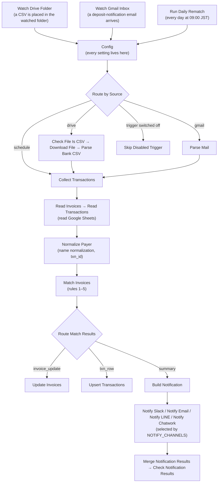

# Bank Deposit Reconciliation — 入金消込 (Template 01) README

| Item | Value |
|---|---|
| Product name | `[Odaji] 01 Bank Deposit Reconciliation v1.0.0` |
| Bundled workflows | `workflow.json` (main workflow), `error-handler.json` (`[Odaji] 01 Error Handler v1.0.0`) |
| Supported n8n | **2.x. Built and tested on 2.40.5 (self-hosted).** n8n Cloud is expected to work on any 2.x version, but the template was not tested on Cloud |
| Setup guide | `SETUP.en.md` (this README explains what the template does and how it works; every procedure is in SETUP) |
| Changelog | `CHANGELOG.md` |
| License | `LICENSE.md` (single-business license) |

This document is the product description, meant to be read before and after purchase. Reading the whole file takes about 20 minutes; each section heading shows its own estimate.

---

## 1. Overview (about 2 minutes)

**The template matches your bank's transaction CSV and deposit-notification emails against an invoice list in Google Sheets, decides "who paid, and for which invoice", and hands only the cases that need a human decision to you as a notification.**

**Who it is for**
- Freelancers, small e-commerce shops and small B2B businesses that collect revenue by invoice (bank transfer).
- Anyone who reconciles tens to hundreds of deposits per month by hand, comparing the bank statement with an invoice list.
- Anyone who can keep the invoice list in Google Sheets (an existing list works once its columns are renamed to the required names).

**What it does**
- Imports deposits from bank CSVs (Shift_JIS or UTF-8) placed in a watched Google Drive folder and from deposit-notification emails received in Gmail.
- Identifies the invoice by remitter name (katakana) and amount, and updates the payment state in the `invoices` sheet (`status`, `paid_amount` and so on).
- Records every imported deposit in the `transactions` sheet (matched, unmatched, ambiguous).
- Sends the result to the channels you configure: Slack, email (Gmail), LINE and/or Chatwork.
- Every morning, re-matches deposits that could not be matched the day before (so an invoice registered later is picked up).

**What it does not do**
- It never auto-confirms an ambiguous deposit (several invoices with the same amount, an amount that matches nothing, and so on). It lists the candidates and a person confirms them in the sheet.
- It does not guarantee compatibility with any specific bank. The CSV is adapted through a column mapping and the emails through regular expressions (two fictional samples are included).
- It does not store the original CSV or email. It does not post to accounting software, send reminders, handle foreign currency or make consumption-tax decisions.

---

## 2. How it works (about 6 minutes)

### 2.1 Overall flow

The workflow runs in this order: three triggers → intake → normalization → matching → sheet update → notification. Node names are the English names shown on the n8n canvas.



Canvas of the main workflow and the Error Workflow (captured on the author's n8n 2.40.5; bundled in `docs/`):


| Stage | Node | What it does |
|---|---|---|
| Trigger | `Watch Drive Folder` | Polls the watched Google Drive folder every minute and starts a run when a new file appears. Anything that is not a CSV ends in `Skip Non-CSV File` without doing anything |
| Trigger | `Watch Gmail Inbox` | Polls Gmail every 5 minutes and starts a run for emails that match the search (default `subject:(入金 OR Deposit) newer_than:1d`). At most 10 emails per poll |
| Trigger | `Run Daily Rematch` | Runs every day at 09:00 JST. Imports nothing new; re-matches only the `unmatched` / `ambiguous` rows of `transactions` |
| Settings | `Config` | A Set node that holds every value the buyer edits. `TRIGGERS_ENABLED` switches the three triggers on and off |
| Intake | `Parse Bank CSV` | Decodes Shift_JIS, strips a UTF-8 BOM and extracts only the deposit rows through the column mapping in `CSV_MAPPING`. Withdrawal rows are ignored |
| Intake | `Parse Mail` | Extracts amount, remitter and date from the body with the regular expressions in `MAIL_PARSERS`. An email that matches no parser is reported as a warning |
| Normalization | `Normalize Payer` | Normalizes the remitter name: NFKC → hiragana to katakana → remove legal-entity tokens (`カ)`, `株式会社`, …) → remove spaces and punctuation → remove a leading run of digits. The only place that defines `txn_id` (`date\|amount\|normalized name\|normalized memo`) |
| Matching | `Match Invoices` | Applies rules 1–5 from the table below. A `txn_id` already present in `transactions` is skipped (idempotent) |
| Update | `Update Invoices` / `Upsert Transactions` | Append or Update keyed on `invoice_id` / `txn_id`. **Sheets are written before the notification** |
| Notification | `Build Notification` … `Check Notification Results` | Builds the summary and detail lines and sends them to every configured channel. The run fails and goes to the Error Workflow only when every channel fails |

### 2.2 Matching rules (5 rules)

Candidates are the rows of `invoices` whose `status` is `unpaid` or `partial` and whose `currency` is `JPY` (an empty cell counts as JPY). "Remaining" means `amount − paid_amount`. A "name match" means the normalized remitter name equals the normalized `customer_name` or `payer_name_alias`, or one contains the other with at least 3 characters (`NAME_MIN_CONTAINS`).

| Rule | Condition | Change to `invoices` | Auto-confirmed | Notification category |
|---|---|---|---|---|
| 1 | Exactly one invoice with a name match and remaining = deposit | `status=paid`, `match_confidence=auto` | Yes | Auto-matched |
| 2 | Exactly one invoice with remaining = deposit, no name match | `paid`, `amount_only` | Yes | Needs review |
| 3a | No remaining match. One name match whose remaining − deposit is in `FEE_SET` (default 110–880 yen) | `paid`, `fee_deducted`, difference written to the `fee_deducted` column | Yes | Needs review |
| 3b | No remaining match. The remaining amounts of 2–3 name-matched invoices add up to the deposit, and only one such combination exists | All of them `paid`, `combined` | Yes | Needs review |
| 3c | No remaining match. One name match and deposit < remaining | `status=partial`, deposit added to `paid_amount`, `auto` | Yes | Auto-matched (remaining amount shown) |
| 3d | One name match and deposit > remaining (overpayment) | Unchanged. `transactions` row is `ambiguous` (reason `overpaid`) | No | Ambiguous |
| 4 | Several candidates and no way to decide (several invoices with the same amount, amount match and name match on different invoices, several combined-payment combinations, …) | Unchanged. `transactions` row is `ambiguous`, top 3 candidates in `suggested_invoice_ids` | No | Ambiguous |
| 5 | None of the above | Unchanged. `transactions` row is `unmatched`, top 3 similar invoices in `suggested_invoice_ids` | No | Unmatched |

- Only **1, 2, 3a, 3b and 3c** are confirmed automatically. 2, 3a and 3b are confirmed but listed under "needs review" in the notification (check the result in the sheet by eye).
- An amount match is mandatory because remitter names arrive in katakana and, for individuals, identical names are common. Confirming by name alone would settle an invoice with someone else's money.
- An invoice settled earlier in the same run is removed from the candidates for later deposits. A second deposit for the same invoice on the same day is picked up by the next morning's re-match.

### 2.3 The four notification categories

A notification consists of a one-line title and detail lines per category (the copy comes from `MESSAGES` in `Config`; `LANG` switches between Japanese and English). The default `LANG` is `ja`; the examples below show the `LANG=en` copy, and the Japanese copy has the same structure (`■ 自動消込`, `■ 要確認`, `■ 候補複数`, `■ 未消込`, `■ 警告`).

```
[Reconciliation 2026-09-23] Processed 11 | Auto-matched 4 | Needs review 3 | Unmatched 4
```

| Category | Heading (`LANG=en`) | Content | What a person does |
|---|---|---|---|
| `auto` | ■ Auto-matched | Confirmed by rules 1 and 3c. A partial payment carries "(partial, remaining ¥…)" | Normally nothing |
| `needs_review` | ■ Needs review (auto-matched by amount only, fee deducted, or combined) | Confirmed by rules 2, 3a and 3b, with the reason: "(amount only, needs review)", "(fee ¥220 deducted)", "(combined)" | Check the result in the sheet by eye. If it is wrong, correct `invoices` and `transactions` by hand |
| `ambiguous` | ■ Ambiguous (multiple candidates, not auto-matched; pick one) | Rules 3d and 4. Lists the candidates and their remaining amounts | Set `status` / `paid_amount` in `invoices` and `transactions.status` (`matched` or `ignored`) by hand |
| `unmatched` | ■ Unmatched (no matching invoice) | Rule 5. Lists similar invoices if any | Register the invoice and the next morning's re-match settles it. Mark deposits that are out of scope as `transactions.status=ignored` |

"Unmatched C" in the title is the sum of `ambiguous` and `unmatched` (3d included). Emails with an intake problem (no parser matched, and so on) and non-JPY invoices appear under "■ Warnings". When there is no new deposit at all the message becomes "No new transactions (skipped as already processed: N)". The morning re-match sends a notification only when a state changed or an intake warning exists.

---

## 3. What is included (about 2 minutes)

Contents of `templates/01-bank-reconciliation/`. The buyer uses the items in bold; the others are documentation and verification material.

| File / folder | Content |
|---|---|
| **`workflow.json`** | Main workflow (30 nodes plus 8 bilingual sticky notes). The file you import into n8n |
| **`error-handler.json`** | Error Workflow (11 nodes plus 4 sticky notes). Notifies you when the main workflow fails |
| **`README.ja.md` / `README.en.md`** | This document (Japanese / English) |
| **`SETUP.ja.md` / `SETUP.en.md`** | Setup guide (Japanese / English), written at a level of detail that allows deployment in 30 minutes |
| `DESIGN.md` | Design document (node diagram, data shapes, reasoning, pseudocode of the Code nodes). Read it before modifying the workflow |
| `CHANGELOG.md` | Change history (Keep a Changelog format) |
| `LICENSE.md` | License (single business) |
| `code/` | Source of the 8 Code nodes in JavaScript (the same text is embedded in `workflow.json`; not needed to run) |
| `build/build_workflow.py` | Script that regenerates `workflow.json` / `error-handler.json` from `code/` and the settings (for people modifying the template; not needed to run) |
| **`fixtures/`** | Fictional trial-run data: 3 bank CSVs (Shift_JIS, Shift_JIS with a description line, UTF-8 BOM), 2 deposit-notification emails (`.eml`), a seed of 20 invoices and 1 transaction, and example `CSV_MAPPING` / `MAIL_PARSERS` settings. `fixtures/README.md` has the table of expected results |
| `tests/CASES.md` | Acceptance test list (R01–R23) |
| `tests/SMOKE.md` | Record of runs in a local n8n (15 paths) |
| `tests/SMOKE-p3-followup.md` | Record of the credential validation on Publish and of deactivated `Notify …` nodes passing data through |
| `tests/RESULTS.md` | Record of the acceptance test runs |
| `tests/results/` | Per-path run records (Drive / Gmail and notifications / Schedule and Error Workflow) and the hashes of the evidence |
| `tests/unit/` / `tests/pins/` | Unit tests of the Code nodes and pinned data for running without Google / notification credentials (for people modifying the template) |
| `docs/` | Canvas images (whole canvas of the main workflow and the Error Workflow, the Config note, the two Config key tables, the thumbnail) and how they were captured (`docs/README.md`) |

The **`shared/`** folder at the repository root is also used: `sheets-schema.md` (how to create the spreadsheet and the column definitions, Japanese and English), `invoices.template.csv` / `transactions.template.csv` (empty templates to import into the sheets), `messages.ja.json` / `messages.en.json` (source of the notification copy; the same content is embedded in `MESSAGES` in `Config`).

---

## 4. Requirements (about 2 minutes)

| Requirement | Used for | Notes |
|---|---|---|
| **n8n 2.x** | Running the workflow | Built and tested on 2.40.5 (self-hosted, Docker or npm). Cloud is expected to work on any 2.x version but was not tested. The template uses Code nodes, so a self-hosted instance must be a standard setup where task runners are running |
| **Google account** | Google Sheets (ledger), Google Drive (watched folder for CSVs), Gmail (receiving deposit-notification emails, sending email notifications) | Three n8n credentials: **Google Sheets OAuth2**, **Google Drive OAuth2** and **Gmail OAuth2**. On a self-hosted instance one OAuth client created in Google Cloud can be shared by all three. On n8n Cloud, "Sign in with Google" (Managed OAuth2) is available. Gmail is not needed if you use neither email intake nor email notifications; in that case deactivate `Watch Gmail Inbox` and `Notify Email` (main workflow and Error Workflow) and set `TRIGGERS_ENABLED.gmail` to `false`. An active node without a credential blocks Publish |
| One Google Spreadsheet | Two sheets, `invoices` and `transactions` | 5 minutes following `shared/sheets-schema.md`. If you already have an invoice list, rename its columns to the required names |
| Bank transaction CSV, or deposit-notification emails | Source of deposits | Either one is enough. Switch off the path you do not use in `TRIGGERS_ENABLED` |
| Notification target (optional, several allowed) | Delivering the result | Slack (an n8n Slack credential using a Bot User OAuth Token with the `chat:write` scope) / email (the Gmail OAuth2 credential above) / LINE (a Messaging API channel access token in a Header Auth credential named `LINE Messaging API`) / Chatwork (an API token in a Header Auth credential named `Chatwork API`). Running with no notification target at all is possible (leave `NOTIFY_CHANNELS` empty) |

Costs depend on your contracts with each service. The template calls the Google Sheets / Drive / Gmail APIs within normal limits (two sheet reads per run; polling every minute for Drive and every 5 minutes for Gmail).

---

## 5. Scope and limitations (about 2 minutes)

**Supported**
- Currency: **JPY only**. Rows of `invoices` whose `currency` is not JPY are not matched and appear under "■ Warnings" as `non_jpy_invoice`.
- Bank CSV: adapted through `CSV_MAPPING` in `Config` (column headers, number of lines to discard before the header `skip_rows`, date formats `yyyy/MM/dd`, `yyyyMMdd`, `yyyy-MM-dd`, encodings `shift_jis`, `utf-8`, `auto`). **Compatibility with any specific bank is not guaranteed.** The bundled fictional CSVs come in two layouts (`日付,摘要,入金額,出金額,残高` and `取引日,内容,お預入,お引出`).
- Deposit-notification emails: adapted through `MAIL_PARSERS` in `Config` (substring match on sender and subject, regular expressions for amount, remitter and date). **The parser is regex-configurable and two fictional samples (labelled-line layout and table layout) are included.** Adjust the expressions to your bank's emails. The text body is preferred, but HTML bodies work too.
- The ledger is Google Sheets (`invoices`, `transactions`). Nothing is written to any other database or accounting software.
- Every run reads **all rows** of `invoices` and `transactions`. This read is what limits the volume; once `transactions` grows beyond roughly 10,000 rows, split the sheet by year.
- If Google Drive converted the CSV to a spreadsheet on upload, the file is still exported and read as UTF-8 CSV (characters already broken by the conversion cannot be repaired; see §9).
- If several CSVs land in the folder within the same poll, all of them are processed in one run.

**Not supported**
- Guaranteed compatibility with a specific bank or online-banking screen. Reading passbook images or PDFs.
- Foreign currency, consumption-tax decisions, posting to accounting software (Template 02), reminder emails (Template 03).
- Auto-confirming ambiguous, unmatched or overpaid deposits.
- n8n community nodes and the `Read/Write Files from Disk` node (not used, because it is unavailable on n8n Cloud).
- Emails that list several deposits in one message (one email is treated as one deposit).

---

## 6. Safety (about 2 minutes)

- **No images, files or email bodies are stored.** The CSV is read in memory while the n8n run executes, and only text values such as amount, date and remitter are written to the sheet. n8n's execution log keeps node inputs and outputs as usual (the retention period is an n8n setting).
- **Secrets live only in n8n credentials.** `workflow.json` / `error-handler.json` contain no credential contents or IDs; the sheet ID and notification targets are placeholders (`REPLACE_ME_…`). A secret-detection grep was run before shipping and returned 0 hits.
- **Idempotent (running the same input twice does not change the state).** Every deposit gets a deterministic `txn_id`; each run reads `transactions` and skips a `txn_id` that already exists. A `txn_id` already recorded in `invoices.matched_txn_ids` is not applied again either (this prevents double settlement when a run fails halfway through the sheet update and is re-run).
- **The sheet-writing nodes do not have Continue On Fail.** A failure of `Read Invoices` / `Read Transactions` / `Update Invoices` / `Upsert Transactions` stops the run as a failure (3 retries each) and is reported through the Error Workflow. Only the notification nodes pass a failure on to the next node, so that "every configured channel is attempted"; only when every channel fails does `Check Notification Results` fail the run.
- **Sheets are written before the notification.** If the notification fails, the ledger is already correct and a re-run skips everything.
- **An Error Workflow is included.** Select `[Odaji] 01 Error Handler v1.0.0` as the Error workflow in the main workflow's Settings and you are notified with the failed node name, the error and the URL of the execution log. The procedure is in `SETUP.en.md` (per the official n8n documentation, the Error workflow is chosen in Workflow settings; it runs only when an automatic execution fails, never for a manual run).
- `Notify Slack` has "Include Link to Workflow" switched OFF and `Notify Email` has n8n's attribution switched OFF, so no n8n URL or workflow ID appears in the notifications.
- Personal data: `customer_name`, `customer_email` and `payer_name_alias` are names and email addresses. Keep the spreadsheet's sharing to the minimum and delete rows you no longer need.

---

## 7. Deployment (about 1 minute)

The procedure is in **`SETUP.en.md`**; allow about 30 minutes. The outline is as follows (see SETUP for the actual screens).

1. Create the spreadsheet (`shared/sheets-schema.md`).
2. Register the Google credentials (Sheets / Drive / Gmail) and the credentials of the notification channels you use in n8n.
3. Import `error-handler.json`, then `workflow.json`, into n8n (workflow menu → **Import from File**).
4. Replace the `REPLACE_ME_…` values in the main workflow's `Config`, set the three trigger nodes `Watch Drive Folder` (folder), `Watch Gmail Inbox` (search) and `Run Daily Rematch` (time), and set the `Config` of the Error Workflow as well (the key table is also on the canvas sticky notes; see `docs/canvas-config-keys-1.png` / `docs/canvas-config-keys-2.png`).
5. Select the credential in each node (deactivate the `Notify …` nodes of channels you do not use) and select the Error workflow in the main workflow's Settings.
6. Do a trial run with the bundled fixtures and compare the result with the expected values in `fixtures/README.md`.
7. **Publish** the Error Workflow and the main workflow (this enables automatic runs). An Error Workflow that is not published is never invoked.

---

## 8. FAQ (about 4 minutes)

**Does it run on n8n Cloud?**
It is built from built-in nodes only and uses neither `Read/Write Files from Disk` nor community nodes, both unavailable on Cloud, so it is expected to run on a 2.x Cloud instance. However, the author verified it only on self-hosted n8n 2.40.5, and **it was not tested on Cloud.** On Cloud, the Google credentials can use "Sign in with Google" (Managed OAuth2), so creating an OAuth client in Google Cloud is not required (per the official n8n documentation). The Cloud version is chosen under Updates & maintenance in the admin dashboard.

**Will it work with my bank's CSV?**
Once the column mapping (`CSV_MAPPING`) is adjusted it handles most transaction statements, but **compatibility with any specific bank is not guaranteed.** Things to check: the header strings, whether description lines precede the header (`skip_rows`), the date format, the encoding (Shift_JIS by default; a UTF-8 BOM switches to UTF-8 automatically) and thousands separators, `¥` and `円` in amounts (removed automatically). `fixtures/csv_mapping.examples.json` holds example settings for the two layouts. For deposit-notification emails, adjust the regular expressions in `MAIL_PARSERS` to your bank's email body.

**What if the transfer fee was deducted from the payment?**
If the difference from the remaining amount is one of `FEE_SET` (default `[110,165,220,275,330,440,550,660,770,880]` yen) and exactly one invoice matches by name, rule 3a marks it `paid`, writes the difference to the `fee_deducted` column and lists it under "needs review" as, for example, "(fee ¥220 deducted)". Edit `FEE_SET` to match your bank's or your customers' fees. If the difference is not in `FEE_SET`, the deposit becomes a partial payment (rule 3c).

**What about partial payments?**
If exactly one invoice matches by name and the deposit is smaller than the remaining amount, rule 3c sets `status=partial`, adds the deposit to `paid_amount` and shows the remaining amount under "auto-matched" as, for example, "(partial, remaining ¥150,000)". When the rest is paid later it equals the remaining amount at that time and the invoice becomes `paid`. If the same invoice is paid in two transfers on the same day, the second one stays unmatched in that run and is settled by the next morning's re-match.

**What if several invoices have the same amount?**
If the name narrows it down to one invoice, rule 1 confirms it. If the name cannot decide (no name match, or several invoices with the same name and amount), nothing is auto-confirmed: the candidates are listed under "ambiguous", `transactions.status` becomes `ambiguous` and the candidates are written to `suggested_invoice_ids`. A person then corrects `status` / `paid_amount` in `invoices` and `transactions.status`. Registering the remitter name (katakana) in `payer_name_alias` reduces these cases.

**What happens if I feed an already-settled deposit again?**
Whether the same CSV is placed again or the same email is delivered again, a `txn_id` (`date|amount|normalized name|normalized memo`) that already exists in `transactions` is skipped and the notification reads "No new transactions (skipped as already processed: N)". The sheets do not change. A deposit already recorded in `invoices.matched_txn_ids` is not applied again either. A genuine double deposit (same day, same amount, same remitter and memo) is skipped as the second row. The skip count appears in the notification only when no new deposit was processed at all ("skipped as already processed: N"); otherwise check the output of `Match Invoices` in Executions (`skipped_existing` / `skipped_duplicate_in_batch` in the summary item) and handle it by hand with `source=manual`.

**Can I notify several channels?**
Yes. List `slack` / `email` / `line` / `chatwork` as an array in `NOTIFY_CHANNELS` in `Config` (for example `["slack","email"]`). Every configured channel is attempted; if some fail, the rest still receive the message. Only when every channel fails does the run fail and go to the Error Workflow. Put the same notification settings into the Error Workflow's `Config` as well.

**What do I do with the nodes of notification channels I do not use?**
Deactivate the `Notify …` nodes of unused channels in both the main workflow and the Error Workflow (right-click the node → Deactivate). n8n validates the credentials of every active node when you Publish, so an active node without a credential blocks publishing with `Missing required credential` (confirmed on the author's n8n 2.40.5). Also remove the deactivated channel from `NOTIFY_CHANNELS`. A deactivated node passes its input through unchanged, so if the channel stays in `NOTIFY_CHANNELS`, `Check Notification Results` counts it as a failed channel (`errors` contains `notify node disabled or not executed (payload passed through)`), and if it is the only channel the run fails. Nothing goes silently undelivered.

**Does the Error Workflow have to be published?**
Yes. On the author's n8n 2.40.5, an Error Workflow that was not published was not invoked when the main workflow failed (the log said `is not active and cannot be executed`). Select the credentials of the channels you use in the Error Workflow too, or deactivate the nodes of unused channels, and then Publish it. The procedure is in `SETUP.en.md` §4.4.

**Can the notifications be in English?**
Set `LANG` in `Config` to `"en"` and the copy switches to `MESSAGES.en` (the same content as `shared/messages.en.json`). Set `LANG` in the Error Workflow's `Config` to the same value. To change the wording itself, edit `MESSAGES` in `Config`.

**Google shows "Google hasn't verified this app".**
This warning appears on a self-hosted instance that uses an OAuth client from your own Google Cloud project. See `SETUP.en.md` and the official n8n documentation (Google OAuth2 single service, Troubleshooting).

---

## 9. Known limitations and pitfalls (about 4 minutes)

Read this before deploying. The same content is on the red sticky note in the main workflow (Sticky Note S6 Caution) and in `SETUP.en.md`.

1. **Remitter names arrive in katakana.** Unless you fill `invoices.payer_name_alias` with the remitter name (katakana; comma-separated if there are several, for example `カ)サンプルシヨウジ,サンプルシヨウジ`), the auto-match rate drops sharply. A kanji `customer_name` alone does not match.
2. **Individuals share names.** That is why an amount match is mandatory. Check amount-only matches (rule 2) by eye under "needs review" in the notification.
3. **Bank CSV layouts can change from one month to the next** (header row present or not, extra description lines). When a mapped column is not found the run fails (it does not silently produce 0 rows). Review `CSV_MAPPING.skip_rows` and the column headers.
4. **If Google Drive is set to convert uploaded CSVs to spreadsheets**, Shift_JIS content can be broken at conversion time. The template reads a converted file as UTF-8 CSV, but it cannot repair broken characters. Switch the conversion setting off before placing files in the watched folder (the setting's location is in `SETUP.en.md`).
5. **`Config` alone is not enough.** The triggers run before `Config`, so the live values also go into the three nodes `Watch Drive Folder` (folder ID), `Watch Gmail Inbox` (search) and `Run Daily Rematch` (time). `DRIVE_FOLDER_ID` / `GMAIL_QUERY` / `RUN_AT` in `Config` are documented mirrors; keep them equal.
6. **Switching a trigger off in `TRIGGERS_ENABLED` does not stop its polling.** The switched-off path falls through `Route by Source` into `Skip Disabled Trigger` and does nothing, but the Drive / Gmail API calls continue. To stop the calls as well, deactivate the trigger node itself.
7. **JPY only.** Non-JPY invoices are not matched and appear under "■ Warnings" (the morning re-match does not send a notification for this warning alone).
8. **Ambiguous, unmatched and overpaid deposits are confirmed by a person.** Correct `status` / `paid_amount` in `invoices` and set `transactions.status` to `matched` or `ignored`. `ignored` rows are excluded from re-matching. `status=overpaid` for an overpayment is set by a person.
9. **The Error Workflow is selected in the main workflow's Settings, and it must itself be published.** The Error Trigger does not fire unless the main workflow is published (automatic runs). It does not fire for a failed manual run. In addition, on the author's n8n 2.40.5, **an Error Workflow that is not itself published is never invoked** (log: `is not active and cannot be executed`). The Error Workflow has its own `Config` (notification settings), which must hold the same values as the main workflow.
10. **`transactions` is read in full on every run.** Beyond roughly 10,000 rows, split the sheet by year.
11. **Two rows with the same `txn_id` in one run** (same day, amount, remitter and memo): the second row is skipped. The count is not shown in the notification; it is recorded as `skipped_duplicate_in_batch` in the summary output of `Match Invoices` in the execution log (Executions).
12. **Fee deduction (3a) takes precedence over partial payment (3c).** A partial payment whose difference from the remaining amount happens to be 110–880 yen is treated as a fee. The difference is spelled out under "needs review", so tell them apart there.
13. **Gmail's `subject:` does not search the body.** The default `subject:(入金 OR Deposit) newer_than:1d` matches the subjects of the two bundled sample emails. Change the Search in `Watch Gmail Inbox` to match your bank's subjects.
14. **Do not change the column names (row 1) of the sheets.** Columns are referenced by name, so a one-character difference breaks the workflow. Adding your own columns to the right is fine. Dates are handled as `yyyy-MM-dd` strings, so keep the sheet formatted as plain text.
15. **If you rename a trigger node, update the rules in `Route by Source` too** (node names are used as the comparison values for `SOURCE`).
16. **Deactivate the `Notify …` nodes of channels you do not use, or select a credential** (in both the main workflow and the Error Workflow). n8n validates the credentials of every active node when you Publish, so an active node without a credential blocks publishing with `Missing required credential`. Remove deactivated channels from `NOTIFY_CHANNELS` as well. If one stays, `Check Notification Results` counts it as a failed channel (`notify node disabled or not executed`), and if it is the only channel the run fails and goes to the Error Workflow (nothing goes silently undelivered).

---

## 10. Verification status (about 2 minutes)

This section separates what was confirmed in the author's environment from what was not. Details are in `tests/SMOKE.md`, `tests/CASES.md`, `tests/RESULTS.md` and `ASSUMPTIONS.md` (repository root).

**Confirmed (2026-09-23, self-hosted n8n 2.40.5, Node.js 24)**
- Unit tests of the 8 Code nodes: **10 suites** (including the integration tests) pass. The code embedded in `workflow.json` gives the same results.
- Imported into a local n8n, **15 smoke-run paths** behave as expected (CSV intake, two files in one poll, a file converted to a spreadsheet, a second run of the same CSV skipping everything, Gmail intake, trigger switched off, re-match, non-CSV file, partial and total notification failure, Error Workflow). The execution order (sheet update → notification) was confirmed as well.
- n8n-mcp `validate_workflow`: 0 errors for both files. Built-in nodes only. Secret-detection grep: 0 hits.
- A Shift_JIS CSV is read without garbled characters, and a UTF-8 BOM does not remain in the header.
- The reconciliation results for the bundled fixtures (fictional data) equal the expected values in `fixtures/README.md`.
- An unpublished Error Workflow is not invoked; publishing is refused while an active node has no credential; a deactivated `Notify …` node left in `NOTIFY_CHANNELS` is counted as a failed channel by `Check Notification Results` (`tests/results/g3-schedule-error.md`, `tests/SMOKE-p3-followup.md`).

**Not verified (no credentials in the author's environment)**
- **The real Google Sheets / Drive / Gmail APIs** (actual cell writes, preservation of unmapped columns, real Drive polling, real Gmail polling). The Google nodes were replaced by pinned data for verification.
- **Actual delivery to Slack, Gmail (sending), LINE and Chatwork.** LINE and Chatwork were verified up to the HTTP call (the body was checked at a local receiver); Slack and Gmail sending were verified only at the node-configuration level.
- Operation on **n8n Cloud**.
- Real bank CSVs or notification emails. All fixtures are fictional.

Use the trial-run procedure in `SETUP.en.md` to confirm the unverified items in your own environment before going live.

---

## 11. License and support (about 1 minute)

- **Single-business license** (`LICENSE.md`). One purchasing business (one sole proprietor or one legal entity) may use the template for its own operations. There is no limit on the number of n8n instances, and modification is free. Resale, redistribution and reuse in other template products or client deliverables are not allowed.
- **Support**: questions about deployment are answered **by email for 30 days** from the purchase date (when deployment does not work as described in `SETUP.en.md`). Behaviour after modification, support for bank-specific formats and defects in n8n itself are out of scope.
- The product is provided as is, and the author is not liable for damages caused by reconciliation errors or undelivered notifications. Always do a trial run before going live.
- n8n is a product of n8n GmbH. This product is not affiliated with or endorsed by n8n.
- The price is stated on the sales page.

---

## 12. Changelog

See `CHANGELOG.md` (Keep a Changelog format).

---

## Pre-deployment checklist

- [ ] n8n is 2.x (the author verified 2.40.5 self-hosted; Cloud was not tested)
- [ ] The Google Spreadsheet has `invoices` and `transactions`, and the column names in row 1 are unchanged
- [ ] `invoices.payer_name_alias` holds the remitter names (katakana)
- [ ] Google Sheets OAuth2 / Google Drive OAuth2 / Gmail OAuth2 credentials are registered in n8n (Gmail only if you use it)
- [ ] Credentials for the notification channels are registered (Slack, Gmail, Header Auth `LINE Messaging API` / `Chatwork API`, whichever you use)
- [ ] `error-handler.json` and `workflow.json` are imported
- [ ] Every `REPLACE_ME_…` / `replace-me@…` in `Config` is replaced (main workflow and Error Workflow)
- [ ] The three nodes `Watch Drive Folder`, `Watch Gmail Inbox` and `Run Daily Rematch` hold the live values
- [ ] `CSV_MAPPING` (headers, `skip_rows`, date format, encoding) and `MAIL_PARSERS` are adapted to your bank's formats
- [ ] The main workflow's Settings select `[Odaji] 01 Error Handler v1.0.0` as the Error workflow
- [ ] Google Drive's conversion of uploads is OFF
- [ ] A trial run with the fixtures matched the expected values in `fixtures/README.md`, and a second run of the same CSV skipped everything
- [ ] The `Notify …` nodes of unused channels are deactivated in both the main workflow and the Error Workflow and removed from `NOTIFY_CHANNELS`
- [ ] The Error Workflow is published
- [ ] The main workflow is published
- [ ] You have read the scope of `LICENSE.md`

---

## 参考 / References

The procedures and specifications of external products mentioned in this document were checked against the following official pages, fetched on 2026-09-23. n8n screen labels are as shown on the author's self-hosted n8n 2.40.5. The detailed procedures are in `SETUP.en.md`; this document only outlines them. The verification record for the LINE / Chatwork API details (URLs, header names, body formats) is in the "External APIs" table of `ASSUMPTIONS.md`.

1. n8n Docs — Google OAuth2 single service (creating the OAuth client in Google Cloud, enabling APIs, consent screen, Managed OAuth2 / Sign in with Google on n8n Cloud, troubleshooting "Google hasn't verified this app"): https://docs.n8n.io/integrations/builtin/credentials/google/oauth-single-service.md
2. n8n Docs — Google credentials (types of OAuth2; nodes that support Managed OAuth2, including Google Drive, Google Drive Trigger, Gmail, Gmail Trigger and Google Sheets): https://docs.n8n.io/integrations/builtin/credentials/google.md
3. n8n Docs — Create and edit credentials (creating and naming credentials): https://docs.n8n.io/build/understand-workflows/create-and-edit-credentials.md
4. n8n Docs — Slack credentials (creating the Slack app, `chat:write` scope, Bot User OAuth Token as the Access Token): https://docs.n8n.io/integrations/builtin/credentials/slack.md
5. n8n Docs — HTTP Request credentials (Header Auth: Name / Value): https://docs.n8n.io/integrations/builtin/credentials/httprequest.md
6. n8n Docs — Export and import (three-dots menu → Import from File / Import from URL): https://docs.n8n.io/build/manage-workflows/export-and-import.md
7. n8n Docs — Configure workflow settings (Error Workflow (to notify when this one errors), Timezone, Execution order): https://docs.n8n.io/build/manage-workflows/configure-workflow-settings.md
8. n8n Docs — Handle errors gracefully (setting up an error workflow): https://docs.n8n.io/build/flow-logic/handle-errors-gracefully.md
9. n8n Docs — Error Trigger (does not fire on manual runs; the page states that an error workflow does not have to be published, but the author's self-hosted n8n 2.40.5 did not invoke an unpublished Error Workflow, so this template requires publishing it; see §8 and §9 item 9): https://docs.n8n.io/integrations/builtin/core-nodes/n8n-nodes-base.errortrigger.md
10. n8n Docs — Save and publish workflows (Publish button and publishing dialog; production executions use the published version): https://docs.n8n.io/build/understand-workflows/save-and-publish-workflows.md
11. n8n Docs — Create and run workflows (Publish enables automatic runs; Execute Workflow runs manually): https://docs.n8n.io/build/understand-workflows/create-and-run-workflows.md
12. n8n Docs — Work with nodes (Deactivate in the node context menu): https://docs.n8n.io/build/understand-workflows/workflow-components/work-with-nodes.md
13. n8n Docs — Pin and mock data (pinned data is not used in production executions; the basis for replacing the Google nodes with pinned data during the author's verification): https://docs.n8n.io/build/work-with-data/pin-and-mock-data.md
14. n8n Docs — Set up task runners (the Code node runs in task runners; internal and external modes): https://docs.n8n.io/deploy/host-n8n/configure-n8n/set-up-task-runners.md
15. n8n Docs — Update your version (n8n Cloud: Updates & maintenance section of the admin dashboard): https://docs.n8n.io/deploy/use-n8n-cloud/update-your-version.md
16. n8n Docs — Release notes (n8n 2.40 was released on 2026-09-15): https://docs.n8n.io/changelog/release-notes.md
17. n8n Docs — Timezone and localization (`GENERIC_TIMEZONE` on self-hosted instances): https://docs.n8n.io/deploy/host-n8n/configure-n8n/basic-configuration/use-environment-variables/timezone-and-localization.md
18. LINE Developers — Messaging API reference (`POST /v2/bot/message/push`; most of the page is rendered in the browser, so only the endpoint list was checked; the request format follows the OpenAPI definition recorded in `ASSUMPTIONS.md`): https://developers.line.biz/en/reference/messaging-api/ / Channel access token (types and validity periods): https://developers.line.biz/en/docs/basics/channel-access-token/
19. Chatwork API — Post a message to a chat (`POST /rooms/{room_id}/messages`, `body` 1–65,535 characters): https://developer.chatwork.com/reference/post-rooms-room_id-messages
20. Google Drive Help — Upload files & folders to Google Drive (where the "Convert uploads to Google Docs editor format" setting is): https://support.google.com/drive/answer/2424368?hl=en
