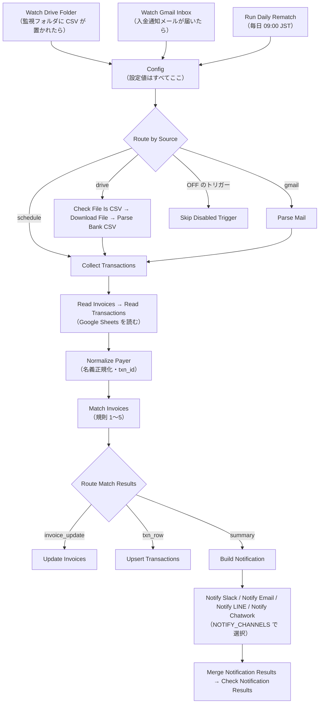
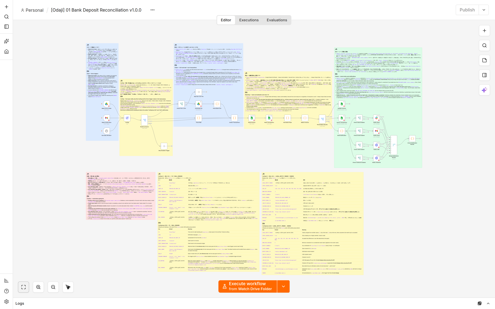
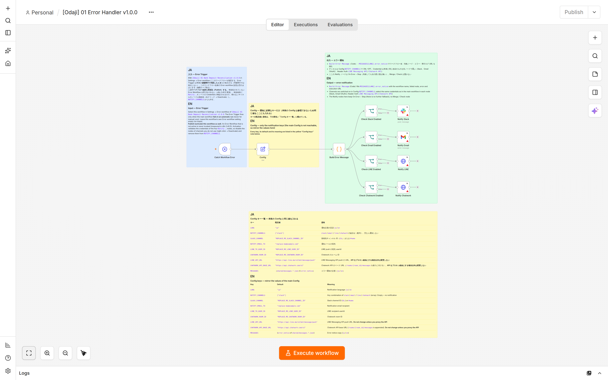

# 入金消込 — Bank Deposit Reconciliation（テンプレ01）README

| 項目 | 値 |
|---|---|
| 製品名 | `[Odaji] 01 Bank Deposit Reconciliation v1.0.0` |
| 同梱ワークフロー | `workflow.json`（本体）、`error-handler.json`（`[Odaji] 01 Error Handler v1.0.0`） |
| 対応 n8n | **2.x。2.40.5（セルフホスト）で構築・検証。** n8n Cloud は 2.x 系であれば動作する想定ですが、Cloud での実機検証は行っていません |
| 導入手順 | `SETUP.ja.md`（この README は「何ができるか・どう動くか」の説明です。手順はすべて SETUP に書いてあります） |
| 更新履歴 | `CHANGELOG.md` |
| ライセンス | `LICENSE.md`（単一事業者ライセンス） |

この文書は購入前・購入後に読む製品説明です。読む目安は全体で 20 分です。各節の見出しに目安時間を付けています。

---

## 1. 概要（目安 2 分）

**銀行の入出金 CSV と入金通知メールを、Google Sheets の請求一覧と自動で突き合わせ、「誰から・どの請求の入金か」を判定し、確認が必要な分だけ通知で人に渡します。**

**誰向けか**
- 請求書払い（銀行振込）で売上を回収しているフリーランス、小規模 EC、BtoB の小規模事業者。
- 月に数十〜数百件の入金を、通帳と請求一覧を見比べて手で消し込んでいる人。
- Google Sheets で請求一覧を管理できる人（既存の一覧を所定の列名に合わせれば使えます）。

**何をするか**
- 監視フォルダに置いた銀行 CSV（Shift_JIS／UTF-8）と、Gmail に届く入金通知メールから入金を取り込む。
- 振込名義（カナ）と金額で請求を判定し、`invoices` シートの入金状況（`status` / `paid_amount` など）を更新する。
- 取り込んだ入金をすべて `transactions` シートに記録する（消込済み・未消込・候補複数）。
- 結果を Slack／メール（Gmail）／LINE／Chatwork のうち設定したチャネルへ通知する。
- 毎朝、前日までに消し込めなかった入金を再突合する（あとから請求を登録した場合に拾う）。

**何をしないか**
- 曖昧な入金（同額の請求が複数ある、金額が合わないなど）を勝手に確定しない。候補を示して人がシートで確定する。
- 特定の銀行との互換を保証しない。CSV は列の対応表、メールは正規表現で自行の形式に合わせる（架空のサンプル 2 種を同梱）。
- 元の CSV やメールを保存しない。会計ソフトへの記帳、督促、外貨、消費税の判定はしない。

---

## 2. 仕組み（目安 6 分）

### 2.1 全体の流れ

3 系統のトリガー → 取込 → 正規化 → 突合 → シート更新 → 通知、の順に動きます。ノード名は n8n のキャンバスに表示される英語名です。



本体と Error Workflow のキャンバス（作者の n8n 2.40.5 で撮影。`docs/` に同梱）：





| 段階 | ノード | 内容 |
|---|---|---|
| トリガー | `Watch Drive Folder` | Google Drive の監視フォルダを毎分ポーリングし、新しいファイルがあれば起動。CSV 以外は `Skip Non-CSV File` で何もせず終了 |
| トリガー | `Watch Gmail Inbox` | Gmail を 5 分ごとにポーリングし、検索式（既定 `subject:(入金 OR Deposit) newer_than:1d`）に一致するメールで起動。1 回最大 10 通 |
| トリガー | `Run Daily Rematch` | 毎日 09:00 JST に起動。新しい入金は取り込まず、`transactions` の `unmatched` / `ambiguous` 行だけを再突合 |
| 設定 | `Config` | 買い手が触る設定値をすべて持つ Set ノード。`TRIGGERS_ENABLED` で 3 系統の ON／OFF |
| 取込 | `Parse Bank CSV` | Shift_JIS を復号し、UTF-8 BOM を除去し、`CSV_MAPPING` の列対応で入金行だけを取り出す。出金行は無視 |
| 取込 | `Parse Mail` | `MAIL_PARSERS` の正規表現で本文から金額・名義・日付を抽出。一致しないメールは警告として通知 |
| 正規化 | `Normalize Payer` | 名義を NFKC 正規化 → ひらがな→カタカナ → 法人格（`カ)` `株式会社` など）除去 → 空白・記号除去 → 先頭の数字列除去。`txn_id`（`日付\|金額\|正規化名義\|正規化メモ`）を決める唯一の場所 |
| 突合 | `Match Invoices` | 下表の規則 1〜5 で判定。`transactions` にある `txn_id` は skip（冪等） |
| 更新 | `Update Invoices` / `Upsert Transactions` | `invoice_id` / `txn_id` をキーに Append or Update。**通知より先に書く** |
| 通知 | `Build Notification` 〜 `Check Notification Results` | サマリと明細を組み、設定した全チャネルへ送る。全チャネル失敗のときだけ実行を失敗させ Error Workflow へ |

### 2.2 突合の規則（5 規則）

対象は `invoices` のうち `status` が `unpaid` または `partial` で、`currency` が `JPY`（空欄も JPY 扱い）の請求です。「残額」は `amount − paid_amount`。「名義一致」は正規化した振込名義が `customer_name` または `payer_name_alias` の正規化値と完全一致、または 3 文字以上（`NAME_MIN_CONTAINS`）の包含一致です。

| 規則 | 条件 | `invoices` の更新 | 自動確定 | 通知の区分 |
|---|---|---|---|---|
| 1 | 名義一致 かつ 残額＝入金額 の請求が 1 件 | `status=paid`、`match_confidence=auto` | する | 自動消込 |
| 2 | 残額＝入金額 が 1 件、名義一致が 0 件 | `paid`、`amount_only` | する | 要確認 |
| 3a | 残額一致なし。名義一致 1 件で、残額−入金額 が `FEE_SET`（既定 110〜880 円）にある | `paid`、`fee_deducted`、`fee_deducted` 列に差額 | する | 要確認 |
| 3b | 残額一致なし。名義一致 2〜3 件の残額合計が入金額と一致し、組合せが 1 通りだけ | 該当全件 `paid`、`combined` | する | 要確認 |
| 3c | 残額一致なし。名義一致 1 件で、入金額 < 残額 | `status=partial`、`paid_amount` に加算、`auto` | する | 自動消込（残額を明記） |
| 3d | 名義一致 1 件で、入金額 > 残額（超過） | 変更しない。`transactions` は `ambiguous`（理由 `overpaid`） | しない | 候補複数 |
| 4 | 候補が複数あり決めきれない（同額の請求が複数、金額一致と名義一致が別の請求、合算の組合せが複数 など） | 変更しない。`transactions` は `ambiguous`、`suggested_invoice_ids` に候補上位 3 件 | しない | 候補複数 |
| 5 | 上記のいずれにも当たらない | 変更しない。`transactions` は `unmatched`、`suggested_invoice_ids` に類似候補上位 3 件 | しない | 未消込 |

- 自動で確定するのは **1・2・3a・3b・3c** だけです。2・3a・3b は確定はしますが「要確認」として通知に列挙します（消し込み結果を目視で確認してください）。
- 金額一致を必須にしているのは、振込名義がカナで届き、個人名では同姓同名が普通に起きるためです。名義だけで確定すると別人の入金を消し込みます。
- 同一実行で一度消し込んだ請求は、以後の入金の候補から外れます。同じ請求への同日 2 回目の入金は翌朝の再突合で拾います。

### 2.3 通知の 4 区分

通知は 1 行のタイトルと、区分ごとの明細で構成されます（文面は `Config` の `MESSAGES`、`LANG` で日本語／英語を切替）。

```
【入金消込 2026-09-23】処理 11件｜自動消込 4｜要確認 3｜未消込 4
```

| 区分 | 見出し（`LANG=ja`） | 内容 | 人がすること |
|---|---|---|---|
| `auto` | ■ 自動消込 | 規則 1・3c で確定した分。一部入金は「（一部入金・残 ¥…）」付き | 基本的に不要 |
| `needs_review` | ■ 要確認（金額のみ一致・手数料差引・合算で自動消込した分） | 規則 2・3a・3b で確定した分。理由（「（金額のみ一致・要確認）」「（手数料 ¥220 差引）」「（合算）」）付き | シートの結果を目視で確認。誤りなら `invoices` と `transactions` を手で直す |
| `ambiguous` | ■ 候補複数（自動確定せず。候補から選んでください） | 規則 3d・4。候補と残額を列挙 | `invoices` の `status` / `paid_amount` と `transactions.status`（`matched` か `ignored`）を手で確定 |
| `unmatched` | ■ 未消込（該当請求なし） | 規則 5。類似候補があれば列挙 | 請求を登録すれば翌朝の再突合で消し込まれる。対象外の入金は `transactions.status=ignored` にする |

タイトルの「未消込 C」は `ambiguous` と `unmatched`（3d を含む）の合計です。取込で問題があったメール（パーサ不一致など）や JPY 以外の請求は「■ 警告」に出ます。新規の入金が 1 件も無いときは「新規の入金はありませんでした（処理済みのため skip：N 件）」になります。毎朝の再突合では、状態の変化か取込警告があるときだけ通知します。

---

## 3. 同梱物（目安 2 分）

`templates/01-bank-reconciliation/` の内容です。買い手が使うのは太字の項目で、他は説明・検証用です。

| ファイル / フォルダ | 内容 |
|---|---|
| **`workflow.json`** | 本体ワークフロー（30 ノード＋日英併記の付箋 8 枚）。n8n に取り込むファイル |
| **`error-handler.json`** | Error Workflow（11 ノード＋付箋 4 枚）。本体の失敗を通知する |
| **`README.ja.md` / `README.en.md`** | この文書（日本語／英語） |
| **`SETUP.ja.md` / `SETUP.en.md`** | 導入手順（日本語／英語）。30 分で導入できる粒度で書いてある |
| `DESIGN.md` | 設計書（ノード構成図、データの形、判断理由、Code ノードの疑似コード）。改変するときに読む |
| `CHANGELOG.md` | 更新履歴（Keep a Changelog 形式） |
| `LICENSE.md` | ライセンス（単一事業者） |
| `code/` | Code ノード 8 本の JavaScript 原本（`workflow.json` に同じ内容が埋め込まれている。動作には不要） |
| `build/build_workflow.py` | `code/` と設定から `workflow.json` / `error-handler.json` を再生成するスクリプト（改変者向け。動作には不要） |
| **`fixtures/`** | 試運転用の架空データ：銀行 CSV 3 本（Shift_JIS、Shift_JIS＋説明行、UTF-8 BOM）、入金通知メール 2 通（`.eml`）、請求 20 件・取引 1 件の seed、`CSV_MAPPING` / `MAIL_PARSERS` の設定例。`fixtures/README.md` に期待結果の表 |
| `tests/CASES.md` | 受け入れテスト一覧（R01〜R23） |
| `tests/SMOKE.md` | ローカル n8n での実行記録（15 経路） |
| `tests/SMOKE-p3-followup.md` | Publish 時の Credential 検証と、無効化した `Notify …` ノードの素通りの検証記録 |
| `tests/RESULTS.md` | 受け入れテストの実行記録 |
| `tests/results/` | 経路別（Drive／Gmail・通知／Schedule・Error Workflow）の実行記録と証跡のハッシュ |
| `tests/unit/` / `tests/pins/` | Code ノードの単体テストと、Google／通知の Credential 無しで実行するための固定データ（改変者向け） |
| `docs/` | キャンバス画像（本体・Error Workflow の全体図、Config 付箋、Config キー一覧 2 枚、サムネイル）と撮影条件（`docs/README.md`） |

リポジトリ直下の **`shared/`** も使います：`sheets-schema.md`（スプレッドシートの作り方と列の定義、日英）、`invoices.template.csv` / `transactions.template.csv`（シートに取り込む空テンプレ）、`messages.ja.json` / `messages.en.json`（通知文面の原本。`Config` の `MESSAGES` に同じ内容が入っている）。

---

## 4. 必要なもの（目安 2 分）

| 必要なもの | 用途 | 備考 |
|---|---|---|
| **n8n 2.x** | ワークフローの実行 | 2.40.5（セルフホスト、Docker または npm）で構築・検証。Cloud は 2.x であれば動作する想定、未検証。Code ノードを使うので、セルフホストではタスクランナーが動く標準構成であること |
| **Google アカウント** | Google Sheets（台帳）、Google Drive（CSV の監視フォルダ）、Gmail（入金通知メールの受信、メール通知の送信） | n8n の Credential は **Google Sheets OAuth2**、**Google Drive OAuth2**、**Gmail OAuth2** の 3 種。セルフホストでは Google Cloud で OAuth クライアントを 1 つ作れば 3 種で共用できる。n8n Cloud では「Sign in with Google」（Managed OAuth2）が使える。Gmail はメールでの取込・通知を使わないなら不要。その場合は `Watch Gmail Inbox` と `Notify Email`（本体・Error Workflow）を無効化（Deactivate）し、`TRIGGERS_ENABLED.gmail` を `false` にする。有効なまま Credential が無いと Publish が拒否される |
| Google スプレッドシート 1 冊 | `invoices` と `transactions` の 2 シート | `shared/sheets-schema.md` の手順で 5 分。既存の請求一覧がある場合は列名を合わせる |
| 銀行の入出金明細 CSV、または入金通知メール | 入金の取込元 | どちらか一方でも可。`TRIGGERS_ENABLED` で使わない系統を OFF にできる |
| 通知先（任意、複数可） | 結果の通知 | Slack（Bot User OAuth Token を使う n8n の Slack Credential、`chat:write` スコープ）／メール（上記 Gmail OAuth2）／LINE（Messaging API のチャネルアクセストークンを Header Auth Credential `LINE Messaging API` に）／Chatwork（API トークンを Header Auth Credential `Chatwork API` に）。通知先を 1 つも設定しない運用も可（`NOTIFY_CHANNELS` を空に） |

料金は各サービスの契約によります。本テンプレは Google Sheets / Drive / Gmail の API を通常の範囲で呼び出します（シート読み込みは 1 実行につき 2 回、ポーリングは Drive 毎分・Gmail 5 分ごと）。

---

## 5. 対応範囲と非対応（目安 2 分）

**対応**
- 通貨は **JPY のみ**。`invoices.currency` が JPY 以外の行は突合せず、通知の「■ 警告」に `non_jpy_invoice` として出します。
- 銀行 CSV：`Config` の `CSV_MAPPING`（列見出し、見出し前に捨てる行数 `skip_rows`、日付形式 `yyyy/MM/dd`・`yyyyMMdd`・`yyyy-MM-dd`、文字コード `shift_jis`・`utf-8`・`auto`）で対応します。**特定銀行との互換は保証しません。** 同梱の架空 CSV は 2 形式（`日付,摘要,入金額,出金額,残高` と `取引日,内容,お預入,お引出`）です。
- 入金通知メール：`Config` の `MAIL_PARSERS`（差出人・件名の部分一致と、金額・名義・日付の正規表現）で対応します。**正規表現の設定式で、架空のサンプル 2 種（ラベル行形式、表形式）を同梱**。自行の通知に合わせて調整してください。本文はテキストを優先し、HTML でも動きます。
- 台帳は Google Sheets（`invoices`、`transactions`）。他のデータベースや会計ソフトには書きません。
- 1 回の実行で `invoices` と `transactions` を**全行**読みます。処理量の上限はこの読み込みで決まり、`transactions` が 1 万行程度を超えたら年次でシートを分けることを推奨します。
- Google Drive がアップロード時に CSV をスプレッドシートへ変換していた場合も、UTF-8 の CSV として取り出して読みます（変換時に壊れた文字は直りません。§9 参照）。
- 同じポーリングで複数の CSV が置かれた場合は全ファイルを 1 回の実行で処理します。

**非対応**
- 特定銀行・特定の Web バンキング画面との互換保証。通帳画像や PDF の読み取り。
- 外貨、消費税の判定、会計ソフトへの記帳（テンプレ02）、督促メール（テンプレ03）。
- 曖昧・未消込・超過入金の自動確定。
- n8n のコミュニティノード、`Read/Write Files from Disk` ノード（n8n Cloud で使えないため使っていません）。
- 1 通のメールに複数の入金が並ぶ形式（1 通＝1 入金として扱います）。

---

## 6. 安全性（目安 2 分）

- **画像・ファイル・メール本文を保存しません。** CSV は n8n の実行中にメモリ上で読み、シートには金額・日付・名義などの文字情報だけを書きます。n8n の実行ログには通常どおりノードの入出力が残ります（保持期間は n8n 側の設定）。
- **秘密情報は n8n の Credential にだけ置きます。** `workflow.json` / `error-handler.json` に Credential の中身・ID は含まれず、Sheet ID や通知先はプレースホルダ（`REPLACE_ME_…`）です。出荷前に秘密検出の grep を通し 0 件を確認しています。
- **冪等（同じ入力を 2 回流しても状態が変わらない）。** 入金ごとに決定的な `txn_id` を作り、実行のたびに `transactions` を読んで既存なら skip します。さらに `invoices.matched_txn_ids` に記録済みの `txn_id` も再適用しません（シート更新の途中で失敗して再実行した場合の二重消込を防ぐため）。
- **シート書込みノードに Continue On Fail は設定していません。** `Read Invoices` / `Read Transactions` / `Update Invoices` / `Upsert Transactions` の失敗は実行の失敗として止まり（各 3 回リトライ）、Error Workflow に通知されます。通知ノードだけは「設定した全チャネルを試す」ために失敗を次のノードへ流し、全チャネルが失敗したときに限り `Check Notification Results` が実行を失敗させます。
- **通知より先にシートへ書きます。** 通知が失敗しても台帳は正しい状態で、再実行は全件 skip になります。
- **Error Workflow を同梱。** 本体の Settings で `[Odaji] 01 Error Handler v1.0.0` を Error workflow に指定すると、失敗したノード名・エラー・実行ログの URL が通知されます。指定方法は `SETUP.ja.md` に書いてあります（n8n 公式：Error workflow は Workflow settings で選ぶ。自動実行の失敗でだけ起動し、手動実行では起動しない）。
- `Notify Slack` は「Include Link to Workflow」を OFF、`Notify Email` は n8n の署名（attribution）を OFF にしてあり、通知に n8n の URL やワークフロー ID が載りません。
- 個人情報：`customer_name`、`customer_email`、`payer_name_alias` は氏名・メールアドレスです。スプレッドシートの共有範囲を最小にし、不要な行は削除してください。

---

## 7. 導入（目安 1 分）

導入手順は **`SETUP.ja.md`** にまとめてあります。目安 30 分。大まかな流れは次のとおりです（具体的な画面操作は SETUP を見てください）。

1. スプレッドシートを作る（`shared/sheets-schema.md`）。
2. Google の Credential（Sheets／Drive／Gmail）と、使う通知先の Credential を n8n に登録する。
3. `error-handler.json` → `workflow.json` の順に n8n へ取り込む（ワークフロー メニューの **Import from File**）。
4. 本体の `Config` の `REPLACE_ME_…` を置き換え、`Watch Drive Folder`（フォルダ）・`Watch Gmail Inbox`（検索式）・`Run Daily Rematch`（時刻）の 3 ノードと、Error Workflow 側の `Config` も設定する（キーの一覧はキャンバスの付箋にもあり、`docs/canvas-config-keys-1.png` / `docs/canvas-config-keys-2.png` で確認できる）。
5. 各ノードで Credential を選び（使わない通知チャネルの `Notify …` ノードは無効化する）、本体の Settings で Error workflow を指定する。
6. 同梱の fixtures で試運転し、結果を `fixtures/README.md` の期待値と見比べる。
7. Error Workflow と本体を **Publish**（自動実行を有効化）する。Error Workflow は Publish されていないと呼び出されない。

---

## 8. よくある質問（目安 4 分）

**n8n Cloud で動きますか？**
組み込みノードだけで作り、Cloud で使えない `Read/Write Files from Disk` やコミュニティノードは使っていないので、2.x 系の Cloud で動く想定です。ただし作者の環境で検証したのはセルフホストの n8n 2.40.5 だけで、**Cloud での実機検証はしていません。** Cloud では Google の Credential に「Sign in with Google」（Managed OAuth2）が使えるため、Google Cloud での OAuth クライアント作成は不要です（n8n 公式ドキュメント）。Cloud のバージョンは管理画面の Updates & maintenance で選べます。

**自分の銀行の CSV で動きますか？**
列の対応（`CSV_MAPPING`）を合わせれば多くの入出金明細に対応できますが、**特定銀行との互換は保証しません。** 確認する点は、列見出しの文字列、見出しより前に説明行があるか（`skip_rows`）、日付の形式、文字コード（Shift_JIS が既定。UTF-8 BOM があれば自動で UTF-8）、金額のカンマ・`¥`・`円`（自動で除去）です。`fixtures/csv_mapping.examples.json` に 2 形式の設定例があります。入金通知メールは `MAIL_PARSERS` の正規表現を自行の本文に合わせます。

**手数料を差し引いて振り込まれた場合は？**
残額との差が `FEE_SET`（既定 `[110,165,220,275,330,440,550,660,770,880]` 円）のいずれかで、名義が一致する請求が 1 件あれば、規則 3a で `paid` にし、`fee_deducted` 列に差額を書き、通知の「要確認」に「（手数料 ¥220 差引）」のように出します。自行や取引先の手数料に合わせて `FEE_SET` を編集できます。差額が `FEE_SET` にない場合は一部入金（規則 3c）になります。

**一部入金があった場合は？**
名義が一致する請求が 1 件で、入金額が残額より少なければ規則 3c で `status=partial`、`paid_amount` に加算し、通知の「自動消込」に「（一部入金・残 ¥150,000）」のように残額を出します。残りが後日振り込まれれば、そのときの残額と一致して `paid` になります。同じ日に同じ請求へ 2 回に分けて振り込まれた場合、2 回目は同じ実行では未消込になり、翌朝の再突合で消し込まれます。

**同額の請求が複数あるときは？**
名義で 1 件に絞れれば規則 1 で確定します。名義で絞れない（名義が一致しない、または同じ名義の請求が同額で複数ある）ときは自動確定せず「候補複数」として候補を通知し、`transactions.status=ambiguous`、`suggested_invoice_ids` に候補を書きます。人が `invoices` の `status` / `paid_amount` と `transactions.status` を直してください。`payer_name_alias` に振込名義（カナ）を登録しておくと、この状況を減らせます。

**既に消込済みの入金を再投入したら？**
同じ CSV を再度置いても、同じメールが再配信されても、`txn_id`（`日付|金額|正規化名義|正規化メモ`）が `transactions` に既にあれば skip し、通知は「新規の入金はありませんでした（処理済みのため skip：N 件）」になります。シートに差分は出ません。`invoices.matched_txn_ids` に記録済みの入金も再適用しません。実在する二重入金（同日・同額・同名義・同メモ）は 2 件目が skip されます。skip 件数が通知に出るのは、新規の入金が 1 件も処理されなかったとき（「処理済みのため skip：N 件」）だけです。それ以外は Executions で `Match Invoices` の出力（summary の `skipped_existing` / `skipped_duplicate_in_batch`）を確認し、人が `source=manual` で処理してください。

**通知先を複数にできますか？**
できます。`Config` の `NOTIFY_CHANNELS` に `slack` / `email` / `line` / `chatwork` を配列で列挙します（例：`["slack","email"]`）。設定した全チャネルへ送り、一部が失敗しても残りには届きます。全チャネルが失敗したときだけ実行が失敗し Error Workflow に回ります。Error Workflow 側の `Config` にも同じ通知設定を入れてください。

**使わない通知チャネルのノードはどうすればいいですか？**
使わないチャネルの `Notify …` ノードは、本体と Error Workflow の両方で無効化してください（ノードを右クリック → Deactivate）。n8n は Publish のときに有効な全ノードの Credential を検証するため、Credential 未設定のノードが有効のままだと `Missing required credential` で Publish できません（作者の n8n 2.40.5 で確認）。無効化したチャネルは `NOTIFY_CHANNELS` からも外します。無効化したノードは入力をそのまま通すので、`NOTIFY_CHANNELS` に残すと `Check Notification Results` がそのチャネルを「失敗」として数え（`errors` に `notify node disabled or not executed (payload passed through)`）、それしか無ければ実行が失敗します。黙って未配信になることはありません。

**Error Workflow は Publish が必要ですか？**
必要です。作者の n8n 2.40.5 では、Publish されていない Error Workflow は本体が失敗しても呼び出されませんでした（ログに `is not active and cannot be executed`）。Error Workflow 側でも使うチャネルの Credential を選ぶか、使わないチャネルのノードを無効化してから Publish してください。手順は `SETUP.ja.md` §4.4 にあります。

**英語の通知にできますか？**
`Config` の `LANG` を `"en"` にすると、通知の文面が `MESSAGES.en`（`shared/messages.en.json` と同じ内容）になります。Error Workflow の `Config` の `LANG` も合わせてください。文面自体を変えたいときは `Config` の `MESSAGES` を編集します。

**Google 側で「このアプリは確認されていません」と出ます。**
セルフホストで自分の Google Cloud プロジェクトの OAuth クライアントを使う場合に出る警告です。対処は `SETUP.ja.md` と n8n 公式ドキュメント（Google OAuth2 single service の Troubleshooting）を参照してください。

---

## 9. 既知の制約と落とし穴（目安 4 分）

導入前に必ず読んでください。同じ内容は本体の赤い付箋（Sticky Note S6 Caution）と `SETUP.ja.md` にも書いてあります。

1. **振込名義はカナで届きます。** `invoices.payer_name_alias` に振込名義（カナ、複数あればカンマ区切り。例：`カ)サンプルシヨウジ,サンプルシヨウジ`）を入れないと自動消込率が大きく落ちます。漢字の `customer_name` だけでは一致しません。
2. **個人名の名義は同姓同名が起きます。** そのため金額一致を必須にしています。金額のみ一致（規則 2）は通知の「要確認」で目視してください。
3. **銀行 CSV は月をまたぐと形式が変わることがあります**（見出し行の有無、説明行の追加）。列が見つからないときは実行を失敗させます（黙って 0 件にはしません）。`CSV_MAPPING.skip_rows` と列見出しを見直してください。
4. **Google Drive がアップロード時に CSV をスプレッドシートへ変換する設定になっていると**、Shift_JIS の内容が変換の時点で壊れることがあります。本テンプレは変換後のファイルも UTF-8 の CSV として読みますが、壊れた文字は直せません。監視フォルダに置く前に変換設定を OFF にしてください（設定場所は `SETUP.ja.md`）。
5. **設定は `Config` だけでは足りません。** トリガーは `Config` より先に動くため、`Watch Drive Folder`（フォルダ ID）、`Watch Gmail Inbox`（検索式）、`Run Daily Rematch`（時刻）の 3 ノードにも実値を入れます。`Config` の `DRIVE_FOLDER_ID` / `GMAIL_QUERY` / `RUN_AT` は参照用の写しで、同じ値にしておきます。
6. **`TRIGGERS_ENABLED` で OFF にしてもトリガーのポーリングは止まりません。** OFF の系統は `Route by Source` で `Skip Disabled Trigger` に落ちて何もしませんが、Drive／Gmail API の呼出しは続きます。呼出しも止めたいときは、そのトリガーノード自体を無効化してください。
7. **通貨は JPY のみ。** JPY 以外の請求は突合されず「■ 警告」に出ます（毎朝の再突合では、この警告だけでは通知しません）。
8. **曖昧・未消込・超過入金は人が確定します。** `invoices` の `status` / `paid_amount` を直し、`transactions.status` を `matched` か `ignored` にします。`ignored` は再突合の対象外です。超過入金の `status=overpaid` は人が設定します。
9. **Error Workflow は本体の Settings で指定し、Error Workflow 自身も Publish しないと動きません。** 本体を Publish（自動実行）しないと Error Trigger は起動しません。手動実行の失敗では起動しません。さらに作者の n8n 2.40.5 では、**Error Workflow 自身が Publish されていないと呼び出されません**（ログに `is not active and cannot be executed`）。Error Workflow 側にも `Config`（通知設定）があり、本体と同じ値を入れる必要があります。
10. **`transactions` は毎回全行読みます。** 1 万行程度を超えたら年次でシートを分けてください。
11. **同じ実行内で `txn_id` が同じになる 2 行**（同日・同額・同名義・同メモ）は 2 行目を skip します。件数は通知には出ず、実行ログ（Executions）の `Match Invoices` の summary 出力に `skipped_duplicate_in_batch` として記録されます。
12. **手数料差引（3a）は一部入金（3c）より優先します。** 残額との差がたまたま 110〜880 円の一部入金は手数料扱いになります。通知の「要確認」に差額を明記するので、そこで判別してください。
13. **Gmail の検索式 `subject:` は本文を見ません。** 既定の `subject:(入金 OR Deposit) newer_than:1d` は同梱サンプル 2 通の件名に一致します。自行の件名に合わせて `Watch Gmail Inbox` の Search を変えてください。
14. **シートの列名（1 行目）は変えないでください。** 列名で参照しているため、1 文字違うだけで動きません。右側に独自の列を足すのは構いません。日付は `yyyy-MM-dd` の文字列で扱うので、シートは「書式なしテキスト」にしておきます。
15. **トリガーノードの名前を変えたら `Route by Source` のルールも直します**（`SOURCE` の比較値にノード名を使っています）。
16. **使わない通知チャネルの `Notify …` ノードは無効化するか Credential を選びます**（本体・Error Workflow の両方）。n8n は Publish 時に有効な全ノードの Credential を検証するため、未設定のノードが有効のままだと `Missing required credential` で Publish できません。無効化したチャネルは `NOTIFY_CHANNELS` からも外してください。残すと `Check Notification Results` がそのチャネルを失敗（`notify node disabled or not executed`）として数え、それだけなら実行が失敗して Error Workflow に回ります（黙って未配信にはなりません）。

---

## 10. 検証状況（目安 2 分）

作者の環境で確認できたことと、できていないことを区別して書きます。詳細は `tests/SMOKE.md`、`tests/CASES.md`、`tests/RESULTS.md`、`ASSUMPTIONS.md`（リポジトリ直下）にあります。

**確認済み（2026-09-23、セルフホスト n8n 2.40.5、Node.js 24）**
- Code ノード 8 本の単体テスト **10 スイート**（結合テストを含む）合格。`workflow.json` に埋め込んだコードでも同じ結果。
- ローカル n8n に取り込み、**15 経路のスモーク実行**（CSV 取込、2 ファイル同時取込、スプレッドシート変換済みファイル、同一 CSV の 2 回目投入で全件 skip、Gmail 取込、トリガー OFF、再突合、非 CSV ファイル、通知の一部失敗／全チャネル失敗、Error Workflow）が期待どおり。実行順（シート更新 → 通知）も確認。
- n8n-mcp の `validate_workflow` で両ファイルともエラー 0。組み込みノードのみ。秘密検出 grep 0 件。
- Shift_JIS の CSV が文字化けせずに読めること、UTF-8 BOM が見出しに残らないこと。
- 同梱の fixtures（架空データ）に対する消込結果が `fixtures/README.md` の期待値と一致すること。
- Publish されていない Error Workflow は呼び出されないこと、Credential 未設定の有効ノードがあると Publish が拒否されること、無効化した `Notify …` ノードを `NOTIFY_CHANNELS` に残すと `Check Notification Results` が失敗チャネルとして数えること（`tests/results/g3-schedule-error.md`、`tests/SMOKE-p3-followup.md`）。

**未検証（作者の環境に Credential が無いため）**
- **Google Sheets／Drive／Gmail の実 API**（実際のセルの書込み、未指定列が保持されること、Drive の実ポーリング、Gmail の実ポーリング）。Google ノードは固定データ（pinned data）で代替して検証しました。
- **Slack／Gmail 送信／LINE／Chatwork への実到達。** LINE と Chatwork は HTTP 呼出しまで（ローカルの受信先で本文を確認）、Slack と Gmail 送信はノードの設定のみです。
- **n8n Cloud** での動作。
- 実在の銀行の CSV や通知メール。fixtures はすべて架空です。

同梱の試運転手順（`SETUP.ja.md`）で、上記の未検証項目を自分の環境で確認してから本番運用に入ってください。

---

## 11. ライセンス・サポート（目安 1 分）

- **単一事業者ライセンス**（`LICENSE.md`）。購入者 1 事業者（個人事業主 1 名または 1 法人）が自らの業務のために使えます。n8n のインスタンス数に制限はなく、改変は自由です。再販・再配布・他のテンプレート製品や受託納品物への転用はできません。
- **サポート**：購入日から **30 日間、メール**で導入に関する質問に対応します（`SETUP.ja.md` どおりに導入できない場合）。改変後の動作、金融機関固有の形式への対応、n8n 自体の不具合はサポート対象外です。
- 本製品は現状有姿で提供され、消込の誤りや通知の不達による損害について作者は責任を負いません。本番運用の前に必ず試運転してください。
- n8n は n8n GmbH の製品です。本製品は n8n 公式・関連会社の製品ではありません。
- 価格は販売ページに記載します。

---

## 12. 更新履歴

`CHANGELOG.md` を参照してください（Keep a Changelog 形式）。

---

## 導入前チェックリスト

- [ ] n8n は 2.x（作者の検証は 2.40.5 セルフホスト。Cloud は未検証）
- [ ] Google スプレッドシートに `invoices` と `transactions` を作り、1 行目の列名を変えていない
- [ ] `invoices.payer_name_alias` に振込名義（カナ）を入れた
- [ ] Google Sheets OAuth2 / Google Drive OAuth2 / Gmail OAuth2 の Credential を n8n に登録した（Gmail は使う場合のみ）
- [ ] 通知先の Credential を登録した（Slack、Gmail、Header Auth `LINE Messaging API` / `Chatwork API` のうち使うもの）
- [ ] `error-handler.json` と `workflow.json` を取り込んだ
- [ ] `Config` の `REPLACE_ME_…` / `replace-me@…` をすべて置き換えた（本体と Error Workflow の両方）
- [ ] `Watch Drive Folder`・`Watch Gmail Inbox`・`Run Daily Rematch` の 3 ノードに実値を入れた
- [ ] `CSV_MAPPING`（列見出し・`skip_rows`・日付形式・文字コード）と `MAIL_PARSERS` を自行の形式に合わせた
- [ ] 本体の Settings で Error workflow に `[Odaji] 01 Error Handler v1.0.0` を指定した
- [ ] Google Drive のアップロード時の変換を OFF にした
- [ ] fixtures で試運転し、`fixtures/README.md` の期待値と一致した。同じ CSV を 2 回流して 2 回目が全件 skip になった
- [ ] 使わない通知チャネルの `Notify …` ノードを本体・Error Workflow の両方で無効化し、`NOTIFY_CHANNELS` からも外した
- [ ] Error Workflow を Publish した
- [ ] 本体を Publish した
- [ ] `LICENSE.md` の許諾範囲を確認した

---

## 参考 / References

本文で触れた外部製品の手順・仕様は、2026-09-23 に次の公式ページを取得して確認しました。n8n の画面表記はセルフホストの n8n 2.40.5 で確認したものです。手順の詳細は `SETUP.ja.md` に書いてあり、本文書では概要のみ述べています。LINE／Chatwork の API 仕様（URL・ヘッダ名・本文形式）の確認記録は `ASSUMPTIONS.md` の「外部 API」表にあります。

1. n8n Docs — Google OAuth2 single service（Google Cloud での OAuth クライアント作成、API の有効化、同意画面、n8n Cloud の Managed OAuth2／Sign in with Google、「このアプリは確認されていません」の対処）: https://docs.n8n.io/integrations/builtin/credentials/google/oauth-single-service.md
2. n8n Docs — Google credentials（OAuth2 の種類、Managed OAuth2 対応ノード。Google Drive、Google Drive Trigger、Gmail、Gmail Trigger、Google Sheets を含む）: https://docs.n8n.io/integrations/builtin/credentials/google.md
3. n8n Docs — Create and edit credentials（Credential の作成・命名）: https://docs.n8n.io/build/understand-workflows/create-and-edit-credentials.md
4. n8n Docs — Slack credentials（Slack App の作成、`chat:write` スコープ、Bot User OAuth Token を Access Token に入れる）: https://docs.n8n.io/integrations/builtin/credentials/slack.md
5. n8n Docs — HTTP Request credentials（Header Auth の設定項目 Name / Value）: https://docs.n8n.io/integrations/builtin/credentials/httprequest.md
6. n8n Docs — Export and import（三点メニュー → Import from File / Import from URL）: https://docs.n8n.io/build/manage-workflows/export-and-import.md
7. n8n Docs — Configure workflow settings（Error Workflow (to notify when this one errors)、Timezone、Execution order の設定場所）: https://docs.n8n.io/build/manage-workflows/configure-workflow-settings.md
8. n8n Docs — Handle errors gracefully（Error workflow の設定手順）: https://docs.n8n.io/build/flow-logic/handle-errors-gracefully.md
9. n8n Docs — Error Trigger（手動実行では発火しない。ページは Error Workflow の公開を不要としているが、作者のセルフホスト n8n 2.40.5 では公開されていない Error Workflow は呼び出されなかったため、本テンプレは公開を必須としている。§8・§9 の 9 参照）: https://docs.n8n.io/integrations/builtin/core-nodes/n8n-nodes-base.errortrigger.md
10. n8n Docs — Save and publish workflows（Publish ボタンと公開ダイアログ。本番実行は公開済みバージョンを使う）: https://docs.n8n.io/build/understand-workflows/save-and-publish-workflows.md
11. n8n Docs — Create and run workflows（Publish による自動実行の有効化、Execute Workflow による手動実行）: https://docs.n8n.io/build/understand-workflows/create-and-run-workflows.md
12. n8n Docs — Work with nodes（ノードのコンテキストメニューの Deactivate）: https://docs.n8n.io/build/understand-workflows/workflow-components/work-with-nodes.md
13. n8n Docs — Pin and mock data（固定データは本番実行では使われない。作者の検証で Google ノードを固定データで代替した根拠）: https://docs.n8n.io/build/work-with-data/pin-and-mock-data.md
14. n8n Docs — Set up task runners（Code ノードはタスクランナーで実行される。internal／external モード）: https://docs.n8n.io/deploy/host-n8n/configure-n8n/set-up-task-runners.md
15. n8n Docs — Update your version（n8n Cloud のバージョン選択：管理画面の Updates & maintenance）: https://docs.n8n.io/deploy/use-n8n-cloud/update-your-version.md
16. n8n Docs — Release notes（n8n 2.40 は 2026-09-15 リリース）: https://docs.n8n.io/changelog/release-notes.md
17. n8n Docs — Timezone and localization（セルフホストの `GENERIC_TIMEZONE`）: https://docs.n8n.io/deploy/host-n8n/configure-n8n/basic-configuration/use-environment-variables/timezone-and-localization.md
18. LINE Developers — Messaging API reference（`POST /v2/bot/message/push`。ページの大部分がブラウザー側で描画されるため、エンドポイント一覧のみ確認。リクエスト形式は `ASSUMPTIONS.md` に記録した OpenAPI 定義による）: https://developers.line.biz/en/reference/messaging-api/ ／ Channel access token（種類と有効期限）: https://developers.line.biz/en/docs/basics/channel-access-token/
19. Chatwork API — チャットにメッセージを投稿する（`POST /rooms/{room_id}/messages`、`body` 1〜65,535 文字）: https://developer.chatwork.com/reference/post-rooms-room_id-messages
20. Google ドライブ ヘルプ — Google ドライブにファイルやフォルダをアップロードする（「アップロードしたファイルを Google ドキュメント エディタ形式に変換する」の設定場所）: https://support.google.com/drive/answer/2424368?hl=ja
