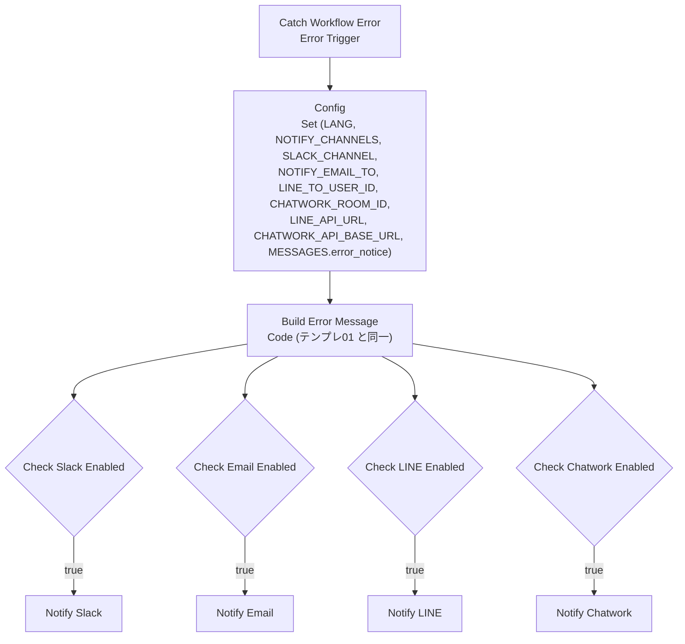

# テンプレ03 未入金リマインド — DESIGN.md

| 項目 | 値 |
|---|---|
| ワークフロー名 | `[Odaji] 03 Unpaid Invoice Reminder v1.0.0` |
| 同梱 | `workflow.json`（本体）、`error-handler.json`（Error Workflow、名称 `[Odaji] 03 Error Handler v1.0.0`） |
| 文書の版 | P1 設計版（2026-09-23）。P2 の実装・P3 のテストで実測値を追記する |
| 仕様の出典 | `CLAUDE.md` §1（絶対ルール）、§4（共通設計規約）、§5（共有 Google Sheets スキーマ：`invoices` の `remind_stage` / `last_reminded_at` / `promised_date` / `do_not_remind`、`reminders_log`）、§6（フェーズ）、「テンプレ03：未入金リマインド」、付録B（督促メール文面。原本は `shared/messages.ja.json` / `messages.en.json` の `reminder.stage0..3`、`draft_summary`、`escalated`） |
| 流用元 | テンプレ01 `DESIGN.md`（節構成・Config の方式・通知 4 系統・Error Workflow・D34）、`build/build_workflow.py`（Set v3.5 JSON 出力、`SOURCE = {{ $prevNode.name }}`、付箋のレイアウト）、`code/check_notification_results.js` / `build_error_message.js`（同一コードを流用）、`ASSUMPTIONS.md` A5・A11〜A15・A18〜A28・A35〜A39 |
| ノード資料 | n8n 公式ドキュメント（2026-09-23 取得。§2.3 の各行に出典）と n8n-mcp 2.87.0 `get_node`（`nodes-base.googleCalendar` 1.3、`nodes-base.gmail` 2.2、`nodes-base.googleSheets` 4.7、2026-09-23）。**`typeVersion` とパラメータ内部名は P2 で `validate_node` により再確認してから `workflow.json` に書く** |

この文書は「何を・なぜ・どう作るか」を固定するためのもの。ここに無い判断は末尾の「仕様判断 / Decisions」に追記し、`ASSUMPTIONS.md` へ転記する。英語の要約は末尾「EN summary」。

---

## 1. 目的・スコープ

**目的**：`invoices` シートの支払期限超過を毎朝（営業日のみ）チェックし、段階的に文面を強めた督促メールを **Gmail の下書き** として用意する。オーナーは下書きを確認して送るだけ。慣れたら `SEND_MODE=send` で自動送信に切り替える。テンプレ01 が入金を `paid` にすると自動的に止まる（`status` が `unpaid` / `partial` でなくなるため）。

**買い手**：テンプレ01 と同じ層（請求書払い・銀行振込のフリーランス・小規模 EC・BtoB 小規模事業者）。

**スコープに含む**
- トリガー：`Schedule Trigger` 毎日 `RUN_AT`（既定 10:00 JST）。営業日判定：土日（`SKIP_WEEKENDS`）と日本の祝日（Google Calendar ノードで `ja.japanese#holiday@group.v.calendar.google.com` を照会。失敗時・OFF 時は Config `HOLIDAYS` の静的リスト）。非営業日は何もしない
- ステージ判定：`STAGES`（stage 0 = 期限 3 日前の事前案内、既定 OFF／1 = +1 日／2 = +7 日／3 = +14 日、日数は変更可）。`promised_date`（未来日なら停止）、`do_not_remind`、`status ∈ {unpaid, partial}`、残額 = `amount − paid_amount`（`partial` は文面で残額を明示）
- 冪等：`(invoice_id, stage)` を `reminders_log` で先に照合し、既存なら送らない。加えて `invoices.remind_stage` より大きいステージだけを対象にする（二重防御）。同日 2 回実行しても 2 通目を作らない
- 送信モード：`draft`（既定）／`send`／`owner_only`（試運転）。同一顧客の複数請求は 1 通にまとめる（`GROUP_BY_CUSTOMER`、既定 ON）
- 記録：`reminders_log` へ追記、`invoices` の `remind_stage` / `last_reminded_at` を更新、stage 3 送付後は `status=escalated`
- オーナー通知：「本日の下書き N 件」（`draft_summary`）と stage 3 到達の個別通知（`escalated`）を Slack／Email／LINE／Chatwork（設定分のみ。テンプレ01 と同じ 4 系統・同じ Code）
- Error Workflow の同梱（テンプレ01 と同一構成、名称のみ変更）

**スコープに含まない**
- 入金の検知・消込（テンプレ01）。03 は `invoices` を読むだけで入金状態を変えない
- Gmail 以外の督促チャネル（`reminders_log.channel` は v1 では `gmail` 固定。`shared/sheets-schema.md`）
- JPY 以外の請求（`currency` が空または `JPY` 以外の行は対象外にして警告。テンプレ01 D28 と同じ約束）
- 「法的措置」等の具体的な法的手段の断言（付録B の注記。文面は原本のまま使う）
- 祝日カレンダーの内容の正しさの保証（Google の共有カレンダーをそのまま信頼する。組織で無効化されている場合は `USE_HOLIDAY_CALENDAR=false` ＋ `HOLIDAYS`）
- コミュニティノード、`Read/Write Files from Disk`（n8n Cloud 非対応）

---

## 2. ノード構成図

### 2.1 本体ワークフロー（Mermaid）

```mermaid
flowchart TD
  subgraph IN["入力 / Input  —  Sticky: 青 blue"]
    T1["Run Daily Check<br/>Schedule Trigger<br/>(daily, RUN_AT 10:00 JST)"]
  end

  subgraph CFGG["Config  —  黄 yellow"]
    CFG["Config<br/>Set (JSON output, include all input fields)<br/>+ SOURCE = $prevNode.name"]
    RRD["Resolve Run Date<br/>Code → 1 item { today, day_start_iso, day_end_iso, weekday, now_iso, today_source }<br/>(TZ, TODAY_OVERRIDE)"]
  end
  T1 --> CFG --> RRD

  subgraph BIZ["営業日判定 / Business-day check  —  黄 yellow"]
    IFH{"Check Holiday Calendar Enabled<br/>IF USE_HOLIDAY_CALENDAR is true"}
    GC["Fetch Holidays<br/>Google Calendar: Event Get Many<br/>calendar = HOLIDAY_CALENDAR_ID (By ID)<br/>After = day_start_iso, Before = day_end_iso<br/>Always Output Data, On Error: Continue (regular output)"]
    CBD["Check Business Day<br/>Code → 1 item { today, is_business_day, reason, holiday_name, holiday_source, warnings[] }"]
    IFB{"Check Is Business Day<br/>IF is_business_day is true"}
    SKIPB["Skip Non-Business Day<br/>NoOp"]
  end
  RRD --> IFH
  IFH -- "true" --> GC --> CBD
  IFH -- "false (static HOLIDAYS only)" --> CBD
  CBD --> IFB
  IFB -- "false" --> SKIPB

  subgraph RD["台帳読込 / Ledger read  —  青 blue"]
    RI["Read Invoices<br/>Google Sheets: Get Row(s)<br/>Execute Once + Always Output Data"]
    RL["Read Reminders Log<br/>Google Sheets: Get Row(s)<br/>Execute Once + Always Output Data"]
  end
  IFB -- "true" --> RI --> RL

  subgraph DEC["判定・文面 / Decision & copy  —  黄 yellow"]
    SDI["Select Due Invoices<br/>Code (run once) → 1 item { today, candidates[], skipped{}, warnings[] }<br/>仕様の判定ループそのまま"]
    GBC["Group By Customer<br/>Code → 1 item { today, groups[], skipped, warnings }<br/>key = (customer_id or customer_email, stage)"]
    BRE["Build Reminder Emails<br/>Code → N items { _kind: 'email', … } or 1 item { _kind: 'none' }<br/>MESSAGES[LANG].reminder.stage&lt;n&gt;, placeholders"]
    SW1{"Route by Send Mode<br/>Switch: _kind = none / SEND_MODE = draft / send / owner_only"}
  end
  RL --> SDI --> GBC --> BRE --> SW1

  subgraph OUT["出力 / Output  —  緑 green"]
    GD["Create Draft<br/>Gmail: Draft Create<br/>To/CC/BCC in Options, Email Type: Text<br/>Retry 3, On Error: Continue (regular output)"]
    GS["Send Reminder<br/>Gmail: Message Send<br/>Sender Name = SENDER_NAME, attribution OFF<br/>Retry OFF, On Error: Continue (regular output)"]
    MSR["Merge Send Results<br/>Merge: Append, Number of Inputs = 4"]
    CSR["Collect Send Results<br/>Code (run once) → items tagged _kind: invoice_update / log_row / summary"]
    SW2{"Route Results<br/>Switch on _kind"}
    UIS["Update Invoice Stage<br/>Google Sheets: Append or Update (invoice_id)<br/>remind_stage / last_reminded_at / status, Cell Format: Let n8n format"]
    RRL["Record Reminder Log<br/>Google Sheets: Append Row<br/>Cell Format: Let n8n format"]
    BON["Build Owner Notice<br/>Code → 1 + E items (draft_summary, escalated) or []"]
    IF1{"Check Slack Enabled"}
    IF2{"Check Email Enabled"}
    IF3{"Check LINE Enabled"}
    IF4{"Check Chatwork Enabled"}
    NS["Notify Slack<br/>On Error: Continue (using error output)"]
    NE["Notify Email<br/>On Error: Continue (using error output)"]
    NL["Notify LINE<br/>HTTP Request (Header Auth)"]
    NC["Notify Chatwork<br/>HTTP Request (Header Auth)"]
    MRG["Merge Notification Results<br/>Merge: Append, Number of Inputs = 8"]
    CHKN["Check Notification Results<br/>Code: 全て失敗のときだけ throw → Error Workflow（テンプレ01 と同一コード）"]
  end
  SW1 -- "0: none" --> MSR
  SW1 -- "1: draft" --> GD --> MSR
  SW1 -- "2: send" --> GS --> MSR
  SW1 -- "3: owner_only" --> MSR
  MSR --> CSR --> SW2
  SW2 -- "0: invoice_update" --> UIS
  SW2 -- "1: log_row" --> RRL
  SW2 -- "2: summary" --> BON
  BON --> IF1 -- "true" --> NS
  BON --> IF2 -- "true" --> NE
  BON --> IF3 -- "true" --> NL
  BON --> IF4 -- "true" --> NC
  NS -- "success / error" --> MRG
  NE -- "success / error" --> MRG
  NL -- "success / error" --> MRG
  NC -- "success / error" --> MRG
  MRG --> CHKN

  subgraph WARN["注意 / Caution  —  赤 red（Sticky のみ）"]
    N1["Sticky: 既定は draft。send に切り替える前に fixtures で試運転<br/>Sticky: 祝日カレンダーが使えない組織は USE_HOLIDAY_CALENDAR=false と HOLIDAYS<br/>Sticky: Fetch Holidays / Notify … は Credential を選ぶか無効化（Publish 時に検証される）<br/>Sticky: 行き違いの文言は stage1・2 の原本に含まれる。文面を変えるときは MESSAGES を編集"]
  end
```



実行順の前提：ワークフロー Settings は `executionOrder = v1`・`timezone = Asia/Tokyo`（テンプレ01 と同じ `SETTINGS`）。`Route Results` の出力は 0（`invoice_update`）→ 1（`log_row`）→ 2（`summary`）の順に配線し、**シート書込み（0, 1）が通知（2）より先に実行される**ことを P3 の実行ログで確認する（テンプレ01 §5-11 と同じ理由：通知が失敗しても台帳は正しい状態になり、再実行は全件 skip）。`Merge Send Results`（Append、4 入力）と `Merge Notification Results`（Append、8 入力）は、データが来ない入力があっても `executionOrder v1` では末尾で実行される（テンプレ01 A21 で実測済み。P2 で 4 入力版を再確認、§8.3）。

`Check Business Day` には `Check Holiday Calendar Enabled` の false 出力と `Fetch Holidays` の main 出力の **2 本が同じ入力に入る**が、1 回の実行でデータが届くのはどちらか一方だけなので Code ノードは 1 回だけ実行される（テンプレ01 `Collect Transactions` と同じ合流方式、D01）。`Fetch Holidays` を On Error = Continue (**regular output**) にしているのは、error 出力を使うと成功出力（Always Output Data の `{}`）と error 出力の 2 本からデータが届いて Code ノードが 2 回実行されうるため（D05）。

### 2.2 Error Workflow（`error-handler.json`）

テンプレ01 の `error-handler.json` と**同一構成**（Error Trigger → 自前の最小 `Config` → `Build Error Message` → `Check … Enabled` ×4 → `Notify …` ×4、Notify は On Error = Stop、Merge／Check は置かない）。差分はワークフロー名 `[Odaji] 03 Error Handler v1.0.0` と付箋 E1 の本文中の本体名だけ。`Build Error Message` の Code はテンプレ01 `code/build_error_message.js` と同一文字列（A15、`error_notice` の文面は `shared/messages.*.json` 共通）。



- 本体の Settings → **Error workflow** にこのワークフローを指定する（SETUP に手順）。Error Workflow 自身の Error workflow 設定は空（無限ループ防止）。
- Error Trigger は手動実行では発火しない（公式ドキュメント）。**Error Workflow 自身も有効化（Publish）されていなければ呼び出されない**（n8n 2.40.5 実測、A35）。
- **有効化時に n8n は接続済みの有効ノード全部の Credential を検証する**（A36）。買い手が使わないチャネルの `Notify …` は本体・Error Workflow の両方で無効化するか Credential を割り当てる。出荷時は 4 ノードとも有効のまま（テンプレ01 D34 を踏襲）。
- `error_notice` の本文には「シート書込みやメール送信が途中まで進んでいる可能性があるため、再実行前に台帳シートを確認」とあり、03 では **Gmail の下書き／送信済みも確認する**よう SETUP に補足する（§8.1）。

### 2.3 ノード一覧（型 ID・役割・主要設定）

`typeVersion` はテンプレ01 A18 で確認済みの値（scheduleTrigger 1.4、set 3.5、switch 3.4、if 2.3、noOp 1、code 2、googleSheets 4.7、slack 2.7、gmail 2.2、httpRequest 4.5、merge 3.2、stickyNote 1、errorTrigger 1）に、本テンプレで新規に使う googleCalendar 1.3（n8n-mcp `get_node`、2026-09-23）を加える。**P2 で `validate_node` により再確認**する。「主要設定」は公式ドキュメントの UI 名で書き、括弧内に n8n-mcp／ソースで確認した内部名を添える。

| # | ノード名 | type | 役割 | 主要設定（UI 名／内部名） | 出典 | Sticky |
|---|---|---|---|---|---|---|
| 1 | Run Daily Check | `n8n-nodes-base.scheduleTrigger` | 毎日 `RUN_AT` に起動 | Trigger Interval: Days、Days Between Triggers: 1、Trigger at Hour: 10、Trigger at Minute: 0（`rule.interval[0] = { field: days, daysInterval: 1, triggerAtHour: 10, triggerAtMinute: 0 }`）。時刻はワークフロー Settings の Timezone（`Asia/Tokyo`）で解釈される | Schedule Trigger doc「Days trigger interval」「Timezone settings」（https://docs.n8n.io/integrations/builtin/core-nodes/n8n-nodes-base.scheduletrigger.md）、A18 | 青 |
| 2 | Config | `n8n-nodes-base.set` | 全調整値。§4 の表 | Mode: JSON Output（`mode: raw`、`jsonOutput: "=<JSON>"`）、Include in Output: All Input Fields（`includeOtherFields: true`）、JSON に `"SOURCE": "{{ $prevNode.name }}"` | テンプレ01 §2.3 #4、A13／A19 | 黄 |
| 3 | Resolve Run Date | `n8n-nodes-base.code` | 「今日」を 1 か所で決める（`TZ`、`TODAY_OVERRIDE`）。後段の Calendar 照会範囲・日数計算・`sent_at` が全てここを参照する | Run Once for All Items（§6.2） | — | 黄 |
| 4 | Check Holiday Calendar Enabled | `n8n-nodes-base.if` | 祝日カレンダー照会の ON／OFF ゲート | Boolean → is true：`{{ $('Config').first().json.USE_HOLIDAY_CALENDAR }}`。true → #5、**false → #6 に直結**（#5 は実行されない） | If doc（https://docs.n8n.io/integrations/builtin/core-nodes/n8n-nodes-base.if.md）、テンプレ01 `if_channel` と同じ filter v3 | 黄 |
| 5 | Fetch Holidays | `n8n-nodes-base.googleCalendar` | 当日の祝日イベントを取得 | Resource: Event、Operation: **Get Many**（`resource: event`, `operation: getAll`）、Calendar: **By ID** `{{ $('Config').first().json.HOLIDAY_CALENDAR_ID }}`（`calendar: { __rl: true, mode: id, value }`。ID モードの正規表現は `local@domain` 形式を要求し、`#` を含む `ja.japanese#holiday@group.v.calendar.google.com` は許容される。ソースは `encodeURIComponentOnce` で URL エンコードして `/calendar/v3/calendars/{id}/events` を呼ぶ）、Return All: OFF、Limit: 50（`returnAll: false`, `limit: 50`）、**After**（`timeMin`、v1.3 では最上位パラメータ）= `{{ $('Resolve Run Date').first().json.day_start_iso }}`、**Before**（`timeMax`）= `{{ $('Resolve Run Date').first().json.day_end_iso }}`（どちらも `+09:00` 付き ISO 8601。ソース `addTimezoneToDate` はオフセット付きならそのまま送る）、Options → Recurring Event Handling: All Occurrences（既定 `expand` → `singleEvents=true`）、Timezone: 未指定（n8n／ワークフローの Timezone を使う）。Settings: **Always Output Data ON**（祝日なしの日は API が `items: []` を返し出力 0 件になるため）、Retry On Fail 3 回・2000ms、**On Error: Continue (regular output)**（`onError: continueRegularOutput`。失敗時は `{ error: "<message>" }` 1 件が main 出力に出て #6 が `HOLIDAYS` にフォールバック。ソース `catch` 節 `returnJsonArray({ error: error.message })`） | Google Calendar doc（https://docs.n8n.io/integrations/builtin/app-nodes/n8n-nodes-base.googlecalendar.md）、Event operations「Get Many」（…/n8n-nodes-base.googlecalendar/event-operations.md#get-many：Calendar By ID、Return All／Limit、After／Before、Options の Recurring Event Handling／Timezone）、n8n-mcp `get_node nodes-base.googleCalendar`（v1.3：`timeMin`/`timeMax` は `@version >= 1.3` で最上位、`options.recurringEventHandling` 既定 `expand`、credential `googleCalendarOAuth2Api` required）、`n8n-nodes-base/dist/nodes/Google/Calendar/GoogleCalendar.node.js`（`operation === 'getAll'` の分岐、2026-09-23） | 黄 |
| 6 | Check Business Day | `n8n-nodes-base.code` | 土日・祝日判定。#5 の出力（イベント／`{}`／`{ error }`／無効化ノードの素通り）と `HOLIDAYS` を合成して 1 アイテム | Run Once for All Items（§6.3） | — | 黄 |
| 7 | Check Is Business Day | `n8n-nodes-base.if` | 営業日なら続行 | Boolean → is true：`{{ $json.is_business_day }}`。false → #8 | If doc | 黄 |
| 8 | Skip Non-Business Day | `n8n-nodes-base.noOp` | 非営業日を正常終了させる（実行ログに残す） | — | テンプレ01 D21 と同じ方針 | 黄 |
| 9 | Read Invoices | `n8n-nodes-base.googleSheets` | `invoices` 全行 | Resource: Sheet Within Document、Operation: Get Row(s)（`operation: read`）、Document: By ID `{{ …SHEET_ID }}`、Sheet: By Name `{{ …SHEET_INVOICES }}`、Options → Output Formatting: Values (unformatted)／Date: Formatted Text（`outputFormatting.values = { general: UNFORMATTED_VALUE, date: FORMATTED_STRING }`）、Settings: **Execute Once ON、Always Output Data ON** | Google Sheets doc「Get Row(s)」（https://docs.n8n.io/integrations/builtin/app-nodes/n8n-nodes-base.googlesheets/sheet-operations.md#get-rows）、A23、テンプレ01 `sheets_read` | 青 |
| 10 | Read Reminders Log | `n8n-nodes-base.googleSheets` | `reminders_log` 全行（冪等キー `(invoice_id, stage)`） | 同上、Sheet: `SHEET_REMINDERS_LOG` | 同上 | 青 |
| 11 | Select Due Invoices | `n8n-nodes-base.code` | 仕様「判定ロジック」の唯一の置き場所。対象請求と target_stage を決める | Run Once for All Items（§6.4）。`$input.all()` = Read Reminders Log、`$('Read Invoices').all()`、`$('Resolve Run Date').first()`、`$('Check Business Day').first()` | — | 黄 |
| 12 | Group By Customer | `n8n-nodes-base.code` | `GROUP_BY_CUSTOMER` に従い (顧客, stage) でまとめる | Run Once for All Items（§6.5） | — | 黄 |
| 13 | Build Reminder Emails | `n8n-nodes-base.code` | `MESSAGES[LANG].reminder.stage<n>` にプレースホルダを埋め、メール 1 通 = 1 アイテム。`SEND_MODE` の検証もここ | Run Once for All Items（§6.6） | — | 黄 |
| 14 | Route by Send Mode | `n8n-nodes-base.switch` | `_kind: none` と `SEND_MODE` で 4 出力 | Mode: Rules。0: `{{ $json._kind }}` equals `none` → output `none`；1: `{{ $json._kind }}` equals `email` AND `{{ $('Config').first().json.SEND_MODE }}` equals `draft` → `draft`；2: 同 `send` → `send`；3: 同 `owner_only` → `owner_only`。Fallback Output: none（#13 が不正な `SEND_MODE` を throw 済み） | Switch doc（https://docs.n8n.io/integrations/builtin/core-nodes/n8n-nodes-base.switch.md）、A20 | 黄 |
| 15 | Create Draft | `n8n-nodes-base.gmail` | 顧客宛て下書き（`draft` モード） | Resource: Draft、Operation: Create（`resource: draft`, `operation: create`）、Subject: `{{ $json.subject }}`、Email Type: Text（`emailType: text`）、Message: `{{ $json.body }}`、Options → **To Email**（`options.sendTo`）: `{{ $json.to }}`、CC（`options.ccList`）: `{{ …CC }}`、BCC（`options.bccList`）: `{{ …BCC }}`（空文字なら送られない：ソース `if (options.ccList)`）。Draft Create には Sender Name／attribution のオプションが無い（差出人は Gmail アカウント本人。`fromAlias` は使わない）。戻り値は Gmail API の Draft リソース `{ id, message: { id, threadId, labelIds } }`（`POST /gmail/v1/users/me/drafts` の応答をそのまま返す）。Settings: Retry On Fail 3 回・2000ms（下書きの重複は無害で目に見える）、**On Error: Continue (regular output)**（失敗した通は `{ error }` アイテムとして同じ位置に残る。D08） | Gmail Draft operations doc「Create a draft」（https://docs.n8n.io/integrations/builtin/app-nodes/n8n-nodes-base.gmail/draft-operations.md#create-a-draft：Subject／Email Type／Message、Options の To Email／CC／BCC／Thread ID、API `users.drafts.create`）、n8n-mcp `get_node nodes-base.gmail`（v2.2：`options.sendTo` / `ccList` / `bccList` / `replyTo` / `fromAlias` / `threadId`、`emailType` 既定 `text`）、`Gmail/v2/GmailV2.node.js`（`resource === 'draft' && operation === 'create'`、2026-09-23） | 緑 |
| 16 | Send Reminder | `n8n-nodes-base.gmail` | 顧客宛て送信（`send` モード） | Resource: Message、Operation: Send（`operation: send`）、To: `{{ $json.to }}`（`sendTo`）、Subject: `{{ $json.subject }}`、Email Type: Text（`emailType: text`。v2.2 の既定は `html` なので明示）、Message: `{{ $json.body }}`、Options → Append n8n Attribution: OFF（`appendAttribution: false`）、CC／BCC: Config、**Sender Name**（`options.senderName`）: `{{ …SENDER_NAME }}`（空なら付けない。ソースは `users/me/profile` でアドレスを取り `Name <addr>` を From にする）。戻り値は Message リソース `{ id, threadId, labelIds }`（`POST /gmail/v1/users/me/messages/send`）。**`id` を `reminders_log.gmail_message_id` に記録**（U10）。Settings: **Retry On Fail OFF**（送信は冪等でないため、応答待ちのタイムアウト後の再試行で二重送信になりうる。D08）、On Error: Continue (regular output) | Gmail Message operations doc「Send a message」「Send options」（https://docs.n8n.io/integrations/builtin/app-nodes/n8n-nodes-base.gmail/message-operations.md#send-a-message：To／Subject／Email Type／Message、Options の Append n8n Attribution／BCC／CC／Sender Name／Send Replies To）、`GmailV2.node.js`（`operation === 'send'`、`senderName` → From、`appendAttribution` 既定 `nodeVersion >= 2.1`） | 緑 |
| 17 | Merge Send Results | `n8n-nodes-base.merge` | #14 の 4 出力（none／draft 結果／send 結果／owner_only のメールアイテム）を 1 つにまとめ、#18 を常に 1 回だけ実行させる | Mode: Append、Number of Inputs: 4（入力 1 = #14 output `none`、2 = #15 main、3 = #16 main、4 = #14 output `owner_only`） | Merge doc「Append」（https://docs.n8n.io/integrations/builtin/core-nodes/n8n-nodes-base.merge.md）、A21（データの来ない入力があっても v1 では末尾に実行） | 緑 |
| 18 | Collect Send Results | `n8n-nodes-base.code` | 送信結果とメールアイテムを突き合わせ、`invoice_update` / `log_row` / `summary` を生成（`owner_only` は書込み 0 件、`none` は summary のみ） | Run Once for All Items（§6.7）。`$input.all()` = Merge、`$('Build Reminder Emails').all()`、`$('Group By Customer').first()` | — | 緑 |
| 19 | Route Results | `n8n-nodes-base.switch` | `_kind` で 3 出力 | Rules: `{{ $json._kind }}` equals `invoice_update` / `log_row` / `summary`（出力 0/1/2）、Fallback: none | テンプレ01 #17 と同じ | 緑 |
| 20 | Update Invoice Stage | `n8n-nodes-base.googleSheets` | `invoices` の `remind_stage` / `last_reminded_at` / `status` を更新 | Operation: Append or Update Row（`appendOrUpdate`）、Column to Match On: `invoice_id`（`columns: { mappingMode: autoMapInputData, matchingColumns: ['invoice_id'] }`）、Options → Cell Format: **Let n8n format**（`cellFormat: RAW`）、Handling extra fields: Ignore Them（`handlingExtraData: ignoreIt`、`_kind` を落とす）。行のキーは常に `invoice_id / status / remind_stage / last_reminded_at` の 4 つ（アイテムごとにキー集合を変えない。D10）。Retry 3 回・2000ms、On Error: Stop | Google Sheets doc「Append or Update Row」（…/sheet-operations.md#append-or-update-row）、A23、テンプレ01 `sheets_upsert` | 緑 |
| 21 | Record Reminder Log | `n8n-nodes-base.googleSheets` | `reminders_log` へ 1 請求 1 行を追記（追記のみ） | Operation: **Append Row**（`operation: append`）、Mapping Column Mode: Map Automatically（`columns.mappingMode: autoMapInputData`）、Options → Cell Format: Let n8n format（`cellFormat: RAW`）、Handling extra fields: Ignore Them（`ignoreIt`）、Use Append: OFF（既定。`useAppend: false`。ON はシートに空行・欠けがあると位置がずれるとドキュメントに注記）。Retry 3 回・2000ms、On Error: Stop | Google Sheets doc「Append Row」（…/sheet-operations.md#append-row：Mapping Column Mode／Cell Format／Handling extra fields／Use Append）、n8n-mcp `get_node nodes-base.googleSheets`（4.7：`operation` に `append`、options `cellFormat` / `handlingExtraData` / `useAppend`）、`Sheet/v2/actions/sheet/append.operation.js` | 緑 |
| 22 | Build Owner Notice | `n8n-nodes-base.code` | `draft_summary`（1 件）＋ `escalated`（stage 3 到達ごとに 1 件）を通知アイテムに組む。通知不要なら `[]` | Run Once for All Items（§6.8） | — | 緑 |
| 23〜26 | Check Slack / Email / LINE / Chatwork Enabled | `n8n-nodes-base.if` | チャネル判定 | Array → contains：`{{ $('Config').first().json.NOTIFY_CHANNELS }}` contains `slack` 等。**テンプレ01 `if_channel` と同一** | テンプレ01 #21〜24 | 緑 |
| 27〜30 | Notify Slack / Email / LINE / Chatwork | slack 2.7 / gmail 2.2 / httpRequest 4.5 ×2 | オーナー通知 | **テンプレ01 #25〜28 と同一設定**（Slack: Blocks `{{ JSON.stringify({ blocks: $json.slack_blocks }) }}`、`includeLinkToWorkflow: false`；Email: `NOTIFY_EMAIL_TO`、`appendAttribution: false`；LINE: `LINE_API_URL` に `{ to, messages: [{ type: text, text: $json.line_text }] }`、Header Auth Credential `LINE Messaging API`；Chatwork: `CHATWORK_API_BASE_URL/rooms/{id}/messages`、`body=$json.chatwork_text`、Header Auth Credential `Chatwork API`）。Retry 3 回・2000ms、On Error: Continue (using error output)。**アイテムが複数（サマリ＋escalated 通知）のときはアイテムごとに 1 通** | テンプレ01 §2.3、A24〜A26、A28、A32 | 緑 |
| 31 | Merge Notification Results | `n8n-nodes-base.merge` | 4 Notify の成功出力＋error 出力（計 8 本） | Mode: Append、Number of Inputs: 8 | テンプレ01 #29 | 緑 |
| 32 | Check Notification Results | `n8n-nodes-base.code` | 試行した通知が**全て**失敗したときだけ `throw` → Error Workflow。無効化ノードの素通りも失敗に数える（D34） | Run Once for All Items。**`code/check_notification_results.js` はテンプレ01 と同一文字列**（§6.10） | テンプレ01 §6.10、A38 | 緑 |
| 33〜 | Sticky Note ×9 | `n8n-nodes-base.stickyNote` | 日英併記の説明 | §2.4 | A14 | — |
| E1〜 | Catch Workflow Error、Config、Build Error Message、Check … Enabled ×4、Notify … ×4 | テンプレ01 E1〜E4 と同一 | Error Workflow | 本体と同一設定。Notify は On Error = Stop | テンプレ01 §2.2 | |

`Fetch Holidays` の Credential（`googleCalendarOAuth2Api`）と `Create Draft` / `Send Reminder` / `Notify Email` の Credential（`gmailOAuth2`）は買い手が SETUP に従って各ノードで選ぶ。販売物の JSON には `credentials` ブロックを置かない（§1-2、テンプレ01 `check()` のアサートを流用）。

**Credential 未設定ノードの扱い（テンプレ01 D34 の拡張、D06）**：`Fetch Holidays` は `USE_HOLIDAY_CALENDAR=false` でも Publish 時に Credential を検証される（A36：無効化したノードだけが検証対象外）。祝日カレンダーを使わない買い手は **`USE_HOLIDAY_CALENDAR=false` にしたうえで `Fetch Holidays` を無効化（右クリック → Deactivate）するか、Google Calendar の Credential を選ぶ**。false のときは IF が #5 を素通しせず false 出力から #6 に直結するので、無効化しても実行経路には影響しない。逆に **`USE_HOLIDAY_CALENDAR=true` のまま `Fetch Holidays` を無効化**すると、無効化ノードは入力（`Resolve Run Date` のアイテム）をそのまま通す（A36）。`Check Business Day` はこの素通り（イベントの形でも `{ error }` でもなく `today` / `day_start_iso` を持つ）を検知して `HOLIDAYS` にフォールバックし、警告 `holiday_calendar_unavailable (node disabled or not executed)` をオーナー通知に出す。同様に `SEND_MODE=owner_only` で `Create Draft` / `Send Reminder` を無効化してもよい（その出力にはメールアイテムが流れない）が、`SEND_MODE=draft` のまま `Create Draft` を無効化するとメールアイテムが素通りして #18 に届く。#18 はこれを「Gmail 応答（`id` / `message` / `error`）を持たない」として検知し、**台帳を書かず**に失敗扱いにする（`draft_node_disabled_or_not_executed`。D06）。

### 2.4 Sticky Note グループと色

| Sticky | 色 | 覆うノード | 内容（## JA → ## EN の順） |
|---|---|---|---|
| S1 入力 | 青 | 1 | 毎日 `RUN_AT` に起動。**時刻はこのノードに入れる**（Config の `RUN_AT` は参照用。トリガーは Config を参照できない、テンプレ01 D04）。営業日判定は次のグループで行うので、土日祝もトリガー自体は発火して `Skip Non-Business Day` で終わる |
| S2 Config | 黄 | 2〜3 | 概要（買い手が触るのは Config と S1 の 1 ノードだけ）、`TODAY_OVERRIDE` はテスト用で本番は空、`SEND_MODE` の既定が `draft` である理由。§4 の表は下段の黄色い付箋 2 枚「Config キー一覧（1/2）（2/2）」に分けて載せる |
| S3 営業日判定 | 黄 | 4〜8 | `SKIP_WEEKENDS`、`USE_HOLIDAY_CALENDAR`（Google の共有カレンダー `ja.japanese#holiday@…`。組織で無効化されている場合は false にして `HOLIDAYS` を保守）、失敗時・素通り時のフォールバックと警告、`HOLIDAYS` は年末年始など自社の休業日にも使える（合成）、`Fetch Holidays` の Credential／無効化の規則（D06） |
| S4 台帳読込 | 青 | 9〜10 | `Read Invoices` / `Read Reminders Log`（Execute Once、Always Output Data）。`reminders_log` は追記専用で `(invoice_id, stage)` が冪等キー。`invoices` の `remind_stage` が二重防御 |
| S5 判定・文面 | 黄 | 11〜14 | ステージ表（0〜3、既定の日数、stage 0 は既定 OFF）、対象条件（`unpaid` / `partial`、`do_not_remind`、`promised_date` 未来日、JPY のみ、メール未登録は警告）、残額、`GROUP_BY_CUSTOMER`（同一顧客・同一 stage で 1 通）、`new_deadline` / `final_deadline` の計算、`SEND_MODE` 3 種と `owner_only` は何も書かないこと、文面は `MESSAGES` を編集（付録B が原本、行き違いの文言は stage1・2 に必ず残す） |
| S6 出力 | 緑 | 15〜32 | Gmail 2 ノードの Credential、`send` の Retry OFF の理由、`Merge Send Results` → `Collect Send Results` の役割、書込み順（`invoices` → `reminders_log` → 通知）、`reminders_log` の `gmail_message_id`、オーナー通知 4 系統（テンプレ01 と同じ Credential 名・同じ規則：使わないチャネルは無効化して `NOTIFY_CHANNELS` から外す） |
| S7 注意 | 赤 | （下段、ノードは覆わない） | 既定を `draft` にした理由（トーンを間違えると顧客を失う）、`send` に切り替える前に `owner_only` → `draft` の順で試運転、祝日カレンダーが使えない組織の手順、Error Workflow の設定手順（Publish 必須、A35）、`invoices.customer_email` が空の請求は督促されず警告に出る、01 と 03 の実行時刻をずらす（09:00 → 10:00）理由 |
| S2K1 / S2K2 | 黄 | （下段） | §4 の Config キー表を 2 枚に分けて掲載（テンプレ01 と同じ `config_keys_text(part)` 方式） |

n8n の Sticky Note `color` 番号は A14（1 = 黄、3 = 赤、4 = 緑、5 = 青）。付箋のサイズは `build_workflow.py` の `TEXT_SIZE` 方式（本文の実測高さ）で決め、P4 で Playwright により重なり・切れを確認する。

### 2.5 ノード Settings の要点

| ノード | Execute Once | Always Output Data | Retry On Fail | On Error |
|---|---|---|---|---|
| Fetch Holidays | OFF（入力は 1 アイテムなので 1 回） | **ON**（祝日なしの日は出力 0 件になり後段が止まるため。`{}` 1 件が流れ、Code が読み飛ばす） | 3 回・2000ms | **Continue (regular output)**（`{ error }` を main に出してフォールバック。error 出力は使わない、D05） |
| Read Invoices / Read Reminders Log | ON | ON（空シートでも後段を止めない） | 3 回・2000ms | Stop |
| Create Draft | OFF（メール 1 通 = 1 アイテム） | OFF | 3 回・2000ms | Continue (regular output)（失敗した通だけ `{ error }`。他の通は作られる） |
| Send Reminder | OFF | OFF | **OFF**（二重送信防止、D08） | Continue (regular output) |
| Merge Send Results / Merge Notification Results | — | OFF | なし | Stop |
| Update Invoice Stage / Record Reminder Log | OFF（全アイテム処理） | OFF | 3 回・2000ms | Stop（副作用があるので Continue にしない）。Cell Format: Let n8n format |
| Notify Slack / Email / LINE / Chatwork | OFF | OFF | 3 回・2000ms | Continue (using error output)。テンプレ01 と同一 |
| Check Notification Results | — | OFF | なし | Stop（全て失敗のときだけ自ら throw） |
| Code ノード（上記以外） | — | OFF | なし | Stop（バグ・Config の誤りは大声で失敗させる） |
| Check Holiday Calendar Enabled → false | — | — | — | `Check Business Day` に直結（Calendar ノードは実行されない） |
| Check Is Business Day → false | — | — | — | NoOp（Skip Non-Business Day）で正常終了 |

---

## 3. データフロー（ノード間のアイテム形状）

以下の JSON は設計時点の想定。**Google Calendar／Gmail／Google Sheets の実出力は P2 で 1 回実行して確認し、差分があればこの節を更新する**（Google Credential が無い間は pinned data。A5／A11）。

### 3.1 トリガー → Config → Resolve Run Date

Schedule Trigger の 1 アイテム（テンプレ01 §3.1 と同じ）：
```json
{ "timestamp": "2026-10-01T10:00:00.000+09:00", "Readable date": "…", "Day of week": "Thursday", "…": "…" }
```
Config 通過後（トリガーの全フィールド + Config キー + `SOURCE`）：
```json
{ "timestamp": "2026-10-01T10:00:00.000+09:00", "…": "…", "SOURCE": "Run Daily Check", "TZ": "Asia/Tokyo", "LANG": "ja",
  "SHEET_ID": "REPLACE_ME_SHEET_ID", "STAGES": [ { "stage": 0, "offset_days": -3, "enabled": false }, "…" ], "SEND_MODE": "draft", "TODAY_OVERRIDE": "", "…": "…" }
```
Resolve Run Date 出力（常に 1 アイテム。**「今日」を決める唯一の場所**、D02）：
```json
{ "today": "2026-10-01", "weekday": 4, "day_start_iso": "2026-10-01T00:00:00.000+09:00", "day_end_iso": "2026-10-01T23:59:59.999+09:00",
  "now_iso": "2026-10-01T10:00:03+09:00", "today_source": "clock" }
```
`TODAY_OVERRIDE = "2026-09-21"` のときは `today = "2026-09-21"`、`today_source = "override"`、`now_iso = "2026-09-21T10:00:03+09:00"`（日付は上書き、時刻は実時刻）。

### 3.2 Fetch Holidays → Check Business Day

Google Calendar Event Get Many の 1 イベント 1 アイテム（想定。v1.3 は `id, summary, start, end, …` の順にキーを並べ替える。祝日カレンダーのイベントは終日なので `start.date` / `end.date`）：
```json
{ "id": "20260921_…", "summary": "敬老の日", "start": { "date": "2026-09-21" }, "end": { "date": "2026-09-22" }, "status": "confirmed",
  "kind": "calendar#event", "htmlLink": "…", "created": "…", "updated": "…", "creator": { "…": "…" }, "organizer": { "…": "…" }, "transparency": "transparent", "visibility": "public" }
```
祝日が無い日：API は `items: []` を返し出力 0 件 → Always Output Data により `{}` 1 件。API 失敗：`{ "error": "<message>" }` 1 件（On Error = Continue (regular output)）。`USE_HOLIDAY_CALENDAR=false`：IF の false 出力から Resolve Run Date のアイテムがそのまま届く。`USE_HOLIDAY_CALENDAR=true` かつノード無効化：同じく Resolve Run Date のアイテムが素通りで届く（Code は `today` / `day_start_iso` キーで検知）。

Check Business Day 出力（常に 1 アイテム）：
```json
{ "today": "2026-09-21", "is_business_day": false, "reason": "holiday", "holiday_name": "敬老の日", "holiday_source": "calendar", "warnings": [] }
```
`reason` は `business` / `weekend` / `holiday`。`holiday_source` は `calendar`（Google Calendar のイベントに一致）/ `static`（`HOLIDAYS` に一致）/ `none`。`warnings[]` にはフォールバックの理由 `{ type: "holiday_calendar_unavailable", detail: "<error message>" | "node disabled or not executed" }` が入り、そのまま Select Due Invoices → summary → オーナー通知の「警告」に載る。

### 3.3 Read Invoices / Read Reminders Log

Google Sheets Get Row(s) は 1 行 1 アイテム（見出し行は返らない。数値は number、空セルは `""`、日付は表示文字列）。`Always Output Data` により空シートは `{}` 1 件：
```json
{ "invoice_id": "INV-2026-101", "customer_id": "C-101", "customer_name": "株式会社サンプル商事", "payer_name_alias": "カ)サンプルシヨウジ", "customer_email": "keiri@example.jp",
  "amount": 33000, "currency": "JPY", "issue_date": "2026-09-01", "due_date": "2026-09-30", "status": "unpaid", "paid_amount": 0, "paid_date": "", "matched_txn_ids": "",
  "match_confidence": "", "fee_deducted": "", "remind_stage": 0, "last_reminded_at": "", "promised_date": "", "do_not_remind": "", "notes": "" }
```
```json
{ "invoice_id": "INV-2026-104", "stage": 1, "mode": "draft", "channel": "gmail", "to": "ap@example.com", "subject": "お支払いのご確認のお願い（請求書番号 INV-2026-104）",
  "sent_at": "2026-09-25T10:00:08+09:00", "gmail_message_id": "18f2a9c4b7e6d301" }
```
`do_not_remind` はチェックボックス列なら boolean `true`、テキスト列なら `"TRUE"` で届く。Code は両方を真とみなす（§6.1 `isTrue`）。

### 3.4 Select Due Invoices 出力（常に 1 アイテム）

```json
{ "today": "2026-10-01", "now_iso": "2026-10-01T10:00:03+09:00",
  "candidates": [
    { "invoice_id": "INV-2026-102", "customer_id": "C-102", "customer_name": "テスト工業有限会社", "customer_email": "ap@example.com", "amount": 55000, "paid_amount": 0,
      "remaining": 55000, "status": "unpaid", "due_date": "2026-09-30", "days_overdue": 1, "remind_stage": 0, "target_stage": 1 },
    { "invoice_id": "INV-2026-105", "customer_id": "C-105", "customer_name": "サンプルシステム株式会社", "customer_email": "billing@example.jp", "amount": 250000, "paid_amount": 100000,
      "remaining": 150000, "status": "partial", "due_date": "2026-09-17", "days_overdue": 14, "remind_stage": 2, "target_stage": 3 }
  ],
  "skipped": { "not_open": 3, "do_not_remind": 1, "promised_future": 1, "no_stage_due": 2, "already_at_stage": 1, "already_logged": 0, "non_jpy": 1, "missing_email": 1, "bad_due_date": 0 },
  "warnings": [ { "type": "non_jpy_invoice", "invoice_id": "INV-2026-110", "currency": "USD" }, { "type": "missing_email", "invoice_id": "INV-2026-111" } ] }
```
`warnings` には Check Business Day の警告（`holiday_calendar_unavailable`）も引き継ぐ。

### 3.5 Group By Customer 出力（常に 1 アイテム）

```json
{ "today": "2026-10-01", "now_iso": "…", "skipped": { "…": "…" }, "warnings": [ "…" ],
  "groups": [
    { "group_key": "C-102|1", "customer_key": "C-102", "stage": 1, "customer_name": "テスト工業有限会社", "to": "ap@example.com",
      "invoices": [ { "invoice_id": "INV-2026-102", "remaining": 55000, "amount": 55000, "due_date": "2026-09-30", "days_overdue": 1, "status": "unpaid", "remind_stage": 0 } ] },
    { "group_key": "C-108|2", "customer_key": "C-108", "stage": 2, "customer_name": "株式会社テスト物産", "to": "keiri@example.jp",
      "invoices": [ { "invoice_id": "INV-2026-108", "…": "…" }, { "invoice_id": "INV-2026-109", "…": "…" } ] }
  ] }
```
`GROUP_BY_CUSTOMER=false` のときは `group_key = "<invoice_id>|<stage>"` で 1 請求 1 グループ。同じ `customer_key` でも stage が違えば別グループ（D03）。

### 3.6 Build Reminder Emails 出力（メール 1 通 = 1 アイテム。0 通なら `_kind: none` 1 件）

```json
{ "_kind": "email", "group_key": "C-108|2", "customer_key": "C-108", "stage": 2, "customer_name": "株式会社テスト物産", "to": "keiri@example.jp",
  "subject": "【再送】お支払いのお願い（請求書番号 INV-2026-108、INV-2026-109）",
  "body": "株式会社テスト物産 様\n\nいつもお世話になっております。…\n恐れ入りますが、2026-10-08までにお振込みいただけますようお願い申し上げます。\n\n・請求書番号：INV-2026-108\n・ご請求金額：¥700,000\n・お支払期限：2026-09-24（超過）\n\n・請求書番号：INV-2026-109\n・ご請求金額：¥534,567\n・お支払期限：2026-09-24（超過）\n\n・お振込先：サンプル銀行 本店 普通 1234567 カ）サンプル\n\n既にお手続き済みの場合は…\n\n{signature の内容}",
  "new_deadline": "2026-10-08", "final_deadline": "",
  "invoices": [ { "invoice_id": "INV-2026-108", "remaining": 700000, "due_date": "2026-09-24", "days_overdue": 7, "status": "unpaid" }, { "invoice_id": "INV-2026-109", "…": "…" } ] }
```
```json
{ "_kind": "none", "today": "2026-10-01" }
```

### 3.7 Gmail 出力 → Merge Send Results → Collect Send Results

`Create Draft` の 1 アイテム（Gmail API Draft リソース、想定。`gmail_message_id` には **`message.id`** を記録する。`shared/sheets-schema.md`「`draft` のときは下書きのメッセージ ID」）：
```json
{ "id": "r-1234567890123456789", "message": { "id": "18f2a9c4b7e6d301", "threadId": "18f2a9c4b7e6d301", "labelIds": [ "DRAFT" ] } }
```
`Send Reminder` の 1 アイテム（Message リソース。`gmail_message_id` には **`id`**）：
```json
{ "id": "18f5c2e6d9a8f503", "threadId": "18f5c2e6d9a8f503", "labelIds": [ "SENT" ] }
```
失敗した通（On Error = Continue (regular output)）：`{ "error": "Invalid email address" }`（Gmail v2 のソースは `{ json: { error: error.message } }`、A21）。**出力順は入力順**（ソースは `for (let i …)` で順に push し、失敗時も同じ位置に `{ error }` を push）。Merge Send Results（Append）を通ると、入力 1（none）→ 2（draft 結果）→ 3（send 結果）→ 4（owner_only のメールアイテム）の順に並ぶが、1 回の実行で中身が来るのは 1 本だけ。

Collect Send Results 出力（3 種、`_kind` で識別）：
```json
{ "_kind": "invoice_update", "invoice_id": "INV-2026-108", "status": "unpaid", "remind_stage": 2, "last_reminded_at": "2026-10-01T10:00:03+09:00" }
```
```json
{ "_kind": "log_row", "invoice_id": "INV-2026-108", "stage": 2, "mode": "draft", "channel": "gmail", "to": "keiri@example.jp",
  "subject": "【再送】お支払いのお願い（請求書番号 INV-2026-108、INV-2026-109）", "sent_at": "2026-10-01T10:00:03+09:00", "gmail_message_id": "18f2a9c4b7e6d301" }
```
```json
{ "_kind": "summary", "date": "2026-10-01", "mode": "draft", "n": 2, "emails_ok": 2, "emails_failed": 0,
  "items": [ { "customer_name": "テスト工業有限会社", "invoice_id": "INV-2026-102", "remaining": 55000, "stage": 1, "to": "ap@example.com", "ok": true },
             { "customer_name": "株式会社テスト物産", "invoice_id": "INV-2026-108", "remaining": 700000, "stage": 2, "to": "keiri@example.jp", "ok": true } ],
  "failed": [ { "group_key": "…", "to": "…", "invoice_ids": [ "…" ], "error": "…" } ],
  "escalated": [ { "invoice_id": "INV-2026-105", "customer_name": "サンプルシステム株式会社", "remaining": 150000, "due_date": "2026-09-17", "days_overdue": 14, "final_deadline": "2026-10-08" } ],
  "skipped": { "…": "…" }, "warnings": [ "…" ] }
```
`invoice_update` は請求 1 件につき 1 アイテム（同一実行で同じ請求に 2 回書かない。stage 3 のものは `status: "escalated"`）。`log_row` は請求ごとに 1 行で、同じメールに含まれた請求は同じ `gmail_message_id` を共有する（`shared/sheets-schema.md`）。`owner_only` では `invoice_update` / `log_row` を出さず、`summary.mode = "owner_only"`、`items[].ok = true`（「送るはずだった一覧」）。`none` では `n = 0` の summary のみ。

### 3.8 Build Owner Notice 出力

```json
{ "title": "【未入金リマインド 2026-10-01】本日の下書き 2 件",
  "body_text": "【未入金リマインド 2026-10-01】本日の下書き 2 件\n\n・テスト工業有限会社｜INV-2026-102｜¥55,000｜stage 1\n・株式会社テスト物産｜INV-2026-108｜¥700,000｜stage 2\n\n■ 警告\n・non_jpy_invoice INV-2026-110 USD",
  "slack_blocks": [ { "type": "header", "text": { "type": "plain_text", "text": "【未入金リマインド 2026-10-01】本日の下書き 2 件" } }, { "type": "section", "text": { "type": "mrkdwn", "text": "・テスト工業有限会社｜…" } } ],
  "line_text": "…", "chatwork_text": "…" }
```
stage 3 到達 1 件につき、さらに 1 アイテム（`escalated.title` / `escalated.body`）：
```json
{ "title": "【未入金リマインド】請求書 INV-2026-105 が最終段階（stage 3）に到達しました",
  "body_text": "請求書番号：INV-2026-105\n顧客：サンプルシステム株式会社\n残額：¥150,000\nお支払期限：2026-09-17（14日超過）\n最終通知に記載した期限：2026-10-08\n状態：escalated（以後の自動督促は停止します）\n\n入金の再確認、…", "slack_blocks": [ "…" ], "line_text": "…", "chatwork_text": "…" }
```
通知不要（`n = 0` かつ `failed` / `escalated` / `warnings` が空）のときは `[]` を返し、Check … Enabled 以降は実行されない（D12）。

---

## 4. Config キー一覧

Set ノード `Config` の JSON。**買い手は `REPLACE_ME_` を置き換える。** 型は JSON の型。「意味」は Sticky S2K1／S2K2 にも載せる。通知 7 キー（`NOTIFY_CHANNELS` 〜 `CHATWORK_API_BASE_URL`）と `NOTIFY_MAX_LINES`、`TZ`、`LANG`、`SHEET_ID`、`SHEET_INVOICES`、`SOURCE` はテンプレ01 と**同じ名前・同じ意味**（買い手が 2 テンプレを併用するときに同じ値を写せる）。

| キー | 型 | 既定値 | 意味（JA） | Meaning (EN) |
|---|---|---|---|---|
| `TZ` | string | `"Asia/Tokyo"` | 「今日」の判定、日数計算、`sent_at` / `last_reminded_at` のタイムゾーン。ワークフロー Settings の Timezone とも一致させる | Time zone for "today", day counts and timestamps; keep equal to the workflow Timezone setting |
| `LANG` | string | `"ja"` | 督促メールとオーナー通知の言語 `ja` / `en` | Language of reminder emails and owner notices |
| `SHEET_ID` | string | `"REPLACE_ME_SHEET_ID"` | スプレッドシートの ID（URL の `/d/<ID>/`）。テンプレ01 と同じシート | Spreadsheet ID from the URL (same spreadsheet as Template 01) |
| `SHEET_INVOICES` | string | `"invoices"` | 請求一覧のシート名 | Sheet name for invoices |
| `SHEET_REMINDERS_LOG` | string | `"reminders_log"` | 督促ログのシート名（追記のみ） | Sheet name for the append-only reminder log |
| `RUN_AT` | string | `"10:00"` | 実行時刻（JST）。**参照用。実値は `Run Daily Check` ノードに入れる**（トリガーは Config を参照できない）。テンプレ01 の再突合（09:00）より後にして、当日の入金反映後に督促する | Daily run time (JST), documented mirror: the Schedule node holds the live value. Later than Template 01's 09:00 re-match so today's payments are reflected first |
| `SKIP_WEEKENDS` | bool | `true` | 土日は何もしない | Do nothing on Saturday / Sunday |
| `USE_HOLIDAY_CALENDAR` | bool | `true` | Google Calendar の日本の祝日カレンダーを照会する。false のとき `Fetch Holidays` は実行されず `HOLIDAYS` だけで判定（そのときは `Fetch Holidays` ノードを無効化するか Credential を選ぶ。D06） | Query Google's Japanese holiday calendar. When false the `Fetch Holidays` node does not run and only `HOLIDAYS` applies (then deactivate that node or assign a credential, D06) |
| `HOLIDAY_CALENDAR_ID` | string | `"ja.japanese#holiday@group.v.calendar.google.com"` | 祝日カレンダーの ID。他国は `en.usa#holiday@group.v.calendar.google.com` 等 | Holiday calendar ID (other countries: e.g. `en.usa#holiday@group.v.calendar.google.com`) |
| `HOLIDAYS` | array\<string\> | 下記（`yyyy-MM-dd`） | 静的な休業日リスト。カレンダー照会の失敗時・OFF 時のフォールバックであり、**カレンダーが使えるときも合成される**（年末年始など自社の休業日を追加できる。D04）。既定は同梱時点の年（2026）の日本の祝日（内閣府の CSV と照合済み、2026-09-23。§4 末尾） | Static non-working days. Fallback when the calendar is off or fails, and **also merged when the calendar works** (add company closures such as year-end). Default: the 2026 Japanese public holidays (verified against the Cabinet Office CSV on 2026-09-23) |
| `STAGES` | array\<object\> | `[{ "stage": 0, "offset_days": -3, "enabled": false }, { "stage": 1, "offset_days": 1, "enabled": true }, { "stage": 2, "offset_days": 7, "enabled": true }, { "stage": 3, "offset_days": 14, "enabled": true }]` | ステージ表。`offset_days` は `due_date` からの日数（負は期限前）。`enabled: false` のステージは飛ばす。**stage 0 は既定 OFF**（事前案内を送りたい買い手だけ ON）。並びは stage 昇順、`offset_days` は昇順であること（Code が検証して不正なら失敗） | Stage table: `offset_days` relative to `due_date` (negative = before). Disabled stages are skipped; **stage 0 is off by default**. Must be sorted by stage with ascending offsets (validated) |
| `STAGE2_NEW_DEADLINE_DAYS` | int | `7` | stage 2 文面の `{new_deadline}` = 実行日 + この日数（`yyyy-MM-dd`） | `{new_deadline}` in the stage 2 copy = run date + this many days |
| `STAGE3_FINAL_DEADLINE_DAYS` | int | `7` | stage 3 文面の `{final_deadline}` = 実行日 + この日数。`escalated` 通知にも載る | `{final_deadline}` in the stage 3 copy and the `escalated` notice = run date + this many days |
| `SEND_MODE` | string | `"draft"` | `draft`：Gmail に下書きを作りオーナーに一覧通知／`send`：顧客へ送信し `gmail_message_id` を記録／`owner_only`：顧客には何もせず、オーナーに「送るはずだった一覧」だけ通知（**シートにも書かない**、試運転用。D07）。それ以外は実行失敗 | `draft`: create Gmail drafts and notify the owner / `send`: send to customers and record `gmail_message_id` / `owner_only`: touch nothing (no sheets either) and only list what would be sent (trial, D07). Anything else fails the run |
| `GROUP_BY_CUSTOMER` | bool | `true` | 同一顧客（`customer_id`、空なら `customer_email`）で同じステージの請求を 1 通にまとめる。ステージが違えば別の通（D03） | Combine invoices of one customer (`customer_id`, falling back to `customer_email`) at the same stage into one email; different stages stay separate (D03) |
| `SENDER_NAME` | string | `"REPLACE_ME_SENDER_NAME"` | 文面の `{sender_name}`（担当者名）。`send` モードでは Gmail の Sender Name にも使う（下書きには付かない：Draft Create に該当オプションが無い） | `{sender_name}` in the copy; in `send` mode also Gmail's Sender Name (drafts have no such option) |
| `COMPANY` | string | `"REPLACE_ME_COMPANY"` | 文面の `{company}` | `{company}` in the copy |
| `SIGNATURE` | string | `"REPLACE_ME_SIGNATURE"` | 文面末尾の `{signature}`（複数行可。`\n` で改行） | `{signature}` at the end of the copy (multi-line with `\n`) |
| `BANK_DETAILS` | string | `"REPLACE_ME_BANK_DETAILS"` | 文面の `{bank_details}`（振込先。stage 0・2・3 に載る） | `{bank_details}` (stages 0, 2, 3) |
| `CC` | string | `""` | 顧客宛てメールの CC（カンマ区切り可）。空なら付けない | CC for customer emails (comma-separated). Empty = none |
| `BCC` | string | `""` | 同 BCC（自社の控え用に推奨） | BCC (recommended for your own copy). Empty = none |
| `NOTIFY_CHANNELS` | array\<string\> | `["slack"]` | オーナー通知のチャネル `slack` / `email` / `line` / `chatwork` の組合せ。空なら通知しない | Owner-notice channels; empty = no notification |
| `SLACK_CHANNEL` | string | `"REPLACE_ME_SLACK_CHANNEL_ID"` | 投稿先チャンネル ID または `#name` | Slack channel |
| `NOTIFY_EMAIL_TO` | string | `"replace-me@example.com"` | オーナー通知メールの宛先 | Owner-notice email recipient |
| `LINE_TO_USER_ID` | string | `"REPLACE_ME_LINE_USER_ID"` | LINE push の宛先 userId | LINE recipient userId |
| `CHATWORK_ROOM_ID` | string | `"REPLACE_ME_CHATWORK_ROOM_ID"` | Chatwork のルーム ID | Chatwork room ID |
| `LINE_API_URL` | string | `"https://api.line.me/v2/bot/message/push"` | LINE Messaging API push の URL。プロキシ経由にする場合以外は変更しない | LINE push URL; do not change unless you proxy the API |
| `CHATWORK_API_BASE_URL` | string | `"https://api.chatwork.com/v2"` | Chatwork API のベース URL | Chatwork API base URL |
| `NOTIFY_MAX_LINES` | int | `40` | オーナー通知の明細の上限行数。超過分は「…他 N 件」（`recon_summary.more_items` の文言を流用しないため、03 では `MESSAGES` に無い場合は `…+N` を出す。D13） | Max detail lines in the owner notice |
| `TODAY_OVERRIDE` | string | `""` | **テスト・試運転専用。** `yyyy-MM-dd` を入れると「今日」をその日付に固定する（営業日判定・祝日照会の範囲・日数計算・`sent_at` の日付部分に効く）。**本番は必ず空**。空以外なら オーナー通知の先頭に `TODAY_OVERRIDE=<date>` を明記して事故を防ぐ | **Test / trial only.** A `yyyy-MM-dd` value pins "today" (business-day check, holiday query range, day counts, the date part of `sent_at`). **Leave empty in production**; when set, the owner notice starts with `TODAY_OVERRIDE=<date>` |
| `MESSAGES` | object | `shared/messages.*.json` から `reminder`（`stage0`〜`stage3` の `subject` / `body`）、`draft_summary`、`escalated`、`error_notice` を `{ "ja": {...}, "en": {...} }` で埋め込み | 督促文面とオーナー通知。`LANG` で選ぶ。文言を変えるときはここを編集（付録B が原本。stage1・2 の「行き違い」の文言は残す） | Reminder copy and owner notices, selected by `LANG`; edit here to change wording (Appendix B is the source; keep the "crossed in the mail" sentence in stages 1–2) |
| `SOURCE` | string | `"{{ $prevNode.name }}"` | 自動設定（発火したトリガー名）。**変更しない** | Set automatically; do not change |

**Config に入れないもの**：Google（Sheets／Calendar／Gmail）の OAuth、Slack トークン、LINE の channel access token、Chatwork API トークン。これらは n8n の **Credential** に置き、ノードからは名前で参照する（§1-2。LINE は Header Auth Credential `LINE Messaging API`、Chatwork は `Chatwork API`。テンプレ01 D06）。

`HOLIDAYS` の既定値（同梱時点 = 2026 年の日本の祝日 18 日。**内閣府「国民の祝日について」の CSV https://www8.cao.go.jp/chosei/shukujitsu/syukujitsu.csv（Shift_JIS）を 2026-09-23 に取得し、`2026/` の 18 行と 1 日ずつ一致することを確認した**（`ASSUMPTIONS.md` に転記）。翌年分は買い手が同じ CSV から追記するか、`USE_HOLIDAY_CALENDAR=true` で自動化する）：
```json
["2026-01-01", "2026-01-12", "2026-02-11", "2026-02-23", "2026-03-20", "2026-04-29", "2026-05-03", "2026-05-04", "2026-05-05", "2026-05-06",
 "2026-07-20", "2026-08-11", "2026-09-21", "2026-09-22", "2026-09-23", "2026-10-12", "2026-11-03", "2026-11-23"]
```
（2026-05-06 は憲法記念日（日曜）の振替休日、2026-09-22 は敬老の日と秋分の日に挟まれた国民の休日。年末年始 12/29〜1/3 は祝日ではないので既定に含めず、SETUP で「自社の休業日として追加」と案内する。）

`Run Daily Check` の時刻（10:00）は Config `RUN_AT` と同じ値にする（D04 と同じ「参照用」方式）。

---

## 5. 判断理由

1. **既定は `draft`（仕様 §1-7）**：督促はトーンを間違えると顧客を失う。初回は Gmail の下書きをオーナーが読んで送る運用にし、`send` は買い手が Config で明示的に ON にする。`owner_only` は「何が送られるか」を先に見る試運転用で、**シートも触らない**（D07）。SETUP では `owner_only` → `draft` → `send` の順に切り替える手順を書く。
2. **冪等キーは `(invoice_id, stage)` ＋ `remind_stage` の二重防御**（仕様 §4.4）：`reminders_log` を毎回先に読み、同じ組があれば送らない。加えて `target_stage > remind_stage` を要求するので、Gmail 成功後に `reminders_log` の追記だけ失敗した場合でも `invoices` 側の `remind_stage` が再送を止める（逆の失敗はログが止める）。両方失敗したときだけ再送の可能性が残り、Error Workflow の通知で「Gmail の下書き／送信済みを確認」と案内する（§8.2）。
3. **stage 0 は `remind_stage` では判定できない**：`remind_stage` の既定は 0 なので `target_stage(0) > remind_stage(0)` は成り立たない。stage 0 だけは `reminders_log` に `(invoice_id, 0)` が無いことを条件にし、送っても `remind_stage` は 0 のまま（`last_reminded_at` は更新）。stage 1 以降は仕様の不等式どおり（D09）。
4. **ステージは「最大の stage」を 1 段だけ**（仕様の疑似コードどおり）：+14 日を過ぎた請求に stage 1・2・3 を同日に 3 通送ることはしない。初回導入時に既に大きく超過している請求は、いきなり stage 3（最終）になる。SETUP で「導入前に `remind_stage` を手で 2 にしておけば stage 3 から、`do_not_remind` で除外もできる」と案内する。
5. **同一顧客の複数請求は同じ stage のときだけ 1 通**（D03）：stage 1 の丁寧な文面と stage 3 の最終通告を 1 通に混ぜることはできない。件名・本文は stage ごとに違うため、グループキーを `(customer_key, stage)` にする。1 顧客・1 実行で最大 4 通（stage 0〜3 が同時に到達する極端な場合）。
6. **付録B の文面は請求 1 件用なので、まとめるときは「・」で始まる明細ブロックを請求ごとに繰り返す**（D11）：本文中の `・請求書番号：…` から始まる連続行を「明細ブロック」とみなし、請求ごとのプレースホルダ（`{invoice_id}` `{remaining}` `{due_date}`）を含む行を請求の数だけ繰り返す（空行区切り）。それ以外の行（`・お振込先：{bank_details}`）は 1 回だけ。地の文の `{invoice_id}` は `、`（EN は `, `）区切りの列挙、`{remaining}` は合計、`{due_date}` は最も早い期限。請求 1 件のときは原本と 1 文字も変わらない。
7. **`new_deadline` / `final_deadline` は実行日 + N 日の暦日**（D14）：営業日で丸めると顧客側にはその理由が見えず、期限の根拠を説明しにくい。`yyyy-MM-dd` 表記で統一（シートの日付と同じ書式）。
8. **営業日判定は Google Calendar + 静的リストの合成**（D04）：仕様は「カレンダー照会（失敗時は `HOLIDAYS`）」だが、`HOLIDAYS` を常に合成しても「休みの日に送らない」方向にしか効かず安全。年末年始・お盆など自社の休業日を同じキーで扱える。カレンダーが失敗したときはオーナー通知に警告を出し、黙って営業日扱いにしない。
9. **Calendar ノードは IF で迂回する**（D05／D06）：`USE_HOLIDAY_CALENDAR=false` の買い手に Google Calendar の Credential を要求しない。ただし Publish 時の Credential 検証（A36）は無効化ノードだけが対象外なので、「false にしたら `Fetch Holidays` を無効化するか Credential を選ぶ」を Sticky と SETUP に書く。無効化ノードの素通り（A36）は Code が検知して警告する。
10. **「今日」を 1 か所で決める**（D02）：`Resolve Run Date` が `TZ` と `TODAY_OVERRIDE` から `today` と当日の ISO 範囲を作り、Calendar の After／Before、日数計算、`sent_at` の全てがそこを参照する。`$now` を各所で使うと、日付をまたぐ瞬間や `TODAY_OVERRIDE` の効き漏れで判定がずれる。
11. **`TODAY_OVERRIDE` はテスト専用と明記**（D15）：P3 の U01〜U16 は固定日 `2026-10-01` で fixtures の期待値を決める。本番で入れっぱなしにする事故を減らすため、値があるときはオーナー通知の先頭行に `TODAY_OVERRIDE=<date>` を出す。
12. **通知を出す条件**（D12）：メールを 1 通以上作った／送った、失敗がある、stage 3 到達がある、警告がある、のいずれかで通知。何も無い営業日は通知しない（毎朝「0 件」が届いて読まれなくなるのを防ぐ。テンプレ01 D12 と同じ考え方）。`escalated` は「個別通知」（仕様）なので請求ごとに別アイテム＝別メッセージにする。
13. **Gmail ノードは On Error = Continue (regular output)、`send` は Retry OFF**（D08）：1 通の失敗で残りの顧客への下書きが作られないのは避けたい（テンプレ01 D17 と同じ理由）。error 出力ではなく regular output にするのは、入力順のまま `{ error }` が同じ位置に残り、`Build Reminder Emails` の出力と添字で突き合わせられるから（error 出力を使うと 2 本の出力に分かれて順序が失われる。A21：Gmail の error アイテムは `{ error: message }` だけで入力 json を持たない）。`Send Reminder` の Retry を OFF にするのは、応答を受け取れなかっただけの送信を再試行すると二重送信になるため。`Create Draft` は重複しても下書きが 2 つ見えるだけなので Retry ON。
14. **非 JPY・メール未登録は対象外にして警告**（D16）：`shared/sheets-schema.md` の約束（03 は JPY のみ）。`customer_email` が空の請求は送れないので `missing_email` として警告に出し、黙って飛ばさない。
15. **`invoices` の更新行は常に同じ 4 キー**（D10）：Append or Update の Map Automatically で、アイテムごとにキー集合が違うと未指定列の扱いが不確かになる（A23：未指定列が空文字で上書きされないことは LIVE-G で未検証）。`status` は stage 3 以外では読んだ値をそのまま書き戻す。01 と 03 の実行時刻をずらしている（09:00／10:00）ので、読み書きの間に 01 が `status` を変える競合は実用上起きない（§8.2）。
16. **`Merge Send Results` で合流させる**（D01）：`Route by Send Mode` の 4 出力のどれから来ても `Collect Send Results` を 1 回だけ実行させるため。Code ノードの入力に 4 本を直結すると、データが届いた本数だけ実行される。メールが 0 通のときも `_kind: none` を流して summary（警告つき）を出せるようにする。
17. **オーナー通知の 4 系統・全滅時だけ Error Workflow**：テンプレ01 D17／D34 をそのまま流用（Code も同一文字列）。`Check Notification Results` はアイテム数を数えるだけなので、サマリ＋escalated の複数アイテムでも「全て失敗したときだけ throw」の意味は変わらない。
18. **Error Workflow はテンプレ01 と同一**：買い手が 2 テンプレを併用するときに同じ手順で設定でき、`error_notice` の文面も共通。名称だけ変える。

---

## 6. 疑似コード

JavaScript に近い形で書く。Code ノードは JavaScript・`require` なし（§4.6）。`DateTime`（Luxon）は Code ノードのグローバル（A12）。各関数は P2 で `code/*.js` に移植して `workflow.json` の `jsCode` に同一文字列を埋め込み（A15）、差分はこの節に反映する。**関数の置き場所は §6.1 の表のとおり。ステージ判定は `Select Due Invoices` にだけ置き、他のノードに複製しない**（1 Code ノード＝1責務、§4.6）。

### 6.1 共通ユーティリティと置き場所

| 関数 | 置くノード |
|---|---|
| `toInt` / `num` / `str` | すべての Code ノード（先頭に同じものを置く。**テンプレ01 §6.1 と同一文字列**） |
| `fill` / `fmtYen` | `Build Reminder Emails`、`Build Owner Notice`、`Build Error Message`（テンプレ01 と同一文字列） |
| `isTrue` | `Select Due Invoices` |
| `normalizeDate` | `Select Due Invoices`（テンプレ01 §6.5 と同一文字列。`due_date` / `promised_date` の表記ゆれ吸収） |
| `has` / `isError` | `Check Business Day`、`Collect Send Results`、`Check Notification Results` |
| ステージ判定・残額 | `Select Due Invoices` のみ |
| グループ化 | `Group By Customer` のみ |
| プレースホルダ展開・明細ブロックの繰り返し（`renderBody`） | `Build Reminder Emails` のみ |

```js
// 数値化：全角→半角、カンマ・¥・円・空白を除去して整数（円）。失敗は toInt() = null / num() = 0（テンプレ01 §6.1 と同一）
const toInt = (v) => {
  if (v === null || v === undefined) return null;
  if (typeof v === 'number') return Number.isFinite(v) ? Math.trunc(v) : null;
  const s = String(v).normalize('NFKC').replace(/[,\s¥￥円]/g, '');
  if (!/^-?\d+(\.\d+)?$/.test(s)) return null;
  return parseInt(s, 10);
};
const num = (v) => toInt(v) ?? 0;
const str = (v) => (v === null || v === undefined) ? '' : String(v).trim();
const fill = (tpl, vars) => String(tpl).replace(/\{(\w+)\}/g, (m, k) => (k in vars ? String(vars[k]) : m));   // {name} 置換。未知のキーは残す
const fmtYen = (n, lang) => Number(n).toLocaleString(lang === 'en' ? 'en-US' : 'ja-JP');                       // 33000 → "33,000"
const has = (j, k) => j !== null && typeof j === 'object' && Object.prototype.hasOwnProperty.call(j, k);
const isError = (j) => has(j, 'error') && j.error !== null && j.error !== undefined;
const errText = (e) => (typeof e === 'string' ? e : (e && e.message) || JSON.stringify(e));
// Sheets の bool：チェックボックス列は true、テキスト列は "TRUE"。どちらも真
const isTrue = (v) => v === true || ['true', '1', 'yes', 'y', 'on'].includes(str(v).toLowerCase());

// 受け付ける形式：yyyy-MM-dd, yyyy/M/d, yyyyMMdd, yyyy.M.d, yyyy年M月d日（テンプレ01 §6.5 normalizeDate と同一）
function normalizeDate(value, format, tz) {
  const s = str(value).normalize('NFKC');
  if (!s) return null;
  let y, m, d;
  if (format && format !== 'auto') {
    const dt = DateTime.fromFormat(s, format, { zone: tz });
    return dt.isValid ? dt.toFormat('yyyy-MM-dd') : null;
  }
  let mt = s.match(/^(\d{4})(\d{2})(\d{2})$/);
  if (!mt) mt = s.match(/^(\d{4})[\/\-.年](\d{1,2})[\/\-.月](\d{1,2})日?/);
  if (!mt) return null;
  [y, m, d] = [Number(mt[1]), Number(mt[2]), Number(mt[3])];
  const dt = DateTime.fromObject({ year: y, month: m, day: d }, { zone: tz });
  return dt.isValid ? dt.toFormat('yyyy-MM-dd') : null;
}
```

### 6.2 `Resolve Run Date`（Config の直後。常に 1 アイテム。D02／D15）

```js
const cfg = $('Config').first().json;
const tz = str(cfg.TZ) || 'Asia/Tokyo';
const override = str(cfg.TODAY_OVERRIDE);
let now = DateTime.now().setZone(tz);                                  // 仕様 §4.5：$now.setZone(TZ) 相当
let today_source = 'clock';
if (override) {                                                        // テスト・試運転専用：日付だけ差し替え、時刻は実時刻
  const d = DateTime.fromFormat(override, 'yyyy-MM-dd', { zone: tz });
  if (!d.isValid) throw new Error(`Config.TODAY_OVERRIDE must be yyyy-MM-dd or empty: "${override}"`);   // Config の誤りは隠さない
  now = d.set({ hour: now.hour, minute: now.minute, second: now.second, millisecond: 0 });
  today_source = 'override';
}
return [{ json: {
  today: now.toFormat('yyyy-MM-dd'),
  weekday: now.weekday,                                                // Luxon: 1 = 月 … 6 = 土, 7 = 日
  day_start_iso: now.startOf('day').toISO(),                           // Fetch Holidays の After（timeMin）。例 2026-10-01T00:00:00.000+09:00
  day_end_iso: now.endOf('day').toISO(),                               // Fetch Holidays の Before（timeMax）。例 2026-10-01T23:59:59.999+09:00
  now_iso: now.toFormat("yyyy-MM-dd'T'HH:mm:ssZZ"),                    // sent_at / last_reminded_at（sheets-schema.md の datetime）
  today_source,
}, pairedItem: { item: 0 } }];
```

`Fetch Holidays` の After／Before にオフセット付き ISO 文字列を渡す理由：Google Calendar API の `timeMin` は「イベントの**終了**時刻がこれより後（exclusive）」、`timeMax` は「イベントの**開始**時刻がこれより前（exclusive）」の下限・上限。終日イベントは `start.date = 当日`、`end.date = 翌日` なので、[当日 00:00:00, 当日 23:59:59.999] の範囲で当日の祝日だけが返り、前日の祝日（`end` = 当日 00:00 は timeMin より後でない）も翌日の祝日（`start` = 翌日 00:00 は timeMax より前でない）も返らない。ノードのソース `addTimezoneToDate` はオフセット付きの文字列をそのまま送るので、ワークフローの Timezone に依存しない（Google Calendar API Events: list リファレンス https://developers.google.com/calendar/api/v3/reference/events/list を 2026-09-23 に取得：`timeMin` = "Lower bound (exclusive) for an event's end time"、`timeMax` = "Upper bound (exclusive) for an event's start time"、いずれも "RFC3339 timestamp with mandatory time zone offset"。n8n Event operations doc の After／Before の説明も同旨。**P2 で実カレンダーに対して当日・前日・翌日の 3 パターンを確認**、§8.3）。

### 6.3 `Check Business Day`（Fetch Holidays または IF false の直後。常に 1 アイテム。D04／D05／D06）

```js
const cfg = $('Config').first().json;
const run = $('Resolve Run Date').first().json;
const items = $input.all().map((i) => i.json);                        // イベント（0〜n 件）/ {}（Always Output Data）/ { error }（API 失敗）/ Resolve Run Date のアイテム（IF false または無効化ノードの素通り）
const today = run.today;
const warnings = [];

// 静的リストの検証（Config の誤りは隠さない）
const holidays = new Set((Array.isArray(cfg.HOLIDAYS) ? cfg.HOLIDAYS : []).map(str).filter(Boolean));
for (const h of holidays) if (!/^\d{4}-\d{2}-\d{2}$/.test(h)) throw new Error(`Config.HOLIDAYS entry is not yyyy-MM-dd: "${h}"`);

const isEvent = (j) => has(j, 'start') || j.kind === 'calendar#event' || has(j, 'summary');
const isPassThrough = (j) => has(j, 'today') && has(j, 'day_start_iso');   // Resolve Run Date のアイテム = Calendar ノードが動いていない
const toDay = (iso) => DateTime.fromISO(iso, { setZone: true }).setZone(cfg.TZ).toFormat('yyyy-MM-dd');

let holiday_name = '', holiday_source = 'none';
if (cfg.USE_HOLIDAY_CALENDAR === true) {
  const err = items.find(isError);
  const events = items.filter(isEvent);
  if (err) {                                                           // API 失敗（On Error = Continue (regular output)）→ HOLIDAYS にフォールバック
    warnings.push({ type: 'holiday_calendar_unavailable', detail: errText(err.error) });
  } else if (!events.length && items.some(isPassThrough)) {            // D06：USE_HOLIDAY_CALENDAR=true のまま Fetch Holidays を無効化した
    warnings.push({ type: 'holiday_calendar_unavailable', detail: 'node disabled or not executed (payload passed through)' });
  }
  for (const ev of events) {
    if (str(ev.status) === 'cancelled') continue;
    const s = ev.start || {}, e = ev.end || {};
    let covers = false;
    if (s.date) covers = s.date <= today && (!e.date || today < e.date);             // 終日イベント：[start.date, end.date)
    else if (s.dateTime) { const sd = toDay(s.dateTime), ed = e.dateTime ? toDay(e.dateTime) : sd; covers = sd <= today && today <= ed; }
    if (covers) { holiday_name = str(ev.summary) || 'holiday'; holiday_source = 'calendar'; break; }
  }
}
if (!holiday_name && holidays.has(today)) { holiday_name = today; holiday_source = 'static'; }   // D04：静的リストは常に合成（フォールバック兼 自社休業日）

const weekend = cfg.SKIP_WEEKENDS === true && (run.weekday === 6 || run.weekday === 7);
const reason = weekend ? 'weekend' : (holiday_name ? 'holiday' : 'business');
return [{ json: { today, is_business_day: reason === 'business', reason, holiday_name, holiday_source, warnings }, pairedItem: { item: 0 } }];
```

### 6.4 `Select Due Invoices`（Read Reminders Log の直後。常に 1 アイテム。仕様「判定ロジック」そのまま。D09／D16）

```js
const cfg = $('Config').first().json;
const run = $('Resolve Run Date').first().json;
const biz = $('Check Business Day').first().json;
const tz = cfg.TZ;
const todayDt = DateTime.fromFormat(run.today, 'yyyy-MM-dd', { zone: tz });

// STAGES の検証：stage 0〜3、stage 昇順・offset_days 昇順。enabled: true のものだけ判定に使う
const stages = (Array.isArray(cfg.STAGES) ? cfg.STAGES : []).map((s) => ({ stage: num(s.stage), offset_days: toInt(s.offset_days), enabled: s.enabled === true }));
if (!stages.length) throw new Error('Config.STAGES is empty');
stages.forEach((s, i) => {
  if (s.offset_days === null || s.stage < 0 || s.stage > 3) throw new Error(`Config.STAGES[${i}] is invalid: ${JSON.stringify(cfg.STAGES[i])}`);
  if (i > 0 && (s.stage <= stages[i - 1].stage || s.offset_days <= stages[i - 1].offset_days)) throw new Error('Config.STAGES must be sorted by stage with ascending offset_days');
});
const enabled = stages.filter((s) => s.enabled);

const invoices = $('Read Invoices').all().map((i) => i.json).filter((i) => str(i.invoice_id));   // Always Output Data の {} を除外
const logRows = $input.all().map((i) => i.json).filter((r) => str(r.invoice_id));
const logged = new Set(logRows.map((r) => `${str(r.invoice_id)}|${num(r.stage)}`));               // 冪等キー (invoice_id, stage)

const skipped = { not_open: 0, do_not_remind: 0, promised_future: 0, no_stage_due: 0, already_at_stage: 0, already_logged: 0, non_jpy: 0, missing_email: 0, bad_due_date: 0 };
const warnings = [...(biz.warnings || [])];
const candidates = [];

for (const raw of invoices) {
  const inv = { ...raw, invoice_id: str(raw.invoice_id), status: str(raw.status).toLowerCase(),
                amount: num(raw.amount), paid_amount: num(raw.paid_amount), remind_stage: num(raw.remind_stage) };
  if (inv.status !== 'unpaid' && inv.status !== 'partial') { skipped.not_open++; continue; }           // paid / cancelled / escalated / overpaid は対象外（入金で自動停止）
  if (isTrue(inv.do_not_remind)) { skipped.do_not_remind++; continue; }                                // do_not_remind != TRUE
  const cur = str(inv.currency).toUpperCase();
  if (cur && cur !== 'JPY') { skipped.non_jpy++; warnings.push({ type: 'non_jpy_invoice', invoice_id: inv.invoice_id, currency: cur }); continue; }   // D16
  const promised = normalizeDate(inv.promised_date, 'auto', tz);
  if (promised && promised >= run.today) { skipped.promised_future++; continue; }                     // promised_date >= today → skip（過去日は通常どおり）
  const due = normalizeDate(inv.due_date, 'auto', tz);
  if (!due) { skipped.bad_due_date++; warnings.push({ type: 'bad_due_date', invoice_id: inv.invoice_id, value: str(inv.due_date) }); continue; }
  const days = Math.round(todayDt.diff(DateTime.fromFormat(due, 'yyyy-MM-dd', { zone: tz }), 'days').days);   // today − due_date（日付単位、JST）
  let target = null;
  for (const s of enabled) if (days >= s.offset_days) target = s.stage;                               // 最大の stage where days >= offset
  if (target === null) { skipped.no_stage_due++; continue; }
  // 仕様：target_stage > remind_stage。stage 0 は remind_stage(0) では判定できないので log だけで判定（D09）
  const dueNow = target > inv.remind_stage || (target === 0 && inv.remind_stage === 0);
  if (!dueNow) { skipped.already_at_stage++; continue; }
  if (logged.has(`${inv.invoice_id}|${target}`)) { skipped.already_logged++; continue; }              // (invoice_id, target_stage) not in reminders_log
  const email = str(inv.customer_email);
  if (!email || !email.includes('@')) { skipped.missing_email++; warnings.push({ type: 'missing_email', invoice_id: inv.invoice_id }); continue; }   // D16
  const remaining = inv.amount - inv.paid_amount;                                                      // 残額 = amount − paid_amount
  if (remaining <= 0) { skipped.not_open++; continue; }                                                // 残額 0 以下は督促しない（01 の更新漏れ等）
  candidates.push({ invoice_id: inv.invoice_id, customer_id: str(inv.customer_id), customer_name: str(inv.customer_name), customer_email: email,
                    amount: inv.amount, paid_amount: inv.paid_amount, remaining, status: inv.status, due_date: due, days_overdue: days,
                    remind_stage: inv.remind_stage, target_stage: target });
}
return [{ json: { today: run.today, now_iso: run.now_iso, today_source: run.today_source, candidates, skipped, warnings }, pairedItem: { item: 0 } }];
```

仕様との対応（読み合わせ用）：

| 仕様の行 | コードの分岐 |
|---|---|
| `status in [unpaid, partial] and do_not_remind != TRUE` | `not_open` / `do_not_remind` で continue |
| `if promised_date and promised_date >= today: skip` | `promised_future`（過去日の `promised_date` は無視して続行。U13） |
| `days = today - due_date（JST、日付単位）` | `todayDt.diff(due, 'days')`（両方とも `TZ` の 00:00 なので整数） |
| `target_stage = 最大の stage where days >= STAGES[stage].offset` | `enabled` を昇順に走査して最後に条件を満たした stage |
| `target_stage > inv.remind_stage` | `dueNow`（stage 0 の例外は D09） |
| `(invoice_id, target_stage) not in reminders_log` | `logged.has(...)` |
| `残額 = amount − paid_amount`、partial は文面で残額 | `remaining`（文面の `{remaining}` は常に残額。`unpaid` では `amount` と同じ） |
| （前提）currency ≠ JPY、customer_email 空 | 対象外にして `warnings` |

### 6.5 `Group By Customer`（常に 1 アイテム。D03）

```js
const cfg = $('Config').first().json;
const sel = $input.first().json;
const groups = new Map();
for (const c of sel.candidates) {
  const customerKey = str(c.customer_id) || c.customer_email.toLowerCase();                   // sheets-schema.md：customer_id、空なら customer_email
  const key = cfg.GROUP_BY_CUSTOMER === true ? `${customerKey}|${c.target_stage}` : `${c.invoice_id}|${c.target_stage}`;   // 同一顧客でも stage が違えば別の通
  if (!groups.has(key)) groups.set(key, { group_key: key, customer_key: customerKey, stage: c.target_stage, customer_name: c.customer_name, emails: [], invoices: [] });
  const g = groups.get(key);
  if (!g.emails.includes(c.customer_email)) g.emails.push(c.customer_email);                 // 同一 customer_id でメールが違えば全員に送る
  g.invoices.push({ invoice_id: c.invoice_id, remaining: c.remaining, amount: c.amount, due_date: c.due_date, days_overdue: c.days_overdue,
                    status: c.status, remind_stage: c.remind_stage });
}
const out = [...groups.values()].map((g) => ({
  ...g, to: g.emails.join(', '),                                                                // Gmail ノードはカンマ区切りの複数宛先を受ける（doc / prepareEmailsInput）
  invoices: g.invoices.sort((a, b) => a.due_date.localeCompare(b.due_date) || a.invoice_id.localeCompare(b.invoice_id)),
})).sort((a, b) => a.stage - b.stage || a.customer_name.localeCompare(b.customer_name) || a.group_key.localeCompare(b.group_key));   // 決定的な順序（§6.7 の添字突合）
return [{ json: { today: sel.today, now_iso: sel.now_iso, today_source: sel.today_source, groups: out, skipped: sel.skipped, warnings: sel.warnings }, pairedItem: { item: 0 } }];
```

### 6.6 `Build Reminder Emails`：`renderBody` ＋ ノード本体（メール 1 通 = 1 アイテム。D11／D14）

```js
const cfg = $('Config').first().json;
const g = $input.first().json;
const lang = cfg.LANG === 'en' ? 'en' : 'ja';
const mode = str(cfg.SEND_MODE);
if (!['draft', 'send', 'owner_only'].includes(mode)) throw new Error(`Config.SEND_MODE must be draft / send / owner_only: "${mode}"`);   // 不正な Config は送る前に失敗
const M = cfg.MESSAGES && cfg.MESSAGES[lang] && cfg.MESSAGES[lang].reminder;
if (!M) throw new Error(`Config.MESSAGES.${lang}.reminder is missing`);
const tz = cfg.TZ;
const todayDt = DateTime.fromFormat(g.today, 'yyyy-MM-dd', { zone: tz });
const new_deadline = todayDt.plus({ days: num(cfg.STAGE2_NEW_DEADLINE_DAYS) || 7 }).toFormat('yyyy-MM-dd');     // D14：暦日、yyyy-MM-dd
const final_deadline = todayDt.plus({ days: num(cfg.STAGE3_FINAL_DEADLINE_DAYS) || 7 }).toFormat('yyyy-MM-dd');
const yen = (n) => fmtYen(n, lang);
const SEP = lang === 'en' ? ', ' : '、';
const BULLET = lang === 'en' ? '•' : '・';                                 // 付録B の明細行の先頭記号
const PER_INVOICE = ['invoice_id', 'remaining', 'amount', 'due_date'];   // 請求ごとに値が変わるプレースホルダ

const invVars = (inv) => ({ invoice_id: inv.invoice_id, remaining: yen(inv.remaining), amount: yen(inv.amount), due_date: inv.due_date });
const groupVars = (invs) => ({                                              // 地の文・件名用（複数請求のとき）
  invoice_id: invs.map((i) => i.invoice_id).join(SEP),
  remaining: yen(invs.reduce((s, i) => s + i.remaining, 0)),
  amount: yen(invs.reduce((s, i) => s + i.amount, 0)),
  due_date: invs.map((i) => i.due_date).sort()[0],
});

// D11：請求 1 件なら原本をそのまま埋める。複数なら「・」で始まる連続行（明細ブロック）のうち請求ごとのプレースホルダを含む行を
//       請求の数だけ繰り返し（空行区切り）、それ以外の明細行（お振込先）は 1 回だけ、地の文は groupVars で埋める
function renderBody(tpl, common, invs) {
  if (invs.length === 1) return fill(tpl, { ...common, ...invVars(invs[0]) });
  const lines = String(tpl).split('\n');
  const i = lines.findIndex((l) => l.startsWith(BULLET));
  if (i < 0) return fill(tpl, { ...common, ...groupVars(invs) });          // 買い手が明細ブロックを消した文面：繰り返さずに列挙
  let j = i; while (j < lines.length && lines[j].startsWith(BULLET)) j++;
  const block = lines.slice(i, j);
  const perLines = block.filter((l) => PER_INVOICE.some((k) => l.includes(`{${k}}`)));
  const commonLines = block.filter((l) => !PER_INVOICE.some((k) => l.includes(`{${k}}`)));
  const repeated = invs.map((inv) => perLines.map((l) => fill(l, { ...common, ...invVars(inv) })).join('\n')).join('\n\n');
  const tail = commonLines.length ? '\n\n' + commonLines.map((l) => fill(l, common)).join('\n') : '';
  const gv = { ...common, ...groupVars(invs) };
  return [...lines.slice(0, i).map((l) => fill(l, gv)), repeated + tail, ...lines.slice(j).map((l) => fill(l, gv))].join('\n');
}

const common = { bank_details: str(cfg.BANK_DETAILS), sender_name: str(cfg.SENDER_NAME), company: str(cfg.COMPANY), signature: str(cfg.SIGNATURE), new_deadline, final_deadline };
const out = [];
for (const grp of g.groups) {
  const m = M[`stage${grp.stage}`];
  if (!m || !m.subject || !m.body) throw new Error(`Config.MESSAGES.${lang}.reminder.stage${grp.stage} is missing`);
  const vars = { ...common, customer_name: grp.customer_name };
  const subject = fill(m.subject, { ...vars, ...(grp.invoices.length === 1 ? invVars(grp.invoices[0]) : groupVars(grp.invoices)) });
  const body = renderBody(m.body, vars, grp.invoices);
  out.push({ json: { _kind: 'email', group_key: grp.group_key, customer_key: grp.customer_key, stage: grp.stage, customer_name: grp.customer_name, to: grp.to,
                     subject, body, new_deadline: grp.stage === 2 ? new_deadline : '', final_deadline: grp.stage === 3 ? final_deadline : '', invoices: grp.invoices },
             pairedItem: { item: 0 } });
}
if (!out.length) out.push({ json: { _kind: 'none', today: g.today }, pairedItem: { item: 0 } });   // 0 通でも Merge Send Results → Collect Send Results を動かす（D01）
return out;
```

付録B との対応：`{customer_name}` `{invoice_id}` `{amount}` `{remaining}` `{due_date}` `{bank_details}` `{sender_name}` `{company}` `{signature}` に加え `{new_deadline}`（stage 2）と `{final_deadline}`（stage 3）を埋める。`¥{remaining}` の `¥` は原本側にあり、Code は数値を `33,000` 形式にするだけ。stage1・2 の「お振込みが行き違いになっている場合は、何卒ご容赦ください」は原本に含まれており Code は文面を足し引きしない（仕様「既知の落とし穴」）。

### 6.7 `Collect Send Results`（Merge Send Results の直後。常に 1 回。D07／D08／D10）

```js
const cfg = $('Config').first().json;
const mode = str(cfg.SEND_MODE);
const grp = $('Group By Customer').first().json;                                   // today / now_iso / skipped / warnings（営業日なら必ず実行済み）
const emails = $('Build Reminder Emails').all().map((i) => i.json).filter((j) => j._kind === 'email');   // 送信対象（入力順 = Gmail ノードの出力順）
const results = $input.all().map((i) => i.json).filter((j) => !(has(j, '_kind') && j._kind === 'none'));   // draft/send: Gmail 応答 / owner_only: メールアイテム自身
if (emails.length !== results.length) {                                            // 添字突合の前提が崩れたら台帳を書かずに失敗（D08）
  throw new Error(`send results (${results.length}) do not match reminder emails (${emails.length}); ledger not written`);
}
const summary = { date: grp.today, mode, n: 0, emails_ok: 0, emails_failed: 0, items: [], failed: [], escalated: [],
                  skipped: grp.skipped, warnings: [...(grp.warnings || [])], today_source: grp.today_source, today_override: str(cfg.TODAY_OVERRIDE) };
const invoiceUpdates = [], logRows = [];
const nodeName = mode === 'send' ? 'Send Reminder' : 'Create Draft';
const gmailId = (r) => (mode === 'draft' ? str(r.message && r.message.id) || str(r.id) : str(r.id));   // draft: Draft リソースの message.id / send: Message の id

emails.forEach((em, idx) => {
  const r = results[idx];
  let ok = true, err = '';
  if (mode !== 'owner_only') {
    if (isError(r)) { ok = false; err = errText(r.error); }                                                      // Gmail v2: { error: message }
    else if (has(r, '_kind') || !gmailId(r)) { ok = false; err = `${nodeName} node disabled or not executed (payload passed through)`; }   // D06：無効化ノードの素通り
  }
  for (const inv of em.invoices) summary.items.push({ customer_name: em.customer_name, invoice_id: inv.invoice_id, remaining: inv.remaining, stage: em.stage, to: em.to, ok });
  if (!ok) { summary.emails_failed++; summary.failed.push({ group_key: em.group_key, to: em.to, invoice_ids: em.invoices.map((i) => i.invoice_id), error: err }); return; }
  summary.emails_ok++; summary.n++;                                                // n = 作成／送信できたメール数（draft_summary の {n}）
  if (mode === 'owner_only') return;                                               // D07：試運転はシートを触らない（remind_stage / log とも）
  const id = gmailId(r);
  for (const inv of em.invoices) {
    logRows.push({ _kind: 'log_row', invoice_id: inv.invoice_id, stage: em.stage, mode: mode === 'send' ? 'sent' : 'draft', channel: 'gmail',
                   to: em.to, subject: em.subject, sent_at: grp.now_iso, gmail_message_id: id });                   // 同じ通の請求は同じ gmail_message_id
    invoiceUpdates.push({ _kind: 'invoice_update', invoice_id: inv.invoice_id,
                          status: em.stage === 3 ? 'escalated' : inv.status,                                        // stage 3 送付後は escalated（draft でも同じ、D07）
                          remind_stage: Math.max(inv.remind_stage, em.stage),                                       // stage 0 は 0 のまま（D09）
                          last_reminded_at: grp.now_iso });                                                         // 4 キー固定（D10）
    if (em.stage === 3) summary.escalated.push({ invoice_id: inv.invoice_id, customer_name: em.customer_name, remaining: inv.remaining, due_date: inv.due_date,
                                                 days_overdue: inv.days_overdue, final_deadline: em.final_deadline });
  }
});
return [
  ...invoiceUpdates.map((u) => ({ json: u, pairedItem: { item: 0 } })),
  ...logRows.map((r) => ({ json: r, pairedItem: { item: 0 } })),
  { json: { _kind: 'summary', ...summary }, pairedItem: { item: 0 } },
];
```

### 6.8 `Build Owner Notice`（Route Results 出力 2 の直後。0〜1+E アイテム。D12／D13）

```js
const cfg = $('Config').first().json;
const s = $input.first().json;                                                   // summary
const lang = cfg.LANG === 'en' ? 'en' : 'ja';
const M = cfg.MESSAGES && cfg.MESSAGES[lang];
if (!M || !M.draft_summary || !M.escalated) throw new Error(`Config.MESSAGES.${lang}.draft_summary / escalated is missing`);
const yen = (n) => fmtYen(n, lang);
const arr = (v) => (Array.isArray(v) ? v : []);
if (!(num(s.n) > 0 || arr(s.failed).length || arr(s.escalated).length || arr(s.warnings).length)) return [];   // D12：何も無い営業日は通知しない

const max = num(cfg.NOTIFY_MAX_LINES) || 40;
const cap = (lines) => (lines.length > max ? [...lines.slice(0, max), `…+${lines.length - max}`] : lines);   // D13：03 の MESSAGES に more_items が無いため記号表記
const head = [];
if (str(s.today_override)) head.push(`TODAY_OVERRIDE=${s.today_override}`);      // D15：テスト設定の入れっぱなしを目立たせる
if (s.mode !== 'draft') head.push(`SEND_MODE=${s.mode}`);                        // draft_summary の文言は「下書き」なので、他モードでは明示（D13）
const okLines = cap(arr(s.items).filter((i) => i.ok).map((i) => fill(M.draft_summary.line_item, { customer_name: i.customer_name, invoice_id: i.invoice_id, remaining: yen(i.remaining), stage: i.stage })));
const failedLines = cap(arr(s.failed).map((f) => `✗ ${f.to} | ${f.invoice_ids.join(', ')} | ${f.error}`));
const warnLines = cap(arr(s.warnings).map((w) => '・' + [w.type, w.invoice_id, w.currency, w.value, w.detail].filter(Boolean).join(' ')));   // 例: ・non_jpy_invoice INV-2026-110 USD

const title = fill(M.draft_summary.title, { date: s.date, n: s.n });
const sections = [head.join('\n'), okLines.join('\n'), failedLines.length ? ['■ failed', ...failedLines].join('\n') : '', warnLines.length ? ['■ warnings', ...warnLines].join('\n') : ''].filter(Boolean);
const chunk = (text, size) => { const out = []; for (let i = 0; i < text.length; i += size) out.push(text.slice(i, i + size)); return out; };
const toItem = (t, secs) => {                                                     // テンプレ01 §6.8 と同じ 5 キー（Slack header ≤ 150、section ≤ 3,000 → 2,900 で分割、LINE ≤ 4,900）
  const body_text = [t, ...secs].join('\n\n').trim();
  return { json: { title: t, body_text,
    slack_blocks: [{ type: 'header', text: { type: 'plain_text', text: t.slice(0, 150) } },
                   ...secs.flatMap((sec) => chunk(sec, 2900).map((x) => ({ type: 'section', text: { type: 'mrkdwn', text: x } })))],
    line_text: body_text.slice(0, 4900), chatwork_text: body_text }, pairedItem: { item: 0 } };
};
const out = [toItem(title, sections)];
for (const e of arr(s.escalated)) {                                              // 仕様：stage 3 到達はオーナーに個別通知 → 1 件 1 アイテム = 1 メッセージ
  const vars = { invoice_id: e.invoice_id, customer_name: e.customer_name, remaining: yen(e.remaining), due_date: e.due_date, days_overdue: e.days_overdue, final_deadline: e.final_deadline };
  out.push(toItem(fill(M.escalated.title, vars), [fill(M.escalated.body, vars)]));
}
return out;
```

`■ failed` / `■ warnings` / `…+N` / `SEND_MODE=` / `TODAY_OVERRIDE=` は `shared/messages.*.json` に無い補助表記（ASCII・記号のみで言語非依存）。日英の文言に置き換えるには `draft_summary` に `failed_heading` / `warnings_heading` / `more_items` / `mode_line` を追加する必要があり、`shared/` の変更提案として記録する（D13、末尾「shared への提案」）。

### 6.9 `Build Error Message`（Error Workflow）

テンプレ01 `code/build_error_message.js` と**同一文字列**（`MESSAGES[LANG].error_notice`、`workflow.name` / `execution.error.message` / `execution.lastNodeExecuted` / `execution.url`、トリガー失敗形状の `trigger.error`。A37 で本番の Error Trigger 出力に対して確認済み）。03 固有の変更なし。

### 6.10 `Check Notification Results`（本体、Merge Notification Results の直後）

テンプレ01 `code/check_notification_results.js` と**同一文字列**（`json.error` を持つアイテムと、Build Notification のペイロード（`title` + `body_text` または `slack_blocks` / `line_text` / `chatwork_text`）を持ちチャネル応答マーカー（Slack `ok`/`ts`/`channel`、Gmail `id`/`threadId`/`labelIds`、LINE `sentMessages`、Chatwork `message_id`）を持たないアイテムを失敗に数え、成功 0 のときだけ `throw`。D34／A38）。`Build Owner Notice` が複数アイテム（サマリ＋escalated）を出すときは、チャネルごとにアイテム数ぶんの結果が Merge に届く。「試行した通知が全て失敗したときだけ throw」の意味はそのまま（アイテム単位で数える）。`NOTIFY_CHANNELS` が `[]` のときは Notify ノードが 1 つも実行されず、このノードも実行されない（正常）。

---

## 7. 受け入れテストとの対応

検証区分はテンプレ01 `tests/CASES.md` §0.1 と同じ：**PIN**（pinned data だけで完結。Google／通知の Credential 不要。判定は `Select Due Invoices` / `Build Reminder Emails` / `Collect Send Results` / `Build Owner Notice` の出力と `Route …` の出力で行う）、**LIVE-G**（Google Credential が必要：Calendar の実照会、Gmail の実下書き・実送信、`Update Invoice Stage` / `Record Reminder Log` の実セル、2 回実行後のシート差分ゼロ）、**LIVE-N**（オーナー通知の実到達）。pinned data の作り方は A5／A11（`PATCH /rest/workflows/{id}` の `pinData` に保存してから `POST …/run`）。

**fixtures（P1 で `fixtures/` に作る。全て架空データ）**：`invoices.seed.csv`（下表、ID は `INV-2026-1xx` でテンプレ01 の seed と重ならない）、`reminders_log.seed.csv`、`holidays_pinned.example.json`（`Fetch Holidays` の pinned data：当日祝日あり／なし／`{ error }` の 3 形）、`config.examples.json`（`SEND_MODE` 3 種、`STAGES` stage 0 ON、`USE_HOLIDAY_CALENDAR=false`、`GROUP_BY_CUSTOMER=false`）。期待値は **`TODAY_OVERRIDE = "2026-10-01"`（木曜・祝日でない）** で固定する（D15）。`Run Daily Check` の pinned data は `[{ "json": { "timestamp": "2026-10-01T10:00:00.000+09:00" } }]`。

| invoice_id | customer_id | customer_email | amount / paid | due_date（日数） | status | remind_stage | promised / do_not_remind / 備考 | reminders_log seed | 期待（2026-10-01、既定 Config） |
|---|---|---|---|---|---|---|---|---|---|
| INV-2026-101 | C-101 | keiri@example.jp | 33000 / 0 | 2026-10-04（−3） | unpaid | 0 | | | 対象外 `no_stage_due`（stage 0 ON なら stage 0、U17） |
| INV-2026-102 | C-102 | ap@example.com | 55000 / 0 | 2026-09-30（+1） | unpaid | 0 | | | **stage 1**（U01） |
| INV-2026-103 | C-103 | info@example.jp | 128000 / 0 | 2026-09-24（+7） | unpaid | 1 | | (103,1) | **stage 2**（U03） |
| INV-2026-104 | C-104 | billing@example.com | 44000 / 0 | 2026-09-17（+14） | unpaid | 2 | | (104,1) (104,2) | **stage 3 → escalated**（U04） |
| INV-2026-105 | C-105 | ap@example.jp | 250000 / 100000 | 2026-09-30（+1） | partial | 0 | | | **stage 1、残額 ¥150,000**（U08） |
| INV-2026-106 | C-106 | paid@example.com | 66000 / 66000 | 2026-09-01（+30） | paid | 0 | | | 対象外 `not_open`（U05） |
| INV-2026-107 | C-107 | keiri2@example.jp | 88000 / 0 | 2026-09-24（+7） | unpaid | 1 | promised_date 2026-10-15 | (107,1) | 対象外 `promised_future`（U06） |
| INV-2026-108 | C-108 | keiri@example.com | 700000 / 0 | 2026-09-24（+7） | unpaid | 1 | 同一顧客 2 件 | (108,1) | **stage 2、109 と 1 通**（U11） |
| INV-2026-109 | C-108 | keiri@example.com | 534567 / 0 | 2026-09-24（+7） | unpaid | 1 | 同一顧客 2 件 | (109,1) | 同上 |
| INV-2026-110 | C-110 | stop@example.jp | 27500 / 0 | 2026-09-24（+7） | unpaid | 1 | do_not_remind TRUE | (110,1) | 対象外 `do_not_remind`（U07） |
| INV-2026-111 | C-111 | overseas@example.com | 128000 / 0 | 2026-09-30（+1） | unpaid | 0 | currency USD | | 対象外 `non_jpy`、警告（U14） |
| INV-2026-112 | C-112 | （空） | 41800 / 0 | 2026-09-30（+1） | unpaid | 0 | | | 対象外 `missing_email`、警告（U18） |
| INV-2026-113 | C-113 | ap3@example.jp | 15400 / 0 | 2026-09-24（+7） | unpaid | 1 | promised_date 2026-09-20（過去） | (113,1) | **stage 2**（U13） |
| INV-2026-114 | C-114 | late@example.com | 57200 / 0 | 2026-09-01（+30） | unpaid | 0 | 導入時に大幅超過 | | **stage 3（1・2 を飛ばす）→ escalated**（U19） |
| INV-2026-115 | C-115 | cancel@example.jp | 12100 / 0 | 2026-09-24（+7） | cancelled | 0 | | | 対象外 `not_open` |
| INV-2026-116 | C-116 | esc@example.com | 49500 / 0 | 2026-09-10（+21） | escalated | 3 | | (116,1..3) | 対象外 `not_open`（以後の自動送信なし） |
| INV-2026-117 | C-117 | retry@example.jp | 38500 / 0 | 2026-09-30（+1） | unpaid | 0 | invoices 更新失敗の再現 | **(117,1)** | 対象外 `already_logged`（U20） |

既定 Config・`SEND_MODE=draft` での期待：メール **7 通**（stage 1 = 102・105 の 2 通、stage 2 = 103・(108+109)・113 の 3 通、stage 3 = 104・114 の 2 通）、`log_row` 8 行（108・109 は同じ `gmail_message_id`）、`invoice_update` 8 行（104・114 は `status: escalated`）、`escalated` 通知 2 件、警告 2 件（`non_jpy_invoice INV-2026-111 USD`、`missing_email INV-2026-112`）、`skipped = { not_open: 3, do_not_remind: 1, promised_future: 1, no_stage_due: 1, already_at_stage: 0, already_logged: 1, non_jpy: 1, missing_email: 1, bad_due_date: 0 }`。件数の正本は P1 の `fixtures/README.md` で確定し、`tests/CASES.md` はそれを参照する。

| ID | 入力（fixture・Config） | 通るコード経路 | 確認するもの | 区分 |
|---|---|---|---|---|
| U01 | seed、`SEND_MODE=draft`、`TODAY_OVERRIDE=2026-10-01` | Resolve Run Date → Check Business Day（business）→ Select Due Invoices（102: days=1 → target 1 > 0、log なし）→ Build Reminder Emails stage1 → Create Draft → Collect Send Results | `_kind: email` に 102 の件名 `お支払いのご確認のお願い（請求書番号 INV-2026-102）`、本文が付録B stage1 と一致（`¥55,000`、`2026-09-30`、行き違いの一文あり）。`log_row { invoice_id: 102, stage: 1, mode: draft, channel: gmail, gmail_message_id: <message.id> }`、`invoice_update { remind_stage: 1, status: unpaid, last_reminded_at }`。オーナー通知タイトル `【未入金リマインド 2026-10-01】本日の下書き 7 件` | PIN（`Create Draft` は pinned。実下書きは LIVE-G） |
| U02 | U01 の後、`Read Invoices` / `Read Reminders Log` の pinned を 1 回目の書込み結果で更新して同日 2 回目 | Select Due Invoices：全件 `already_at_stage` / `already_logged` | `candidates = []`、`_kind: none`、`log_row` / `invoice_update` 0 件、`Update Invoice Stage` / `Record Reminder Log` 不実行、オーナー通知なし（警告 2 件があるため通知は出る：`n = 0` ＋ 警告。警告を消した副ケース U02-b では `[]`） | PIN（シート差分ゼロは LIVE-G） |
| U03 | seed（103: days=7、remind_stage 1、log (103,1)） | target 2 > 1、(103,2) なし → stage2 | 件名 `【再送】お支払いのお願い（請求書番号 INV-2026-103）`、本文に `{new_deadline}` = `2026-10-08`、`（超過）`、`お振込先：<BANK_DETAILS>`、`invoice_update.remind_stage = 2` | PIN |
| U04 | seed（104: days=14、remind_stage 2） | target 3 → stage3 → `invoice_update.status = escalated`、`summary.escalated` | 件名 `【重要】お支払いに関する最終のご連絡（請求書番号 INV-2026-104）`、`{final_deadline}` = `2026-10-08`。`Build Owner Notice` が サマリ＋ `escalated` アイテム（`14日超過`、`最終通知に記載した期限：2026-10-08`）を出す。翌日の再実行（U04-b、pinned 更新）で 104 は `not_open` | PIN |
| U05 | seed（106: paid） | `not_open` | 106 が `candidates` に無い。通知・ログに現れない | PIN |
| U06 | seed（107: promised_date 2026-10-15） | `promised_future` | 107 が対象外。`TODAY_OVERRIDE=2026-10-16` の副ケース U06-b では対象（stage 2） | PIN |
| U07 | seed（110: do_not_remind TRUE） | `do_not_remind` | 110 が対象外。副ケース U07-b：`do_not_remind` が boolean `true`（チェックボックス列）でも同じ | PIN |
| U08 | seed（105: partial 100000/250000） | `remaining = 150000` → stage1 | 本文の `ご請求金額：¥150,000`（`amount` の 250,000 ではない）。`summary.items[].remaining = 150000` | PIN |
| U09 | `TODAY_OVERRIDE=2026-09-21`（敬老の日）、`Fetch Holidays` pinned = 当日の終日イベント `{ summary: 敬老の日, start: { date: 2026-09-21 }, end: { date: 2026-09-22 } }` | Check Business Day → `holiday` → Check Is Business Day false → Skip Non-Business Day | `Read Invoices` 以降が実行されない。実行は成功終了、書込み・通知なし。副ケース U09-b：`TODAY_OVERRIDE=2026-10-03`（土）で `weekend`。U09-c：`SKIP_WEEKENDS=false` なら土曜でも実行 | PIN（実カレンダーは LIVE-G） |
| U10 | `SEND_MODE=send`、`Send Reminder` pinned = `{ id: 18f5c2e6d9a8f503, threadId, labelIds: [SENT] }` ×7 | Route by Send Mode `send` → Send Reminder → Collect Send Results（`gmailId = r.id`） | `log_row.mode = sent`、`gmail_message_id = 18f5c2e6d9a8f503`、`Create Draft` 不実行。オーナー通知の先頭に `SEND_MODE=send` | PIN（実送信は LIVE-G） |
| U11 | seed（108・109 同一 C-108、同 stage 2） | Group By Customer → 1 グループ（`C-108|2`）→ renderBody の繰り返し | メール 1 通、件名 `…（請求書番号 INV-2026-108、INV-2026-109）`、本文に明細ブロック 2 回（`¥700,000` / `¥534,567`）＋ `お振込先` 1 回、地の文の `{new_deadline}` は 1 回。`log_row` 2 行が同じ `gmail_message_id`。副ケース U11-b：`GROUP_BY_CUSTOMER=false` で 2 通・本文は原本と同一 | PIN |
| U12 | `TODAY_OVERRIDE=2026-09-21`、`Fetch Holidays` pinned = `{ error: "Calendar API 403" }` | Check Business Day → `holiday_calendar_unavailable` 警告 → `HOLIDAYS` に 2026-09-21 あり → `holiday`（`holiday_source: static`） | 非営業日として終了。副ケース U12-b：`TODAY_OVERRIDE=2026-10-01`（HOLIDAYS に無い）＋ `{ error }` → 営業日として続行し、オーナー通知の `■ warnings` に `holiday_calendar_unavailable Calendar API 403` | PIN |
| U13 | seed（113: promised_date 2026-09-20 = 過去） | `promised` < today → 続行 → stage 2 | 113 が `candidates` に含まれ stage 2 の通が作られる | PIN |
| U14 | seed（111: USD） | `non_jpy` | 111 が対象外、`warnings` に `{ type: non_jpy_invoice, invoice_id: INV-2026-111, currency: USD }`、通知の `■ warnings` に `・non_jpy_invoice INV-2026-111 USD` | PIN |
| U15 | `TODAY_OVERRIDE=2026-10-15` | Resolve Run Date `today_source: override` | 全ての日数が +14 日ずれる（102 は days=15 → stage 3）。`sent_at` の日付部分が `2026-10-15`、オーナー通知の先頭に `TODAY_OVERRIDE=2026-10-15`。副ケース U15-b：`TODAY_OVERRIDE=""` で実日付（`today_source: clock`）、U15-c：`2026/10/15` は `must be yyyy-MM-dd` で実行失敗 | PIN |
| U16 | 同日 2 回実行（冪等）：1 回目 U01、2 回目は `Read Reminders Log` だけ更新（`invoices` は未更新 = `Update Invoice Stage` 失敗の再現）、3 回目は `invoices` だけ更新（`Record Reminder Log` 失敗の再現） | 2 回目：`already_logged`、3 回目：`already_at_stage` | どちらの片方失敗でも 2 回目に同じ通を作らない（§5-2 の二重防御）。両方揃った U02 と合わせて 3 通り | PIN（差分ゼロは LIVE-G） |
| U17 | `STAGES[0].enabled = true` | 101: days=−3 → target 0、`remind_stage 0` かつ log (101,0) なし → stage 0 | 件名 `お支払期限のご案内（請求書番号 INV-2026-101）`、`invoice_update.remind_stage = 0`（変わらない）、`last_reminded_at` 更新、`log_row.stage = 0`。翌日（U17-b、`TODAY_OVERRIDE=2026-10-02`、log (101,0) あり）は `already_logged`。既定（stage 0 OFF）では 101 は `no_stage_due` | PIN |
| U18 | seed（112: `customer_email` 空） | `missing_email` | 112 が対象外、警告 `missing_email INV-2026-112`。副ケース：`customer_email = "not-an-address"`（`@` なし）も同じ | PIN |
| U19 | seed（114: days=30、remind_stage 0、log なし） | target = 3（最大の stage）→ stage 3 のみ | stage 1・2 を送らず stage 3 が 1 通、`escalated`。SETUP の「導入前に `remind_stage` を調整」の根拠 | PIN |
| U20 | seed（117: log に (117,1) あり、remind_stage 0） | `already_logged` | 117 は対象外（log だけで止まる） | PIN |
| U21 | `USE_HOLIDAY_CALENDAR=false`、`TODAY_OVERRIDE=2026-09-23`（秋分の日、HOLIDAYS に含む） | Check Holiday Calendar Enabled false → Check Business Day（`static`） | `Fetch Holidays` 不実行、`holiday_source: static`、非営業日として終了。U21-b：HOLIDAYS から 09-23 を外すと営業日 | PIN |
| U22 | `USE_HOLIDAY_CALENDAR=true` のまま `Fetch Holidays` を無効化（disabled） | 素通り検知（`today` / `day_start_iso` を持つアイテム） | `holiday_calendar_unavailable node disabled or not executed` の警告つきで `HOLIDAYS` 判定。U22-b：`SEND_MODE=draft` のまま `Create Draft` を無効化 → 7 通とも `failed`（`Create Draft node disabled or not executed`）、`log_row` / `invoice_update` 0 件、実行は成功で通知に `■ failed` | PIN |
| U23 | `SEND_MODE=owner_only` | Route by Send Mode `owner_only` → Merge → Collect Send Results（書込みなし） | `log_row` / `invoice_update` 0 件、Gmail ノード不実行、オーナー通知に 7 通ぶんの明細と `SEND_MODE=owner_only`。2 回実行しても同じ結果（状態を変えない、D07） | PIN |
| U24 | `SEND_MODE=drafts`（誤記） | Build Reminder Emails が throw | 実行失敗、Gmail・シートに何も起きない。本番（自動実行）なら Error Workflow へ | PIN |
| U25 | `Create Draft` pinned の 3 件目だけ `{ error: "Invalid email address" }` | Collect Send Results：その通だけ `failed`、他は台帳へ | `log_row` / `invoice_update` は成功した通のぶんだけ。通知の `■ failed` に宛先・請求番号・エラー。翌日（pinned 更新）に失敗した通だけ再度対象になる | PIN |
| U26 | `NOTIFY_CHANNELS` を `["slack"]` / `["email"]` / `["line"]` / `["chatwork"]` / 全部 / `[]`、一部失敗・全滅 | テンプレ01 R11 と同一経路 | 設定分のノードだけ実行。サマリ＋escalated 2 件 = 各チャネル 3 アイテム。全滅で `Check Notification Results` が throw | PIN（到達は LIVE-N） |
| U27 | Error Workflow | テンプレ01 R21 と同じ使い捨てワークフロー方式、および本体の `SHEET_ID` を壊して自動実行 | `error-handler` が起動し `【n8n エラー】[Odaji] 03 Unpaid Invoice Reminder v1.0.0` を組む。Error Workflow を Publish していないと起動しない（A35）ことも記録 | PIN 相当／LIVE-N |
| U28 | `LANG=en` で U01・U03・U04・U11 | 同じ経路で `MESSAGES.en` | 件名 `Payment reminder — Invoice INV-2026-102` 等、本文が付録B EN と一致、複数請求は `• ` 行の繰り返しと `, ` 区切り、通知タイトル `[Unpaid Reminder 2026-10-01] 7 drafts created today` | PIN |
| U29 | `Read Invoices` / `Read Reminders Log` が空シート（`[{}]`） | Always Output Data → `candidates = []` | 後段が止まらず `_kind: none` で終了、通知なし | PIN |

---

## 8. 既知の制約・落とし穴、P2／P3 で実測する事項

### 8.1 買い手向け（SETUP に必ず書く）
- **既定は `draft`**。督促はトーンを間違えると顧客を失う。`owner_only`（何も送らず一覧だけ）→ `draft`（下書きを読んで送る）→ `send` の順で切り替える。`send` にすると当日の対象に**自動で送信される**。
- **`invoices.customer_email` が空の請求は督促されない**（警告に出る）。`do_not_remind` は `TRUE`／チェックで対象外、`promised_date` は未来日の間だけ停止（過ぎたら再開）。
- **導入初日に大幅に超過した請求は、いきなり stage 3（最終通告）になる**（§5-4）。導入前に `remind_stage` を手で 1 or 2 にするか、`do_not_remind` で除外し、`owner_only` で対象一覧を確認してから `draft` に切り替える。
- **stage 0（事前案内）は既定 OFF**。ON にすると期限 3 日前に案内が出る。
- **祝日カレンダーは Google の共有カレンダー**（`ja.japanese#holiday@group.v.calendar.google.com`）。Google Workspace で共有カレンダーの購読が無効化されている組織では照会が失敗し、警告つきで `HOLIDAYS` にフォールバックする。使わないなら `USE_HOLIDAY_CALENDAR=false` にして **`Fetch Holidays` ノードを無効化**（右クリック → Deactivate）し、`HOLIDAYS` を毎年更新する（年末年始などの自社休業日も同じリストに入れる）。
- **`Fetch Holidays` / `Create Draft` / `Send Reminder` / `Notify …` の Credential**：有効化（Publish）時に有効な全ノードの Credential が検証される（A36）。使わないノード（`USE_HOLIDAY_CALENDAR=false` のときの `Fetch Holidays`、`send` を使わないなら `Send Reminder`、`draft` を使わないなら `Create Draft`、使わない通知チャネル）は無効化するか Credential を選ぶ。**`SEND_MODE` に対応するノードを無効化してはいけない**（素通りを検知して全通 `failed` になる、U22-b）。
- **Error Workflow はワークフロー Settings で指定し、Error Workflow 自身も Publish する**（A35）。Error Workflow 側の Config にも通知設定を写す。エラー通知を受けたら再実行の前に **`reminders_log`・`invoices` に加えて Gmail の下書き／送信済み**を確認する（§8.2）。
- **設定は Config だけでは足りない 1 か所**：`Run Daily Check`（時刻）。テンプレ01 の再突合（09:00）より後にする（当日の入金を反映してから督促するため）。
- **`TODAY_OVERRIDE` は本番では必ず空**。入っているとオーナー通知の先頭に `TODAY_OVERRIDE=…` と出る。
- **文面は Config の `MESSAGES` で変える**。付録B が原本。stage1・2 の「お振込みが行き違いになっている場合は、何卒ご容赦ください」は残す。「法的措置」など具体的な法的手段を断言する文言は入れない（付録B の注記）。複数請求を 1 通にまとめるとき、`・`（EN は `•`）で始まる明細行が請求ごとに繰り返されるので、明細行の書式（先頭記号）を変えない。
- **通貨は JPY のみ**。`currency` が JPY 以外の行は督促されず警告に出る。
- **Gmail の下書きはアカウント本人が差出人**。`SENDER_NAME` は文面の署名部分と `send` モードの From 表示名にだけ効く。
- `reminders_log` は追記専用で消さない（冪等キー）。年次でシートを分けるなら、`invoices.remind_stage` があるので直近分だけ残せばよいが、stage 0 の重複防止はログだけに依存する（D09）。

### 8.2 設計上の制約
- **冪等性の窓**：Gmail が成功した後に `Update Invoice Stage` と `Record Reminder Log` の**両方**が失敗した場合だけ、翌日に同じ通が再度作られうる（片方でも成功していれば止まる、U16）。`send` モードではこれが二重送信になりうるため、Error Workflow の通知を受けたら Gmail の送信済みを確認してから `reminders_log` に手で行を足す手順を SETUP に書く。ログを Gmail より先に書く案（`gmail_message_id` を後から埋める）は `reminders_log` に更新キーが無いため採らない（`shared/` への提案 S-2）。
- **`Send Reminder` は Retry OFF**（D08）。一時的なエラーで送れなかった通は `failed` として通知され、台帳に書かれないので翌日に再度対象になる（翌日以降も同じ stage のまま。`target_stage` は日数で決まるので、+7 日を過ぎていれば stage 2 として送られる）。
- **ステージは 1 段だけ進む**。stage 1 を送った翌日に +7 日を過ぎていれば stage 2 が送られる（1 日 1 段）。`STAGES` の日数を詰めすぎると連日届く。
- **同一顧客でも stage が違えば別の通**（D03）。1 顧客・1 日に最大 4 通（極端な場合）。
- **`invoices` の `status` は読んだ値を書き戻す**（D10）。01（09:00）と 03（10:00）の実行時刻をずらしているので、読み書きの数秒の間に 01 が `status` を変える競合は実用上起きないが、両方を同時刻にすると `paid` を `unpaid` で上書きしうる。SETUP で「時刻を重ねない」と明記。
- **`promised_date >= today` は「当日も止める」**（仕様どおり）。当日入金の消込は 01 の翌朝の再突合で反映されるため、当日は督促しないのが自然。
- **祝日カレンダーの内容は信頼する**。誤った登録があればその日は送られない（安全側）。逆に静的リストの漏れは「休みの日に送る」方向なので、`USE_HOLIDAY_CALENDAR=false` の買い手は毎年の更新が必要。
- **Gmail の宛先バリデーション**：`@` を含まない宛先は Gmail ノードが `Invalid email address` で失敗する（`prepareEmailsInput`）。`Select Due Invoices` の `missing_email` は `@` の有無しか見ないので、形式が壊れたアドレスはその通だけ `failed` になる。
- **n8n では error 出力／regular output で継続したノードの失敗は「処理済み」扱い**になり Error Workflow は起動しない。督促メールの失敗はオーナー通知の `■ failed` で伝え、実行自体は成功として終わる（テンプレ01 §8.2 と同じ）。通知が全滅したときだけ `Check Notification Results` の `throw` で Error Workflow に回す。
- `Resolve Run Date` の `now_iso` は実行開始時刻。数分かかる実行でも `sent_at` は同じ時刻になる（1 実行 = 1 バッチとして扱う）。

### 8.3 P2（実装）で実測・確認する事項
1. **Google Calendar ノード（v1.3）の実出力**：終日イベントの `start.date` / `end.date`、祝日なしの日に出力 0 件 → Always Output Data で `{}` が流れること、`{ error }` の形（`error` は文字列）、`calendar` の ID モードに `#` を含む ID を式で渡せること（正規表現バリデーションが式に掛からないこと）。After／Before に `+09:00` 付き ISO を渡したときに当日・前日・翌日の祝日が正しく含まれる／含まれないこと（§6.2）。Credential 未設定で実行したときの挙動（Retry 後に `{ error }` → フォールバック）。
2. **`HOLIDAYS` の既定値**は 2026-09-23 に内閣府 CSV と照合済み（§4）。P2 では `workflow.json` に埋め込んだ値が §4 の 18 日と一致することだけを `build_workflow.py` のアサートで確認し、翌年分の追記手順を SETUP に書く。
3. **Gmail Draft Create（v2.2）の実出力**：`{ id, message: { id, threadId, labelIds } }` の形と、`options.sendTo` が To に入ること、`ccList` / `bccList` が空文字のとき付かないこと、下書きの差出人がアカウント本人であること。**Gmail Message Send** の出力 `{ id, threadId, labelIds }`、`senderName` が From 表示名になること、`appendAttribution: false` で本文末尾に何も付かないこと、`emailType: text` を明示すること（既定 `html`）。複数宛先（`a@…, b@…`）が通ること。
4. **On Error = Continue (regular output) のときの Gmail v2 の error アイテム**が `{ error: "<message>" }` で**入力と同じ位置**に並ぶこと（§6.7 の添字突合の前提）。1 通だけ失敗させる（宛先を `@` 無しにする）。
5. **`Merge Send Results`（Append、4 入力）**が、データが来ない入力があっても `executionOrder v1` で末尾に実行されること（A21 の 8 入力版と同じ挙動の再確認）。`_kind: none` の 1 件だけでも `Collect Send Results` が動くこと。
6. **`Check Business Day` の 2 本入力**（IF false と Fetch Holidays）で、1 回の実行でノードが 1 回だけ動くこと。`Fetch Holidays` を無効化したときの素通り（A36）を検知して警告になること（U22）。
7. **Google Sheets `Append Row`（4.7）**の内部名（`operation: append`、`columns.mappingMode: autoMapInputData`、`options.cellFormat: RAW`、`options.handlingExtraData: ignoreIt`、`useAppend` 既定 false）を `validate_node` で確認。`Append or Update` は A23 のとおり。`reminders_log` の `stage` が数値のまま書かれること（Let n8n format）。
8. 各ノードの `typeVersion`・パラメータ内部名（n8n-mcp `get_node` / `validate_node`）。Switch v3.4 の 2 条件 AND ルール（`_kind` と `SEND_MODE`）と出力順（A20）。
9. 秘密検出 grep（§1-2）を `workflow.json` / `error-handler.json` に通し 0 件を記録。`credentials` ブロック無し、組み込みノードのみ（テンプレ01 `check()` を流用）。
10. `code/*.js`（Resolve Run Date / Check Business Day / Select Due Invoices / Group By Customer / Build Reminder Emails / Collect Send Results / Build Owner Notice ＋ テンプレ01 と同一の Build Error Message / Check Notification Results）を `build_workflow.py` の 03 版で埋め込み、`--check` で決定的ビルドを確認。`tests/unit/run-code-node.mjs` 相当で fixtures に対して n8n 外実行（A15）。
11. Sticky Note のサイズ（`TEXT_SIZE` の実測）と色番号（A14）。

### 8.4 P3（テスト）で実測する事項
- U01〜U29 の実行 ID・入出力・合否を `tests/RESULTS.md` に記録。Google Credential が無い間（BLOCKERS H1）は Calendar／Sheets／Gmail ノードを pinned data で固定し、Code ノードの入出力で判定。ライブ未検証の旨を明記。
- 冪等：U02（両方書込み済み）、U16（片方だけ書込み済み ×2）、U23（`owner_only` 2 回）で 2 回目の `log_row` / `invoice_update` が 0 件であること。
- 実行順：`Update Invoice Stage` → `Record Reminder Log` → `Build Owner Notice` の順に実行されたことを runData の順序と startTime で確認。
- 営業日：U09 系（祝日／土曜／`SKIP_WEEKENDS=false`）、U12 系（フォールバック）、U21・U22。
- LIVE-G（Credential 取得後）：実カレンダーで祝日当日・前日・翌日、実下書き 1 通（`draft`）、実送信 1 通（`send`、宛先は自分）、実セルの `remind_stage` / `last_reminded_at` / `status` / `reminders_log` 追記、2 回実行後のシート差分ゼロ。

---

## 仕様判断 / Decisions

`ASSUMPTIONS.md` の「仕様判断」表へ転記する（番号は転記時に振り直す）。

### 確認した公式ドキュメント・定義（`ASSUMPTIONS.md` の表へ追記）

| 目的 | URL／出典 | 確認日 |
|---|---|---|
| Google Calendar ノード（操作一覧） | https://docs.n8n.io/integrations/builtin/app-nodes/n8n-nodes-base.googlecalendar.md | 2026-09-23 |
| Google Calendar ノード Event operations（Get Many：Calendar By ID、Return All／Limit、After／Before、Options） | https://docs.n8n.io/integrations/builtin/app-nodes/n8n-nodes-base.googlecalendar/event-operations.md | 2026-09-23 |
| Google Calendar API Events: list（`timeMin` / `timeMax` の意味、RFC3339 + オフセット必須） | https://developers.google.com/calendar/api/v3/reference/events/list | 2026-09-23 |
| Gmail ノード Draft operations（Create：Subject／Email Type／Message、Options To Email／CC／BCC） | https://docs.n8n.io/integrations/builtin/app-nodes/n8n-nodes-base.gmail/draft-operations.md | 2026-09-23 |
| Gmail ノード Message operations（Send：To／Subject／Email Type／Message、Options Append n8n Attribution／CC／BCC／Sender Name） | https://docs.n8n.io/integrations/builtin/app-nodes/n8n-nodes-base.gmail/message-operations.md | 2026-09-23 |
| Google Sheets ノード Sheet operations（Append Row／Append or Update Row／Get Row(s)） | https://docs.n8n.io/integrations/builtin/app-nodes/n8n-nodes-base.googlesheets/sheet-operations.md | 2026-09-23 |
| Schedule Trigger（Days interval、Timezone）、If、Switch、Merge（Append） | https://docs.n8n.io/integrations/builtin/core-nodes/n8n-nodes-base.scheduletrigger.md 、 …/n8n-nodes-base.if.md 、 …/n8n-nodes-base.switch.md 、 …/n8n-nodes-base.merge.md | 2026-09-23 |
| 内閣府「国民の祝日について」CSV（2026 年 18 日） | https://www8.cao.go.jp/chosei/shukujitsu/syukujitsu.csv | 2026-09-23 |
| n8n-mcp `get_node`（`nodes-base.googleCalendar` 1.3、`nodes-base.gmail` 2.2、`nodes-base.googleSheets` 4.7、detail full） | n8n-mcp 2.87.0（`timeMin`/`timeMax` は v1.3 で最上位、`options.recurringEventHandling`、Gmail draft `options.sendTo`/`ccList`/`bccList`、message send `options.senderName`/`appendAttribution`、Sheets `operation: append` の `useAppend`/`cellFormat`/`handlingExtraData`） | 2026-09-23 |
| n8n-nodes-base 実装（`GoogleCalendar.node.js` getAll：`addTimezoneToDate`、`singleEvents`、`catch` → `{ error }`；`GmailV2.node.js` draft create／message send：`prepareEmailsInput`、`prepareEmailBody`、`senderName`） | n8n 2.40.5 同梱の `n8n-nodes-base`（ローカルの n8n-runtime） | 2026-09-23 |

- **D01 合流点 `Merge Send Results` → `Collect Send Results`**：`Route by Send Mode` の 4 出力（`none` / `draft` 結果 / `send` 結果 / `owner_only`）を Merge（Append、4 入力）で 1 本にし、Code ノードを 1 回だけ実行させる。0 通のときも `_kind: none` を流して summary（警告つき）を出す。理由：Code ノードの 1 入力に複数本を直結すると、データが届いた本数だけ実行される。 / A 4-input Merge feeds one always-executed Code node; a `_kind: none` item keeps the summary alive when nothing is due.
- **D02 「今日」は `Resolve Run Date` だけが決める**：`TZ` と `TODAY_OVERRIDE` から `today` / `day_start_iso` / `day_end_iso` / `now_iso` を作り、Calendar の After／Before、日数計算、`sent_at` / `last_reminded_at` が全てこれを参照する。 / One Code node resolves "today"; every later node reads it.
- **D03 グループキーは (顧客, stage)**：`GROUP_BY_CUSTOMER=true` でも stage が違えば別の通。件名・本文・トーンが stage ごとに違い、1 通に混ぜられないため。顧客キーは `customer_id`、空なら `customer_email`（`shared/sheets-schema.md`）。同じ顧客キーでメールが違えば全員を To に並べる。 / Group by (customer key, stage); different stages never share an email.
- **D04 営業日判定は Calendar と `HOLIDAYS` の合成**：`HOLIDAYS` はフォールバックであると同時に常に合成される休業日リスト（年末年始など）。休みの日に送らない方向にしか効かないため安全。 / The static list is merged even when the calendar works.
- **D05 `Fetch Holidays` は On Error = Continue (regular output) ＋ Always Output Data**：失敗時は `{ error }` が main 出力に出て `Check Business Day` がフォールバックする。error 出力を使うと成功出力（Always Output Data の `{}`）と error 出力の 2 本からデータが届き Code が 2 回動きうるため regular output にする。 / Regular-output continuation keeps a single input path into the Code node.
- **D06 Calendar／Gmail ノードの Credential 未設定ルール（テンプレ01 D34 の拡張）**：`USE_HOLIDAY_CALENDAR=false` は IF で `Fetch Holidays` を迂回するが、Publish 時の Credential 検証（A36）は無効化ノードだけが対象外なので、買い手は false にしたら `Fetch Holidays` を無効化するか Credential を選ぶ。true のまま無効化した素通りは `Check Business Day` が検知して警告し `HOLIDAYS` で判定する。`SEND_MODE` に対応する Gmail ノードを無効化した素通りは `Collect Send Results` が `failed`（`… node disabled or not executed`）に数え、台帳を書かない。 / Disabled Calendar / Gmail nodes are detected as pass-through and never counted as success.
- **D07 `owner_only` はシートを触らない**：試運転で `remind_stage` / `reminders_log` を進めると、`draft` に切り替えたときにそのステージが送られなくなる。`escalated` にもしない。 / Trial mode writes nothing.
- **D08 Gmail ノードは On Error = Continue (regular output)、`Send Reminder` は Retry OFF、`Create Draft` は Retry ON**：1 通の失敗で他の顧客の通を止めない。regular output なら `{ error }` が入力と同じ位置に残り、`Build Reminder Emails` の出力と添字で突き合わせられる（error 出力は順序を失い、Gmail の error アイテムは入力 json を持たない、A21）。送信は冪等でないので Retry しない。件数が食い違ったら台帳を書かずに失敗する。 / Regular-output continuation preserves order for index-based pairing; sends are never retried.
- **D09 stage 0 は `reminders_log` だけで冪等判定**：`remind_stage` の既定 0 では `target 0 > 0` が成り立たない。stage 0 は `remind_stage === 0` かつ `(invoice_id, 0)` がログに無いときに送り、送っても `remind_stage` は 0 のまま（`last_reminded_at` は更新）。stage 1〜3 は仕様の不等式どおり。 / Stage 0 relies on the log alone because `remind_stage` starts at 0.
- **D10 `invoices` の更新行は常に 4 キー**（`invoice_id` / `status` / `remind_stage` / `last_reminded_at`）：Map Automatically でアイテムごとにキー集合を変えない。`status` は stage 3 だけ `escalated`、他は読んだ値を書き戻す。 / Uniform update rows; `status` is echoed except for stage 3.
- **D11 複数請求の文面は明細ブロックを繰り返す**：`・`（EN `•`）で始まる連続行のうち請求ごとのプレースホルダ（`invoice_id` / `remaining` / `amount` / `due_date`）を含む行を請求ごとに繰り返し（空行区切り）、含まない行（お振込先）は 1 回だけ。地の文と件名の `{invoice_id}` は `、`／`, ` 区切りの列挙、`{remaining}` `{amount}` は合計、`{due_date}` は最も早い期限。請求 1 件なら原本と同一。 / Grouped emails repeat the bullet block per invoice; single-invoice emails are byte-identical to Appendix B.
- **D12 通知を出す条件**：メールを 1 通以上作った／送った、失敗がある、stage 3 到達がある、警告がある、のいずれか。何も無い営業日は通知しない。`escalated` は請求ごとに別アイテム（別メッセージ）。 / Notify only when there is something to say; escalations are individual messages.
- **D13 補助表記は ASCII**：`■ failed` / `■ warnings` / `…+N` / `SEND_MODE=` / `TODAY_OVERRIDE=` は `shared/messages.*.json` に無いため言語非依存の記号で出す。日英の文言にするには `draft_summary` へのキー追加が必要（`shared/` への提案 S-1）。 / Auxiliary labels are language-neutral until the shared copy gains keys for them.
- **D14 `new_deadline` / `final_deadline` は実行日 + N 暦日、`yyyy-MM-dd`**：営業日で丸めない。既定 7 日。 / Calendar days, ISO format.
- **D15 `TODAY_OVERRIDE` はテスト専用**：`yyyy-MM-dd` 以外は実行失敗。値があるときはオーナー通知の先頭に明記。fixtures の期待値は `2026-10-01` 固定で決める。 / Test-only date pin, made visible in the owner notice.
- **D16 非 JPY・メール未登録・期限日不正は対象外にして警告**：`non_jpy_invoice` / `missing_email` / `bad_due_date`。黙って飛ばさない。 / Excluded with warnings, never silently.
- **D17 ステージは最大の 1 段だけ**（仕様どおり）：大幅超過の請求は導入初日に stage 3 になる。SETUP で `remind_stage` の事前調整と `owner_only` の試運転を案内。 / Only the highest due stage is sent; SETUP tells buyers to pre-set `remind_stage`.
- **D18 Error Workflow・通知 4 系統・`Check Notification Results` はテンプレ01 と同一**（Code は同一文字列、Config の通知キーも同名）。名称だけ 03 に変える。 / Reused verbatim from Template 01.

### `shared/` への提案（本タスクでは変更しない）
- **S-1 `messages.*.json` の `draft_summary` にキー追加**：`failed_heading`（JA `■ 作成・送信できなかった通` / EN `■ Failed`）、`warnings_heading`（`recon_summary.warnings_heading` と同文）、`more_items`（`recon_summary.more_items` と同文）、`mode_line`（JA `送信モード：{mode}` / EN `Send mode: {mode}`）、`override_line`（JA `※ TODAY_OVERRIDE={date}（テスト設定）` / EN `TODAY_OVERRIDE={date} (test setting)`）。採用されれば §6.8 の ASCII 表記を置き換える（D13）。また `draft_summary.title` は `send` モードでは「下書き」が不正確なので `title_sent`（JA `【未入金リマインド {date}】本日の送信 {n} 件` / EN `[Unpaid Reminder {date}] {n} reminders sent today`）と `title_owner_only` の追加を提案する。
- **S-2 `reminders_log` に `reminder_key`（`invoice_id|stage`）列を追加**：Append or Update の一致キーにできれば「ログを先に書き、Gmail 成功後に `gmail_message_id` を埋める」順序にでき、§8.2 の冪等性の窓を閉じられる。v1 は現行スキーマ（追記のみ）で実装する。
- **S-3 `sheets-schema.md` の `remind_stage` 説明に「stage 0 を送っても 0 のまま（ログで判定）」を追記**（D09）。

---

## EN summary

**Purpose.** Template 03 checks the shared `invoices` sheet every business-day morning and prepares escalating reminder emails as **Gmail drafts** (default), or sends them (`SEND_MODE=send`), or only lists them to the owner (`owner_only`, trial). Payments recorded by Template 01 (`status` no longer `unpaid` / `partial`) stop reminders automatically. Stage 3 marks the invoice `escalated` and notifies the owner individually.

**Architecture.** `Run Daily Check` (Schedule Trigger, 10:00 JST; the live time lives in the node, Config `RUN_AT` is a documented mirror) → `Config` (Set v3.5 JSON output, include all input fields, `SOURCE = {{ $prevNode.name }}`) → `Resolve Run Date` (Code: the only place that resolves "today" from `TZ` and `TODAY_OVERRIDE`; emits `today`, `day_start_iso`, `day_end_iso`, `now_iso`) → `Check Holiday Calendar Enabled` (IF on `USE_HOLIDAY_CALENDAR`) → true: `Fetch Holidays` (Google Calendar v1.3, Event → Get Many, Calendar **By ID** = `HOLIDAY_CALENDAR_ID`, After/Before = the day's ISO range with `+09:00`, Recurring Event Handling = All Occurrences, Always Output Data, Retry 3, **On Error = Continue (regular output)**; per the Event operations doc and `GoogleCalendar.node.js` `getAll`) / false: bypass → `Check Business Day` (Code: weekend via `SKIP_WEEKENDS`, holiday from calendar events **merged with** the static `HOLIDAYS` list; an `{ error }` item or a passed-through payload from a disabled node falls back to `HOLIDAYS` with a warning) → `Check Is Business Day` (IF; false → NoOp) → `Read Invoices` / `Read Reminders Log` (Sheets Get Rows, Execute Once + Always Output Data) → `Select Due Invoices` (Code: the spec's decision loop verbatim — `status ∈ {unpaid, partial}`, `do_not_remind`, `promised_date >= today` skip, `days = today − due_date`, highest enabled stage with `days >= offset_days`, `target > remind_stage` (stage 0 uses the log only, D09), `(invoice_id, stage)` not in `reminders_log`, `remaining = amount − paid_amount`; non-JPY, missing email and bad due dates are skipped with warnings) → `Group By Customer` (Code: key = (`customer_id` or `customer_email`, stage) when `GROUP_BY_CUSTOMER`) → `Build Reminder Emails` (Code: `MESSAGES[LANG].reminder.stage<n>` subject/body with `{customer_name} {invoice_id} {amount} {remaining} {due_date} {bank_details} {sender_name} {company} {signature} {new_deadline} {final_deadline}`; multi-invoice emails repeat the bullet block per invoice; validates `SEND_MODE`; emits one item per email or `_kind: none`) → `Route by Send Mode` (Switch: none / draft / send / owner_only) → `Create Draft` (Gmail v2.2 Draft → Create: Subject, Email Type Text, Message, Options To Email / CC / BCC; returns `{ id, message: { id, threadId, labelIds } }`; Retry 3, Continue (regular output)) or `Send Reminder` (Gmail Message → Send: To, Subject, Email Type Text, Message, Options Sender Name = `SENDER_NAME`, attribution OFF, CC / BCC; returns `{ id, threadId, labelIds }` whose `id` becomes `gmail_message_id`; **Retry OFF**, Continue (regular output)) → `Merge Send Results` (Append, 4 inputs) → `Collect Send Results` (Code: pairs Gmail results with the email items by index, emits `invoice_update` {invoice_id, status, remind_stage, last_reminded_at}, `log_row` {invoice_id, stage, mode draft|sent, channel gmail, to, subject, sent_at, gmail_message_id} and one `summary`; `owner_only` writes nothing) → `Route Results` (Switch on `_kind`) → `Update Invoice Stage` (Sheets Append or Update on `invoice_id`, Cell Format Let n8n format, extra fields ignored) / `Record Reminder Log` (Sheets Append Row, Map Automatically, Let n8n format) / `Build Owner Notice` (Code: `draft_summary` item plus one `escalated` item per stage-3 invoice, or `[]` when nothing happened) → the same four `Check … Enabled` / `Notify Slack / Email / LINE / Chatwork` nodes, `Merge Notification Results` (8 inputs) and `Check Notification Results` as Template 01 (identical code, D34 pass-through detection). `error-handler.json` is Template 01's error workflow with the names changed.

**Business day and "today".** `today = DateTime.now().setZone(TZ)` (or `TODAY_OVERRIDE`, test-only, echoed in the owner notice). The Calendar query uses `timeMin = startOf('day').toISO()` and `timeMax = endOf('day').toISO()` (offset included, so the node's `addTimezoneToDate` passes them unchanged); Google's `timeMin` bounds the event end and `timeMax` the event start exclusively, so exactly the day's all-day holidays are returned. When `USE_HOLIDAY_CALENDAR=false` the IF routes around the Calendar node, so it never runs; because publishing validates credentials of every enabled node (A36), buyers either deactivate `Fetch Holidays` or assign a credential — a deactivated node left on the true path passes its input through, which `Check Business Day` detects and reports as `holiday_calendar_unavailable` while falling back to `HOLIDAYS`. The same pass-through rule applies to the Gmail nodes (`Collect Send Results` counts a passed-through email as failed and writes nothing).

**Config.** `TZ`, `LANG`, `SHEET_ID`, `SHEET_INVOICES`, `SHEET_REMINDERS_LOG`, `RUN_AT` (mirror), `SKIP_WEEKENDS`, `USE_HOLIDAY_CALENDAR`, `HOLIDAY_CALENDAR_ID` (`ja.japanese#holiday@group.v.calendar.google.com`), `HOLIDAYS` (static list, fallback and always merged; verified against the Cabinet Office list in P2), `STAGES` (`[{stage, offset_days, enabled}]`, stage 0 disabled by default, offsets −3/+1/+7/+14), `STAGE2_NEW_DEADLINE_DAYS` / `STAGE3_FINAL_DEADLINE_DAYS` (7), `SEND_MODE` (draft|send|owner_only, default draft), `GROUP_BY_CUSTOMER` (true), `SENDER_NAME`, `COMPANY`, `SIGNATURE`, `BANK_DETAILS`, `CC`, `BCC`, the owner-notice keys reused verbatim from Template 01 (`NOTIFY_CHANNELS`, `SLACK_CHANNEL`, `NOTIFY_EMAIL_TO`, `LINE_TO_USER_ID`, `CHATWORK_ROOM_ID`, `LINE_API_URL`, `CHATWORK_API_BASE_URL`, `NOTIFY_MAX_LINES`), `TODAY_OVERRIDE` (empty in production), `MESSAGES` (ja/en `reminder.stage0..3`, `draft_summary`, `escalated`, `error_notice`), `SOURCE`. Tokens and OAuth live in n8n credentials only.

**Key reasoning.** Draft by default because a wrong tone loses customers; idempotency = `(invoice_id, stage)` in `reminders_log` plus `remind_stage` on the invoice (either write blocks a resend; only a double write failure after a Gmail success can repeat an email, and the error notice tells the owner to check Gmail); stage 0 cannot use `remind_stage` (defaults to 0) so it relies on the log; only the highest due stage is sent (one step per day); grouping is per (customer, stage) because stage copies differ; grouped bodies repeat the bullet block so single-invoice emails stay byte-identical to Appendix B; deadlines are calendar days in `yyyy-MM-dd`; the static holiday list is merged with the calendar (safe direction only); the Calendar node is bypassed by an IF and its failure falls back with a warning; Gmail nodes continue on regular output so one bad address does not block other customers and results stay index-aligned; sends are never retried; `owner_only` writes nothing so a later switch to `draft` does not skip stages; update rows always carry the same four keys; the owner is notified only when something happened; escalations are individual messages; the notification fan-out, `Check Notification Results` and the error workflow are reused verbatim from Template 01.

**Tests.** §7 maps U01–U11 (spec) and U12–U29 (holiday fallback, past `promised_date`, non-JPY, `TODAY_OVERRIDE`, partial-write idempotency, stage 0 enabled, missing email, big overdue → stage 3, log-only skip, static holidays, disabled-node pass-through, `owner_only`, invalid `SEND_MODE`, partial Gmail failure, notification channels, Error Workflow, `LANG=en`, empty sheets) to code paths with a 17-row fictional seed pinned at `TODAY_OVERRIDE=2026-10-01`. §8 lists buyer-facing pitfalls (draft first, missing emails, first-day escalation, holiday calendar availability and the deactivate-or-credential rule, Error Workflow publishing, run time after Template 01, `TODAY_OVERRIDE` hygiene, JPY only) and what P2/P3 must verify empirically (Calendar and Gmail output shapes, error-item ordering under regular-output continuation, 4-input Merge behaviour, Sheets Append internals, typeVersions, secret grep, execution order, idempotency). Decisions D01–D18 and the shared-file proposals S-1–S-3 above are to be copied into `ASSUMPTIONS.md`, together with the documents consulted on 2026-09-23: the n8n Google Calendar node and Event operations pages, the Gmail Draft / Message operations pages, the Google Calendar API `events.list` reference, the Cabinet Office public-holiday CSV, and the n8n-mcp `get_node` definitions of `googleCalendar` 1.3 / `gmail` 2.2 / `googleSheets` 4.7.
